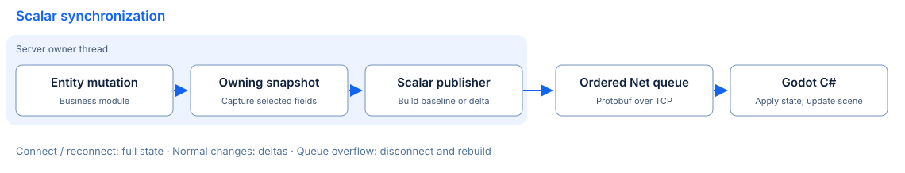

# Entity incremental synchronization proposal

Entity synchronization lets business modules mutate schema-backed state once, while a synchronization layer delivers authorized changes to clients. Kernel provides owning scalar captures and revisioned state APIs. The guest-room example connects them to Protobuf messages and the Godot C# client; nested state and general subscription policies remain separate work.

Read [data-driven design](data-driven.md), [data structures](../guides/data-structures.md) and the [Kernel reference](../reference/kernel.md) for the current data model. [Net](../reference/network.md) owns framework message delivery; arknet owns transport IO.

## Scalar state building blocks

The [Kernel scalar API](../reference/kernel.md#scalar-baselines-and-deltas) provides owning snapshots, a publisher and a replica. At an explicit owner-thread flush point, capture the authorized field selection and compare it with that publisher's baseline. Repeated HP changes coalesce to the captured final value; unchanged state emits no delta. The replica applies consecutive revisions atomically, rejects gaps and incompatible identities, and recovers with a newer-generation baseline. Removal produces a tombstone.

The Kernel APIs are in-process C++ values with field and cumulative text limits. The [guest-room adapter](../../examples/guest_room/protocol.md) supplies the network boundary: a full room baseline on join/reconnect, player baselines for later joins, changed scalar fields at the owner-thread flush point and revisioned removal markers. The matching Godot C# replica validates a whole room update before replacing its visible state. This explicit public-player projection does not provide a general subscription service.

## Responsibilities and integration gaps

| Layer | Responsibility | Boundary |
| --- | --- | --- |
| Schema | Stable class/field indices, scalar types and explicit selected fields | Metadata masks alone do not authorize a recipient |
| Kernel | Owning captures and a publisher/replica for one scalar projection | No session subscription, encoding or automatic flush phase |
| Guest room | Server-assigned logical player/Entity identity, public fields 100–108, owner-thread flush and bounded pending messages | One public lobby; no private/team/AOI subscription policy |
| Net and arknet | Ordered frame delivery and transport IO | Enqueue success is not an application acknowledgment |
| Godot C# | Validate and commit a room baseline/delta, then update presentation on the engine thread | Client input requests actions; it cannot assign authoritative HP/MP or Entity identity |
| Nested state | Existing table/container mutation callbacks and conversions | Row incarnations, relationship ordering and nested wire replication need a separate contract |

The explicit capture path does not expose borrowed node pointers to IO workers. Legacy delayed-sync callbacks remain separate from the new owning values and must not be treated as a durable or acknowledged change log.

## Recommended initial scope

Deliver stages 1–2 below as the minimum synchronization loop over an ordered, reliable TCP or WebSocket connection. Bind each live connection to a server-assigned session/recipient identity and an explicit projection policy; guest sessions are supported without an account or authentication service. Send a full authorized scalar baseline on connect/reconnect, then owned immutable scalar deltas with a per-stream epoch and revision. Include creation baselines and ordered removal markers for the scalar entities in that projection.

Bound pending bytes, batches, age and baseline size. Disconnect on overflow or revision/schema mismatch, then establish a new baseline on reconnect; an explicit in-place reset can be added if useful. Do not add replay history, an application ACK protocol, baseline fragmentation or AOI to this first delivery. Reject a baseline that exceeds the configured limit. The transport queue must own admitted payloads and preserve order; batches and removal markers need no separate retained ACK history. These are recommended design choices, not finalized wire fields or APIs.

## Proposed state contract

The following rules are proposed defaults for review. Names in this section are concepts, not approved C++ methods or message fields.

### Baseline, identity and revisions

A recipient first receives a complete **baseline of its authorized projection**: selected scalar values initially, then table rows and container relationships when nested synchronization is added. A baseline is full for that projection; it must not expose all server data merely because it is called full. Omitted authorized fields need a specified zero/default representation so a fresh client reconstructs the same state without reading server-only configuration.

Identify state using the runtime Entity GUID, an incarnation or stream epoch, class/schema identity and explicit member indices. Keep configuration IDs distinct from runtime IDs. Reusing a GUID after destruction must create a new incarnation. Give reused table rows a generation or equivalent ordered replacement identity. Child references include child Entity identity as well as container/slot indices.

Use a monotonically increasing revision within each recipient projection stream, with an epoch and required base revision on each delta. A projection stream covers one root Entity and, in the later nested stage, its selected nested state. Revisions need not reveal mutations hidden from that recipient. Freeze a baseline at revision R on the owner thread; collect subsequent mutations separately. After installing R, the client applies only a delta whose base matches its installed revision. Duplicate batches are ignored; gaps, wrong epochs and incompatible schemas invalidate the stream instead of partially applying data. Initially, close and reconnect for a fresh baseline rather than replaying missed batches. Cross-root atomic transactions are outside the first stage.

### Collection and coalescing

Collect successful mutations on the Entity owner thread. At a documented flush boundary after the tick's business mutations, detach an immutable batch keyed by stable identities and indices. Retain copied values or owner-thread-safe handles until batch construction completes; never hand borrowed `node*`, `row*` or `entity*` to IO workers. Mutations caused by callbacks during sealing enter the next batch. Establish one explicit flush phase; module registration order is not a reliable end-of-tick contract.

For scalar **state**, repeated writes may coalesce to the last value: HP `100 → 90 → 80` can produce HP `80`. A change back to the baseline value may be omitted only if the collector knows that recipient's base state. `real_time` may suggest an earlier flush, but it must not bypass revision order, authorization or queue limits.

State coalescing cannot replace **events**. Two damage events may be needed for animation, attribution or combat logs even when HP coalesces. Initial state replication does not include an event stream. If event delivery is added later, define ordering, duplicate/gap behavior and bounded retention separately; decide whether acknowledgment or replay is needed for that use case. State reset does not replay or acknowledge events. If an event cannot be delivered within its agreed bounds, report a gap or terminate the stream according to the application contract; never silently discard it as a dirty-field optimization.

### Entity and nested-data ordering

Publish creation only after initialization and creation callbacks have finished; initialization writes form the baseline rather than deltas against a nonexistent object. A recipient joining later gets a fresh baseline. Destruction produces an identity-qualified tombstone, cancels unsealed state for that incarnation and prevents later deltas from reviving it. In the initial ordered connection, a tombstone follows earlier immutable batches in the owned transport queue; after admission, no separate ACK history is retained. Queue admission failure closes the stream, and reconnect replaces its state with a fresh baseline. Entity creation and destruction within one unseen interval may disappear from state replication, while application events retain their own rules.

| Mutation sequence | Required result |
| --- | --- |
| Add row, update columns | Add with final row values before any later row updates |
| Update row, delete row | Delete supersedes pending updates for that row generation |
| Delete row, reuse row number | Delete old generation, then create new generation |
| Clear table, then add row | Clear barrier before new rows; earlier row deltas are superseded |
| Place/swap/remove child | Preserve relationship order or emit one revisioned replacement of affected slots; remove does not imply destroy |
| Destroy child | Remove relationships before destruction becomes visible; suppress unsealed child updates, while admitted batches stay ordered before removal |

Nested state must be permission-filtered recursively. A parent relation does not grant access to all child fields. Cross-container moves need one ordered relationship batch or an explicit reset of affected projections; the first implementation may reject unsupported cross-root moves. These rules require tests for both immediate and deferred paths; the current operation enums alone do not establish them.

## Recipients, recovery and threading

The application explicitly binds each live session to a server-assigned recipient identity and allowed projections. This can be a guest-room session identity; no account or authentication service is a prerequisite. Interpret `sync_self` as an ownership-policy input and `sync_view` as a visibility-policy input, then intersect masks with the session's authorization policy. Missing session binding or policy denies subscription; self-only fields also require a known Entity-owner binding. Client-supplied IDs do not establish that binding. Team/guild/map membership and spatial AOI require later application policy; the initial scope uses explicit recipients. Server-to-client replication grants no client write permission.

When the explicit recipient set or a recipient's permissions expand, send an authorized baseline before deltas. On removal or revocation, discard unadmitted unauthorized payloads and remove the corresponding client state. Initially close the stream if transport-queued payloads can no longer be authorized; do not assume an immutable queued batch can be edited. Check authorization at delivery admission. A new epoch replaces prior projected state and removes fields/rows/children absent from the new baseline.

Keep recipient progress separate from the global dirty set. A successful Net enqueue is not an application acknowledgment. For the initial reliable connection, track only live stream progress and bounded pending payloads; do not retain replay or ACK history. Configure bounds for pending bytes, batches, baseline size, batch age and reconnect/reset rate. Overflow invalidates the epoch and disconnects; disconnect releases recipient state. Reconnect after a lost baseline, schema mismatch or revision gap establishes a new baseline/epoch. Reject synchronization if its baseline cannot fit. In-place reset, ACK/replay history and fragmented baselines are later choices; any fragmentation would require atomic installation and bounded assembly time/memory.

Kernel state, collection, recipient decisions and revision advancement stay on the main-loop owner thread. Net endpoint callbacks are delivered through Update; arknet manages IO workers. The optional HTTP server route handlers run on IO workers and must marshal commands to the owner thread before touching Entity state. Encoding may later move off-thread only from owned immutable data, with ordered completion and bounded queues. No new business thread pool or transport implementation is needed. See [Net ownership](../reference/network.md) and [application lifecycle](application-architecture.md).

## C++ and Godot C# compatibility

The [native configuration exporter](../guides/tools.md) produces canonical JSON and optional C++/C# field-index constants. Constants share names/indices; they do not generate a C# Entity runtime, decoder, transport binding or Godot scene integration. Keep explicit indices stable and validate a schema identity before installing a baseline. Removing/reusing indices or changing types requires a declared compatibility/reset policy; JSON schema format version alone does not identify an application's schema revision.

The canonical [`guest_room.proto`](https://github.com/OpenArkStudio/ark/blob/main/src/proto/proto/guest_room.proto) generates C++ and C# message types. Explicit `oneof` alternatives preserve signedness, width and zero-value presence; positive Entity identities use unsigned 64-bit wire values bounded to the native signed range, GUID-valued fields use signed 64-bit values, and scalar strings use bytes. The room validates player names as UTF-8 and rejects non-finite/out-of-range positions. Field IDs 100–108 and schema ID `ark.guest-player.v1` define its exact public scalar projection; configuration field 99 is excluded. Shared encoded baseline/delta fixtures check both languages. Godot scene updates stay on its main thread.

The 12-byte frame remains separate from the Protobuf body. This wire change requires upgrading the guest-room server and Godot client together; JSON-only peers cannot join. Entity schema/profile files remain JSON. There is no additional application ACK, replay or baseline-fragmentation protocol.

## Incremental delivery and acceptance

Each stage is independently reviewable. The tests below are acceptance criteria for future implementation, not results of this documentation change.

| Stage | Scope | Verifiable exit criteria |
| --- | --- | --- |
| 1. Baseline | Ordered reliable TCP/WebSocket, server-assigned live session binding, explicit scalar projection, schema check and connect/reconnect baseline; keep existing guest-room protocol available | Guest sessions work without an account service; fresh/late/reconnecting C++ clients reconstruct identical projected state; hidden fields never enter payloads; invalid schema and oversized baseline are rejected; no mutation during encode |
| 2. Scalar deltas | Owned collector, flush phase, per-stream epochs/revisions, coalescing, creation baseline/removal marker and bounded disconnect/reconnect recovery | HP burst emits final state; unchanged writes emit nothing; duplicates/gaps/disconnect during delivery converge through a fresh baseline; callback mutation and destruction before flush are safe; slow-client overflow disconnects within limits; no ACK/replay history or fragmentation is needed |
| 3. Nested state | Row generations, clear/delete/reuse, container placement/move/destruction; repair or replace incomplete legacy paths | Apply each ordering case above to a baseline and compare final state; exercise container-only batches, revoke during queueing, GUID reuse, shutdown and stale references; no resurrection or unauthorized child data |
| 4. Client integration | Godot C# adapter and the same compatibility fixtures; any event stream, ACK/replay or fragmented baseline requires a separate later contract | C++/C# produce equal state and reject equal invalid inputs; baseline/reset input is atomic; scene updates stay on the main thread; any later event duplicate/gap/overflow behavior is observable |

For applications beyond the public guest-room projection, define their own schema identity, authorized session policy, flush integration and numeric queue limits. The room v1 contract fixes its Protobuf mapping and C# application rules; general subscription APIs are separate. Row replacement belongs to the nested stage; ACK/replay, event delivery and fragmentation are later decisions, not prerequisites. Measure payload reduction and owner-thread cost after correctness tests; do not infer production capacity from local replay. RPC, persistence, Registry, hot update and AOI are outside the initial scope.
