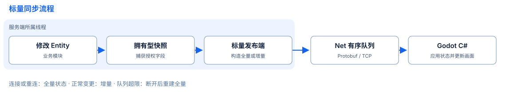

# Entity 增量同步

Kernel 提供拥有型标量捕获及带修订号的发布端／接收端接口。访客房间通过显式公开字段接入 Protobuf 与 Godot C#。通用订阅与嵌套复制仍是提案。

## 当前能力与边界

| 组件 | 已提供 | 边界 · 契约 |
| --- | --- | --- |
| Kernel | `capture_scalar_snapshot`、`scalar_publisher`、`scalar_replica`；合并变化、原子修订校验与删除标记 | 进程内 C++ 值，由调用者选择授权字段和刷新点；字段／文本上限覆盖重建状态，不代表编码大小 · [标量接口](../reference/kernel_CN.md#标量基线与增量)、[捕获上限](../reference/kernel_CN.md#拥有型标量快照) |
| 房间 v1 | 加入／重连基线、后加入玩家基线、TCP 标量增量与移除；公开字段 100–108，隐藏配置字段 99 | 服务端分配玩家／Entity 身份，客户端请求操作；单个大厅，工作量／输出有界，不提供账号服务或持久化 · [协议、身份与具体上限](../../examples/guest_room/protocol_CN.md) |
| Godot C# | 生成的 Protobuf 消息、共享样本、整体校验后提交房间状态、引擎线程更新场景 | 两端协同升级，使用 JSON 消息体的旧端不兼容；Entity 定义／业务配置仍用 JSON · [兼容契约](../../examples/guest_room/protocol_CN.md)、[客户端](https://github.com/OpenArkStudio/ark-client-godot) |
| Net／arknet | 框架帧交付／传输 IO | 入队不等于应用确认；房间 v1 不提供 ACK／重放、分片或 AOI · [Net 所有权](../reference/network_CN.md) |

原生检查覆盖 C++ 状态流程与房间传输，本机双引擎 Godot 测试覆盖移动、HP／MP、移除与重连。main CI 已在 Linux、macOS、Windows 上通过。这些结果不构成生产容量或通用复制验收。

## 下一步设计边界

通用复制需要为表格行定义稳定存续期，将子身份与容器槽位分开，并按顺序提交一个授权根投影。行号可以复用；删除行会改变展示位置，但不会重编号其余行键。现有借用型延迟同步回调不能提供拥有型嵌套发布。

[通用 Entity 复制设计](../project/entity-replication-design_CN.md)将这些约束对应到当前源码，定义基线／增量顺序、授权、恢复及内存上限，并列出 API 或线协议开发前的三个选型：行存续期、跨根一致性和订阅重置范围。方案复用标量叶子值，保持房间 v1 不变。

所有者线程规则继续适用：Net 回调通过 Update 交付，HTTP IO 处理器须将 Entity 命令转交所有者线程。参见 [Net](../reference/network_CN.md)、[生命周期](application-architecture_CN.md)、[数据模型](data-driven_CN.md)与[数据结构](../guides/data-structures_CN.md)。RPC、持久化、Registry 和热更新仍不在本设计范围内。
