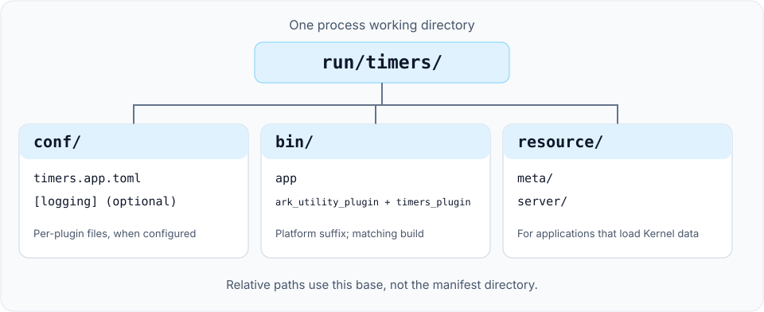

# Application launcher

`app` selects the process identity, reads a TOML manifest and loads plugins. Start with [Timers](../get-started/quick-start.md); use this guide for configuration paths, library names and startup checks.

## Command-line arguments

| Argument | Required | Meaning |
| --- | --- | --- |
| `--busid` / `-b` | Yes | Logical process Bus address, such as `1.0.1.1`; this is not a socket bind address |
| `--name` / `-n` | Yes | Application name, also used in the log filename |
| `--app_conf` / `-a` | Yes | TOML application manifest with the required lowercase `.toml` extension |
| `--help` / `-h` | No | Print the launcher's argument reference |

```sh
./bin/app --busid=1.0.1.1 --name=timers \
  --app_conf=conf/timers.app.toml
```

`busid`, `name` and `app_conf` must be supplied explicitly. The [Bus reference](../reference/bus.md) describes the address fields. Use the executable's `--help` output for additional platform-specific flags.

`--log_conf` / `-l` has been removed. Supplying either flag exits with code `1` and a migration diagnostic. Move logger settings into the application manifest; the launcher never reads a separate `log.conf`. See [embedded logging](../service-manifests.md#embedded-logging). The public `application_manifest` layout changed: rebuild applications, plugins and consumers together.

## Resolve configuration paths

Relative paths resolve from the process working directory, regardless of executable or manifest location.

On Windows, the launcher reads native UTF-16 command-line arguments and converts
them to UTF-8 before parsing. Application names and manifest paths therefore use
UTF-8 bytes inside the launcher and plugin manager; the console title uses the
wide Windows API. Configuration file reads and plugin-library loads convert UTF-8
paths to native UTF-16 at the operating-system boundary.

**Windows encoding migration:** application names and string paths are UTF-8,
including paths passed to public logging APIs. Callers that previously supplied
ANSI or system-code-page bytes must convert them to UTF-8 first. A native Windows
command line needs no manual conversion. CLI flags, C++ string types and function
signatures are unchanged.



| Input | How it is selected | Example from the runtime directory |
| --- | --- | --- |
| Application manifest | `--app_conf` | `conf/timers.app.toml` |
| Logger settings | Optional `[logging]` in the application manifest | Console INFO when omitted |
| Plugin libraries | `application.plugin_library_dir`, plus the library filename | `bin/timers_plugin.dylib` on macOS Release |
| Per-plugin settings | `application.plugin_config_dir` + per-plugin `config` | `conf/my-plugin.conf` when the filename is `my-plugin.conf` |
| Kernel metadata and configuration | The Kernel's `resource/` directory | See [Data-driven configuration](../concepts/data-driven.md) |

The launcher passes the per-plugin path to the plugin manager; each module decides how to read its own configuration. Kernel resource paths are separate from the application manifest and are needed only by applications that use those Kernel facilities. See [Data-driven configuration](../concepts/data-driven.md) and [Configuration tools](tools.md).

## Select plugins

Built-in application presets use TOML. The checked-in [timers.app.toml](https://github.com/OpenArkStudio/ark/blob/main/config/timers.app.toml) contains:

```toml
[application]
plugin_library_dir = "bin/"
plugin_config_dir = "conf/"

[[plugins]]
name = "ark_utility_plugin"

[[plugins]]
name = "timers_plugin"
```

Pass `--app_conf=conf/timers.app.toml` to select it. The application table is required; directory fields are optional strings. Each plugin requires a unique, nonempty `name`; its optional `config` string selects a per-plugin file. See [Application manifests](../service-manifests.md) for validation rules and format boundaries. Bus, HTTP and Consul plugin settings use TOML; see the [Bus reference](../reference/bus.md#configure-processes-and-relationships) for its fields. Logging shares the application manifest; plugin-specific and business-resource formats are documented by their respective modules.

### Plugin library names

Plugin targets and library stems use lowercase `snake_case`: `ark_utility_plugin`,
`ark_mysql_plugin` and `timers_plugin`. Manifest names must match these stems;
the loader adds the platform extension and the Debug `_d` suffix automatically.
Update existing manifests and build commands that use `AFUtilityPlugin`,
`AFMysqlPlugin` or `Sample1Plugin`; the old library filenames are no longer emitted.

### Migrate XML application manifests

**Breaking change:** the launcher and `load_application_manifest()` accept only
TOML files with a lowercase `.toml` suffix. XML application manifests, including
`*.app.conf`, are no longer supported. The launcher reports a manifest-format
error and exits with code `1` before plugin startup. Renaming XML to `.toml` is
insufficient: its contents must be rewritten as TOML.

| Old XML field | TOML replacement |
| --- | --- |
| `plugins/@plugin_lib_dir` | `[application].plugin_library_dir` |
| `plugins/@plugin_conf_dir` | `[application].plugin_config_dir` |
| `plugin/@name` | `[[plugins]].name` |
| `plugin/@conf` | `[[plugins]].config` |

Use the TOML example above and update `--app_conf` / `-a` to the new path. Keep
trailing separators in directory prefixes; library names and optional per-plugin
configuration values retain their meaning. Move embedded logger attributes into
`[logging]`; see [logging settings](../service-manifests.md#embedded-logging).
The CLI flags and public manifest data types and function signatures are unchanged.

Copy the executable and selected plugin libraries from the same build. Keep Debug and Release artifacts in separate runtime directories. The plugin list is not a dependency-order contract: modules declare required provider keys through the [module API](modules.md#declare-startup-dependencies). The manager validates these after installation and orders all four startup phases by dependency, then uses two reverse cached passes for all `pre_shut()` calls and per-module `shut()`/owned-object destruction, with all libraries closing last. Rebuild the launcher and every plugin together for the lifecycle virtual methods and changed manager layout; older binaries are incompatible.

## Check startup and stop the process

For Timers, look for a log entry containing `timers_module` and `PostInit`. This identifies entry into the sample's post-initialization callback, which registers its timer.

Before process stop, the application or operator completes announcements, ingress closure, player removal and saving. The framework performs resource-safe exit; a stop signal does not orchestrate these business actions.

On macOS/Linux, Ctrl+C or `SIGTERM` requests shutdown through the main loop. On Windows, enter `exit` in the application console. The launcher’s `stop()` enters `stopping`, calls task-group `close()` to request cancellation, and continues module updates/shared-executor polling until coroutine frames, active callbacks and native work are safe.

Once every module reports `ready_to_shut()`, all `pre_shut()` calls run consumer-first while every module object is alive to close native callback sources. A second reverse pass runs `shut()` and destroys each owned module before its providers. All modules are released before plugin uninstallation, and all DSOs close last. Timers logs only identify its hooks; undeclared dependencies and arbitrary external callbacks remain resource-owner responsibilities.

A readiness exception, false/throwing cleanup hook or native close failure enters `failed`, reports `shutdown:` phase/module context once and retains remaining resources without retry or rollback. An update failure during shutdown also latches launcher retention. Successful `dlclose`/`FreeLibrary` does not prove OS image removal or arbitrary hot-update safety.

`--shutdown_timeout_ms=N` accepts non-negative int64 milliseconds; default `0` waits indefinitely. A positive value supplies a monotonic `stop_until()` deadline as an optional resource-cleanup safeguard, not a business-drain budget. Expiry before cleanup enters `timed_out`, allowing owner updates without resuming cleanup. Expiry after cleanup begins enters `cleanup_timed_out`, disabling later updates/cleanup. Repeated stop or late completion cannot clear expiry.

The deadline cannot interrupt blocking updates, readiness checks, cleanup or native closes, or undo completed actions. Timeout never permits pending-frame destruction, forced thread termination or successful exit. See [module tasks and resource cleanup](tasks.md#shared-business-executor-for-modules).

<Aside type="caution" title="Do not use process survival as the readiness check">

Before routing traffic, check the expected module's initialization log and application readiness. A running PID or zero exit status is insufficient.

| Failure path | Diagnostic and exit behavior |
| --- | --- |
| Manifest loading or validation | Exit `1` before plugin startup |
| `plugin_manager::start()` returns `false`, or a module/plugin startup exception propagates | Flush a synchronous diagnostic with phase, module/plugin and available exception details; exit `1` before the update loop or Windows command thread |
| Missing library or `DllEntryPlugin` | Report `load_plugin: <plugin>` and exit `1`; a loaded library missing its entrypoint stays retained until process exit, without automatic unload |
| Argument parsing failure, including help handling | Still return `0` |

A failed `start()` or propagated startup exception bypasses C++ object/static destruction so partially started IO pools cannot hold the process open; other buffered/asynchronous logs may be lost. The launcher does not roll back partial startup, run normal shutdown hooks or retry in the same process. Deployment tools should start a fresh process.

</Aside>

The launcher retains startup diagnostics in a 1024-byte stack buffer and writes native stderr, truncating long text and continuing to exit under persistent C++ allocation failure. Up to 16 independent owning capsules explicitly enrolled before acquisition may run failure actions in reverse enrollment order; unsafe/failed/throwing cleanup stops before older owners. Exit remains `1` with no normal shutdown or unload. Utility Timer enrolls callback-free wheel ownership; retained business callbacks and shared IO remain outside automatic cleanup; see [startup-failure cleanup](../project/startup-failure-cleanup.md).

Permanent lifecycle suites include `check-app-business-runtime`, `check-app-shutdown-deadlines` and `check-native-unload`; acceptance requires results for the tested revision. Earlier admission/natural-drain cases do not establish the current cancellation-based resource cleanup. See [lifecycle status](../project/lifecycle-closeout.md).

## Run one application

The shell and Windows helpers share one interface:

```text
run.sh  <Release|Debug> <name> <busid> [runtime-directory]
run.bat <Release|Debug> <name> <busid> [runtime-directory]
```

The default runtime directory is the script's directory. When invoking the checkout's `deployment/scripts/` helpers, pass the staged runtime explicitly; alternatively copy a helper into the runtime root to use that default. An explicit runtime path
is relative to the caller's working directory. The helper selects `bin/app`
(`app.exe` on Windows) for Release or `bin/app_d` (`app_d.exe`) for Debug, reads
`conf/<name>.app.toml`, and runs in the foreground. The name
also becomes the application's `--name` value. Use the executable directly for
a custom TOML manifest path, a different process name or other launcher flags.

After preparing the [Timers runtime](../get-started/quick-start.md), run from
the repository root:

```sh
sh deployment/scripts/run.sh Release timers 1.0.1.1 run/timers
```

On Windows, use `deployment\scripts\run.bat Release timers 1.0.1.1 run\timers`.
Check the application's initialization log before using it; the helper's path
checks do not validate plugins, business configuration or readiness.

## Stop one application

Prefer Ctrl+C on macOS/Linux or `exit` in the Windows application console.
For a process whose PID has been confirmed, `kill.sh <pid>` requests `SIGTERM`;
`kill.bat <pid>` forcibly terminates that PID. Both helpers reject other executable
names and require exactly one explicit PID. Recheck the PID's executable and
command line immediately before use; a PID can be reused after a process exits.
There is no process-name wildcard or machine-wide stop command.

On successful shutdown, the launcher writes `ARK Server stop ...` to standard
output, flushes it and exits with status `0`. This final lifecycle message uses
synchronous output.

## Migrate old helper commands

- Replace `rund.sh` / `rund.bat` with `run.sh Debug ...` / `run.bat Debug ...`.
- Replace `sample1.sh`, `mysql_sample.sh` and `sample5http_test.sh` with
  `run.sh Debug <name> <busid>`, using `timers`, `mysql_sample` or `http_server`. The name
  mapping does not enable omitted example targets. MySQL/Redis examples remain
  disabled in the default build; their manifests do not provide database
  connection options. Configure the public database modules explicitly.
- The old no-argument five-service launch sequence used missing `plugin_conf/`
  paths and inconsistent Release/Debug Bus IDs. Supply each application's name
  and Bus ID explicitly, and arrange service startup separately for the target
  environment. The helper no longer daemonizes applications.
- Replace `vc_clear.bat` with `cmake --build <cmake-build-directory> --target clean`
  to clean a selected build directory.
- Container recipes and cluster examples now live under [deployment/](../../deployment/README.md).

The byte-preserved historical articles under `docs/site/legacy-source/` still show
their original `bin/rund.*` commands. Use the current commands above instead.

## Troubleshoot startup

| Symptom | Check |
| --- | --- |
| Usage text or `Application parameter is invalid` | Supply all three required arguments; check spelling with `--help` |
| Manifest loading fails | Check the working directory, explicit path and format; a lowercase `.toml` suffix is required and XML application manifests must be converted to TOML |
| Logging validation or initialization fails | Check the manifest diagnostic and `logging.output_path` permissions |
| `Load shared library[...] failed` | Check `application.plugin_library_dir`, platform suffix, Debug suffix and the library's dependent shared libraries |
| Plugin loads but the expected module is unavailable | Check registration, enabled targets and required plugins; see [Create a plugin](plugins.md) |
| Built-in server role fails at `init:` | Load Bus and Net; Game also requires Kernel before callback registration. See [role startup errors](../concepts/server-architecture.md#role-startup-errors) for the checked scope |
| Built-in server role fails at `post_init:` | For Game, check Player metadata and callback-registration diagnostics. Check the listener endpoint and port occupancy; failed registration, listener creation or a missing service reaches launcher exit code `1` |
| Kernel metadata or configuration is missing | Stage the generated `resource/meta/` and `resource/server/` files in the process working directory |

The launcher implementation is in [main.cpp](https://github.com/OpenArkStudio/ark/blob/main/src/application/main.cpp).
