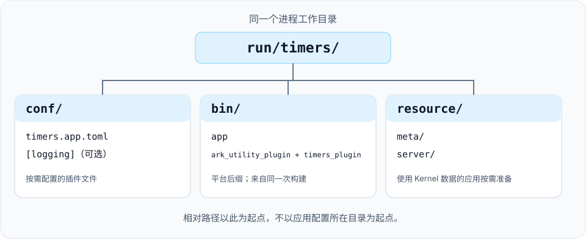

# 应用启动器

`app` 程序设置进程标识、读取 TOML 或 XML 应用配置，并加载所选插件的动态库。首次运行可先按 [Timers 快速开始](../get-started/quick-start_CN.md)操作；本文说明配置路径、动态库命名和启动检查。

## 命令行参数

| 参数 | 必填 | 含义 |
| --- | --- | --- |
| `--busid` / `-b` | 是 | 进程的逻辑 Bus 地址，例如 `1.0.1.1`；不是 socket 绑定地址 |
| `--name` / `-n` | 是 | 应用名称，也用于日志文件名 |
| `--app_conf` / `-a` | 是 | 扩展名为小写 `.toml` 的 TOML 应用配置，或旧版 XML `*.app.conf` 文件 |
| `--log_conf` / `-l` | 否 | 日志配置，默认为 `./conf/log.conf` |
| `--help` / `-h` | 否 | 输出启动器的参数说明 |

```sh
./bin/app --busid=1.0.1.1 --name=timers \
  --app_conf=conf/timers.app.toml --log_conf=conf/log.conf
```

`busid`、`name` 和 `app_conf` 都需要显式传入。地址各字段的含义见 [Bus 参考](../reference/bus_CN.md)。其他平台相关参数以程序的 `--help` 输出为准。

## 确定配置路径

相对路径以进程的工作目录为起点。移动程序，或把应用配置放到其他目录，都不会改变这个起点。



| 输入 | 选择方式 | 相对于运行目录的示例 |
| --- | --- | --- |
| 应用配置 | `--app_conf` | `conf/timers.app.toml` |
| 日志配置 | `--log_conf`，或使用默认值 | `conf/log.conf` |
| 插件动态库 | TOML `plugin_library_dir` 或 XML `plugin_lib_dir` 加动态库文件名 | macOS Release 使用 `bin/timers_plugin.dylib` |
| 插件配置 | TOML `plugin_config_dir` + `config`，或 XML `plugin_conf_dir` + `conf` | 配置文件名为 `my-plugin.conf` 时，对应 `conf/my-plugin.conf` |
| Kernel 元数据和配置 | Kernel 使用的 `resource/` 目录 | `resource/meta/entity_class.config`、`resource/server/item.config` |

启动器把插件配置路径交给插件管理器，具体模块自行读取配置。Kernel 资源路径与应用配置路径相互独立，只有使用相关 Kernel 能力的应用才需要这些资源。详见[数据驱动配置](../concepts/data-driven_CN.md)和[配置工具](tools_CN.md)。

## 选择插件

内置应用配置采用 TOML。仓库中的 [timers.app.toml](https://github.com/OpenArkStudio/ark/blob/main/config/timers.app.toml) 为：

```toml
[application]
plugin_library_dir = "bin/"
plugin_config_dir = "conf/"

[[plugins]]
name = "ark_utility_plugin"

[[plugins]]
name = "timers_plugin"
```

通过 `--app_conf=conf/timers.app.toml` 选择该文件。`application` 表必须存在，目录字段为可省略的字符串。每个插件的 `name` 必须非空且唯一；可选的 `config` 字符串指定插件配置文件。字段校验和格式边界见[应用配置清单](../service-manifests_CN.md)。Bus、HTTP 和 Consul 插件配置使用 TOML，Bus 字段见[运行配置](../reference/bus_CN.md#配置进程与连接关系)。日志配置、Kernel 元数据和业务导出数据保留 XML 格式。

### 插件库命名

插件构建目标和库文件名统一使用小写 `snake_case`，例如 `ark_utility_plugin`、
`ark_mysql_plugin` 和 `timers_plugin`。配置中的插件名必须与库文件名一致；
加载器自动添加平台扩展名和 Debug 的 `_d` 后缀。
已有配置和构建命令中的 `AFUtilityPlugin`、`AFMysqlPlugin`、`Sample1Plugin` 需要更新，
构建不再生成这些旧文件名。

### 兼容已有 XML 配置

启动器仍接受用户维护的旧版 XML 清单，例如：

```xml
<xml>
    <plugins plugin_lib_dir="bin/" plugin_conf_dir="conf/">
        <plugin name="ark_utility_plugin" conf="" />
        <plugin name="timers_plugin" conf="" />
    </plugins>
</xml>
```

- 保留外层 `xml` 元素，启动器在其下查找 `plugins` 子元素。
- `bin/`、`conf/` 等目录前缀保留末尾分隔符，当前加载器直接拼接字符串。
- `name` 使用动态库名称主体，不加平台后缀，也不加 `lib` 前缀。加载器追加 `.dll`、`.so` 或 `.dylib`，Debug 构建还会在后缀前追加 `_d`。
- `conf` 为空表示没有提供插件配置文件名。Timers 不需要单独的 `timers.conf`。

程序和所选插件动态库应来自同一次构建，Debug 与 Release 文件分别放置。插件条目顺序不代表依赖初始化顺序；模块通过[模块 API](modules_CN.md#声明启动依赖)声明必需 provider 注册键。管理器在安装完成后验证依赖，并按依赖顺序执行四个启动阶段，并按缓存反向顺序执行停止接收钩子，其余清理顺序保持不变。模块新增生命周期虚方法，管理器布局也改变；必须同时重建启动器和全部插件，不得混用旧二进制。

## 确认启动并停止进程

Timers 的日志出现 `timers_module` 和 `PostInit`，表示示例已经进入初始化后回调，该回调负责注册定时器。

macOS/Linux 可使用 Ctrl+C 或 `SIGTERM`，由应用主循环处理停止请求。Windows 在应用控制台输入 `exit`。启动器先关闭受管根任务准入，再在外层 owner frame 按缓存依赖的反向顺序执行一次模块 `stop_accepting()`。推迟执行时状态为 `stopping_acceptance`；成功后进入 `draining`，继续模块更新与共享执行器轮询，直到已受理任务完成。任务使用的服务和桥接继续可用，以便协程完成后续等待。

任务完成且当前回调返回后，管理器等待所有模块的 `ready_to_shut()` 返回就绪，再同步执行关闭钩子与卸载。模块应在 owner frame 的就绪检查中停止并排空原生工作，确认原生线程退出后才允许卸载。所有钩子成功时，Timers 依次输出 `PreShut` 和 `Shut`，随后启动器退出。钩子可能阻塞；handler 数量预算不代表停机耗时上限。

停止接收钩子返回 false／异常是硬失败，保留 `stop_accepting: <module>` 上下文：已关闭入口不重开，待完成帧与资源继续保留，不再更新或执行后续钩子，也不重试。官方 HTTP 服务端已接入按请求停止接收，其他 Net 业务入口仍待迁移，见[停止接收合同](modules_CN.md#停止接收新业务根请求)。

关闭钩子返回 `false` 或抛出异常时，启动器输出一次阶段、模块及可用的异常信息，保留进程和资源，不再继续卸载。原生动态库关闭失败时同样报告 `unload: <plugin>`，保留该库句柄与包装对象，并停止关闭后续库。重复 `stop()` 继续返回失败，不重复执行插件出口或关闭调用。先前完成的停机工作与成功关闭的库不会回滚。`FreeLibrary` 或 `dlclose` 成功不证明操作系统已移除库映像，也不证明任意热更新安全。排空期间的 `plugin_manager::update()` 返回 `false` 或抛出异常，也会锁定资源保留状态；启动器尽可能继续 owner 更新，但后续完成不能恢复卸载。

`--shutdown_timeout_ms=N` 设置等待时限，单位为毫秒，接受非负 int64 整数；默认值 `0` 表示无限等待。正数通过 `plugin_manager::stop_until()` 传入单调时钟截止时间。管理器在停止接收／就绪钩子返回后，以及进入 `pre_shut()` 前检查时间，避免慢钩子成功后因没有待完成任务而跳过保留。超时后只输出一次实际耗时、待完成任务数和阶段／模块。清理开始前的超时进入不可恢复的 `timed_out`，保留资源并允许 owner 更新；后续完成或无期限 `stop()` 都不能恢复清理。

该时限采用协作式检查，不能中断阻塞中的用户 `update()`、就绪检查、关闭钩子或卸载调用。清理开始后，在钩子／关闭调用返回边界检查到超限，则进入 `cleanup_timed_out`，停止后续清理和模块更新。`pre_shut()`、`shut()`、插件出口或原生关闭已执行的动作无法回滚；正在执行的调用可能在返回前已经释放资源。两种超时状态都不允许按成功退出、强制取消或销毁待完成帧。业务任务排空不证明外部回调、原生连接池线程或后台清理已经完成，详见[模块任务集成](tasks_CN.md#模块共用业务执行器)。仅凭 Timers 的日志，不能推断所有插件组合都具备相同的就绪条件或停止保证。

<Aside type="caution" title="进程存在不等于应用就绪">

应用配置读取或校验失败时，启动器会在启动插件前返回退出码 `1`。`plugin_manager::start()` 返回 `false`，或模块、插件启动异常向外传播时，启动器同步输出并刷新失败阶段、模块或插件名及可用异常信息，随后以退出码 `1` 终止，不进入更新循环，也不启动 Windows 命令线程。该失败路径跳过 C++ 对象与静态析构，避免部分启动的 IO 池阻止进程退出；其他缓冲或异步日志可能丢失。启动器不会回滚部分启动工作、执行正常关闭钩子或在同一进程中重试；部署工具应在失败退出后启动新进程。缺少库文件或 `DllEntryPlugin` 入口时，也会报告 `load_plugin: <plugin>` 并以退出码 `1` 终止。已加载但缺少入口的库保留至进程退出，不会自动卸载。参数解析失败（包括帮助处理）仍返回 `0`。接入流量前，应检查目标模块的初始化日志和应用自身的就绪条件，不能只判断 PID 存在或退出码为零。

</Aside>

启动器用 1024 字节栈缓冲和原生 stderr 写入保留启动失败诊断，超长文本截断，持续 C++ 分配失败也继续退出。只有通过单槽 API 预登记的独立 owning capsule 可先执行一次失败清理；随后仍退出 `1`，不调用正常停服或卸载。共享 Utility／IO 未接入，见[启动失败清理](../project/startup-failure-cleanup_CN.md)。

失败路径验证：`check-app-business-runtime` 通过真实启动器与受控测试插件覆盖原有 13 个排空／就绪／保留场景，并增加 `drain_admission` 和三个停止接收钩子失败场景，共 17 个；`check-native-unload` 检查插件出口异常与库句柄保留。这些测试不提供部分启动回滚或按依赖顺序清理的保证。[启动与停机闭环提案](../project/lifecycle-closeout_CN.md) 记录资源获取边界、当前原生资源回收限制，以及已选路线中尚未实施的阶段。

## 启动一个应用

Shell 和 Windows 脚本使用相同参数：

```text
run.sh  <Release|Debug> <name> <busid> [runtime-directory]
run.bat <Release|Debug> <name> <busid> [runtime-directory]
```

运行目录默认为脚本所在目录。从源码仓库调用 `deployment/scripts/` 下的脚本时，显式传入已准备的运行目录；也可将脚本复制到运行目录根部后使用默认值。显式传入的相对路径以调用者的工作目录为基准。
Release 使用 `bin/app`（Windows 为 `app.exe`），Debug 使用 `bin/app_d`
（Windows 为 `app_d.exe`）。脚本读取 `conf/<name>.app.toml` 和 `conf/log.conf`，
在前台运行应用；`name` 同时作为 `--name` 的值。使用旧版 XML、自定义清单路径、不同的进程名称或
其他启动参数时，直接调用程序。

按[Timers 快速开始](../get-started/quick-start_CN.md)准备运行目录后，在仓库根目录执行：

```sh
sh deployment/scripts/run.sh Release timers 1.0.1.1 run/timers
```

Windows 使用 `deployment\scripts\run.bat Release timers 1.0.1.1 run\timers`。
使用应用前，检查初始化日志。脚本的路径检查不验证插件、业务配置或服务就绪状态。

## 停止一个应用

macOS/Linux 优先使用 Ctrl+C，Windows 优先在应用控制台输入 `exit`。
确认目标进程的 PID 后，使用 `kill.sh <pid>` 请求 `SIGTERM`；`kill.bat <pid>` 会强制终止
该 PID。两个脚本都只接受一个显式 PID，并拒绝其他可执行文件名。执行前重新确认 PID 的
可执行文件与命令行；进程退出后，PID 可能被复用。脚本不按名称通配批量停止进程。

正常停服时，启动器向标准输出写入并刷新 `ARK Server stop ...`，然后以退出码 `0`
结束。这条进程状态消息使用同步输出。

## 迁移旧命令

- 将 `rund.sh` / `rund.bat` 改为 `run.sh Debug ...` / `run.bat Debug ...`。
- 将 `sample1.sh`、`mysql_sample.sh` 和 `sample5http_test.sh` 改为
  `run.sh Debug <name> <busid>`；名称分别为 `timers`、`mysql_sample`、`http_server`。该名称映射
  不会启用未构建的示例目标。MySQL/Redis 示例在默认构建中仍未启用，其清单不提供数据库连接选项；
  使用时需要显式配置公开数据库模块。
- 旧版无参数五服务启动顺序引用了不存在的 `plugin_conf/`，Release 与 Debug 的总线 ID
  也不一致。现在需要显式传入每个应用的名称与总线 ID，并按目标环境安排启动顺序。
  新脚本不再将应用转为守护进程。
- 使用 `cmake --build <cmake-build-directory> --target clean` 清理选定构建目录，
  替代 `vc_clear.bat`。
- 容器构建文件和集群示例已移至 [deployment/](../../deployment/README_CN.md)。

`docs/site/legacy-source/` 按原始字节保留历史文章，其中的 `bin/rund.*` 命令不再适用，
请使用上面的当前命令。

## 排查启动问题

| 现象 | 检查项 |
| --- | --- |
| 输出帮助或 `Application parameter is invalid` | 补齐三个必填参数，用 `--help` 核对拼写 |
| 应用配置加载失败 | 检查工作目录、显式路径和文件格式；小写 `.toml` 后缀选择 TOML，旧版 `*.app.conf` 使用 XML |
| 日志配置无法读取 | 检查工作目录和 `--log_conf` 路径 |
| `Load shared library[...] failed` | 核对 TOML `plugin_library_dir` 或 XML `plugin_lib_dir`、平台后缀、Debug 后缀，以及动态库自身的共享库依赖 |
| 插件已加载，但目标模块不存在 | 核对模块注册、启用的构建目标和依赖插件，详见[创建插件](plugins_CN.md) |
| 内置服务角色在 `init:` 失败 | 加载 Bus 和 Net；Game 注册回调前还需要 Kernel。已检查的范围见[角色启动错误](../concepts/server-architecture_CN.md#角色启动错误) |
| 内置服务角色在 `post_init:` 失败 | Game 需检查 Player 元数据和回调注册诊断；同时检查监听端点配置和端口占用。注册失败、创建监听器失败或服务缺失会传递到启动器，并产生退出码 `1` |
| Kernel 元数据或配置缺失 | 在进程工作目录准备生成的 `resource/meta/` 和 `resource/server/` 文件 |

启动器实现见 [main.cpp](https://github.com/OpenArkStudio/ark/blob/main/src/application/main.cpp)。采用现有多进程脚本前先检查配置，部分脚本仍沿用旧部署路径和服务设置。
