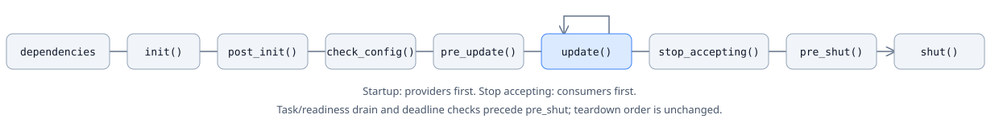

# Create a module

A module exposes an application service through a C++ interface. A plugin creates and registers its implementation; the plugin manager invokes its lifecycle callbacks. Use modules for services such as entity access, timers or application rules. Use a plugin to package and install a group of modules.

This example separates a counter interface from its implementation and calls it from a second module. Pair it with [Create a plugin](plugins.md) to build the shared library.

## Define the interface and implementation

Save this file as `sample_module.hpp`:

```cpp
#pragma once

#include <cstdint>

#include <ark/module.hpp>
#include <ark/plugin_manager.hpp>

namespace ark {

class counter_module : public module
{
public:
    virtual void increment() = 0;
    virtual std::uint64_t value() const = 0;
};

class counter_module_impl final : public counter_module
{
    ARK_DECLARE_MODULE_FUNCTIONS

public:
    void increment() override {
        ++value_;
    }

    std::uint64_t value() const override {
        return value_;
    }

private:
    std::uint64_t value_ = 0;
};

class sample_module final : public module
{
    ARK_DECLARE_MODULE_FUNCTIONS

public:
    bool post_init() override {
        counter_module_ = find_module<counter_module>();
        return counter_module_ != nullptr;
    }

    bool update() override {
        if (counter_module_ == nullptr)
        {
            return false;
        }

        counter_module_->increment();
        return true;
    }

    bool pre_shut() override {
        counter_module_ = nullptr;
        return true;
    }

private:
    counter_module* counter_module_ = nullptr;
};

} // namespace ark
```

The example keeps the three types in one file so their relationship is visible. In an application, share the interface header with consumers and keep implementation details private. Both implementations use `ARK_DECLARE_MODULE_FUNCTIONS`, which stores the manager pointer and registered name and supplies the protected `find_module<T>()` helper.

## Register and find the same interface

Register `counter_module_impl` under `counter_module`, then retrieve it with `find_module<counter_module>()`. The registration key comes from the interface type's RTTI name; an implementation name or a shared-library filename is a different key. Register one implementation per interface in a manager. The macros do not turn duplicate registration into a supported multi-provider model.

The returned pointer is borrowed. Do not delete it or retain it after the owning plugin unregisters the module. While any managed business task is pending, the manager refuses to unregister any module: another module's task may still borrow that provider. A missing interface or failed dynamic cast triggers an assertion when assertions are enabled; with assertions disabled, `find_module<T>()` returns `nullptr`. Check the result before use, and do not use a failed lookup as an optional-service probe in Debug. Build consumers and plugins with compatible headers, compiler/ABI settings and RTTI enabled.

`plugin_manager::try_find_module<T>()` provides a nullable dependency lookup. It returns `nullptr` when the interface RTTI key is absent or its registered object has a different runtime type, without logging, asserting or changing registration. Call it only on the manager's owner thread; a foreign-thread call throws `std::logic_error`. Existing `find_module<T>()` keeps its assertion-based contract. Server startup uses the nullable lookup to report missing required modules through the normal startup failure path.

The two example modules share the application update thread. The counter is deliberately not atomic; it does not support calls from arbitrary worker threads. Queue worker completions for the owning module thread or use a service's documented asynchronous API. See the [network reference](../reference/network.md) for network callback dispatch.

## Declare startup dependencies

Use ordinary C++ template parameters to declare required providers. For example, the Timers sample uses the same form as:

```cpp
#include <ark/module_base.hpp>
#include <ark/utility/guid_module.hpp>
#include <ark/utility/timer_module.hpp>

class dependent_module final
    : public ark::module_base<ark::module, ark::timer_module, ark::guid_module>
{
};
```

`module_base<interface_type, providers...>::get_dependencies()` returns provider interface RTTI registration keys. The first parameter still selects the inherited interface; providers add metadata, not base classes or owned pointers. `module::get_dependencies()` defaults to an empty list. A legacy implementation can override it to return required registration keys directly. Return metadata without mutating the registry; the owner reads it once after installation and caches the validated order. Legal idle module additions/removals invalidate that cache; the first admission-stop stage rebuilds it once when needed. Keep declarations stable while registered; polling and reentrant stop never reread them. Repeated keys count once; a self-dependency is a cycle. Optional lookups remain nullable and should not be declared required. Validation checks registration-key presence; callers of raw `add_module()` remain responsible for supplying an object implementing the registered interface.

The migrated small application is Timers plus Utility. Timers really looks up Timer and Guid during `init()`; Utility's Timer, Guid, Schedule and Compress implementations have no required module providers. Other applications keep their existing declarations and lookup checks; they have not acquired a complete callback-lifetime graph. Stable key ordering is defined within a compatible build, not across different compiler RTTI encodings.

**Upgrade:** `module` adds metadata and `stop_accepting()` virtual methods, changing its virtual table; the manager caches lifecycle order, changing its object layout. Timers also changes its public base specialization. Rebuild the launcher, all official/business plugins and affected consumers together with compatible headers/compiler settings. Do not mix older binaries. Existing lookup keys remain unchanged; this C++ boundary provides no cross-compiler ABI guarantee. The metadata governs startup and the reverse admission-stop hook order. Update, readiness, `pre_shut()`, `shut()` and plugin unloading retain their existing order. Official ingress migration, reverse complete cleanup and opt-in startup-failure compensation remain subsequent work in the [selected lifecycle route](../project/lifecycle-closeout.md).

## Choose lifecycle stages

| Callback | Appropriate work | Current boundary |
| --- | --- | --- |
| `init()` | Initialize local resources | Declared providers have completed this phase; independent modules may follow |
| `post_init()` | Resolve interfaces and use dependencies initialized in `init()` | Declared providers also finish `post_init()` before their consumers |
| `check_config()` | Check configuration and dependencies | A failure stops the remaining startup work |
| `pre_update()` | Prepare work before the application loop | Keep this stage bounded |
| `update()` | Publish queued service and bridge completions | Called only for implementations that override it; the manager then polls its shared executor once. Its Boolean result does not stop updates |
| `stop_accepting()` | Close external business-root admission | Consumer-first once, before task drain; false/exception retains resources |
| `pre_shut()` | Release subscriptions and prepare resource cleanup | Entered after managed tasks finish and the active update/completion stack returns; the first `false` or exception stops shutdown |
| `shut()` | Release module-owned resources | Entered only if every `pre_shut()` succeeds; the first `false` or exception stops remaining callbacks and prevents further unloading |



All module libraries are installed before the manager validates declared provider keys and builds a startup order. `init()`, `post_init()`, `check_config()` and `pre_update()` each use that same order, with providers before consumers. Undeclared modules are independent; ties between currently ready nodes use lexicographic registration-key order, not manifest or insertion order. The base callbacks return `true`; override only the stages needed. The registration macro adds an implementation to the update list when it overrides `update()`. The counter provider therefore receives no frame updates, while `sample_module` increments it once per manager update.

Normal shutdown first seals managed roots, then runs the one-shot admission hooks before pumping accepted tasks. It does not close their operation services or bridges. After draining, shutdown hooks and unloading run synchronously; a hook can block, and the shared poll's handler-count budget does not bound its duration. A failed hook leaves the launcher and resources alive, reports its phase and module, and is not automatically retried.

<Aside type="caution" title="Handle the manager's startup result">

A missing required provider key or a dependency cycle makes `start()` return false before any module startup hook. `get_startup_failure()` identifies `dependencies: <consumer> requires missing module '<provider>'` or lists modules blocked by a cycle; blocked modules can include downstream consumers outside the cycle itself. Metadata exceptions propagate unchanged with `dependencies: <module>` context. All registration and installation side effects have already occurred; validation does not roll them back.

The first `false` from `init()`, `post_init()`, `check_config()` or `pre_update()` stops that stage and all later startup stages, and `plugin_manager::start()` returns `false`. Each callback runs at most once in its stage. Exceptions propagate unchanged and also stop the remaining startup calls. `get_startup_failure()` retains the current `phase: module` context on failure, or `load_plugin: plugin` while loading a library and invoking its entrypoint; it is empty after successful startup and must be read on the manager's owner thread. Modules that already completed a stage are not automatically rolled back.

The application launcher reports the retained context and any exception details, then returns exit code `1` before its update loop or Windows command thread starts. This failure path does not call `pre_shut()` or `shut()` for partial-start cleanup and does not retry in the same process; deployment tools should start a fresh process. Missing libraries and `DllEntryPlugin` entrypoints return false with `load_plugin: <plugin>` context. A loaded library missing its entrypoint remains retained until process exit because its static initializers may have started work; there is no automatic unload or rollback. Assertions for other program invariants remain unchanged. `update()` return values remain ignored. Keep the runtime plugin selection complete and check startup results in callers that manage their own loop.

</Aside>

## Stop new business roots

Override `bool stop_accepting()` to close only the module's external business-root gate. Its default returns `true` for source compatibility. Keep provider requests, completion delivery and bridges usable by accepted workflows; do not call a provider's `close()`, `stop()` or admission seal here merely because it has a similar name.

The first `manager.stop()` seals all managed task groups and enters `stopping_acceptance`. If an update, poll or completion is active, it returns false and defers module hooks until an outer owner-frame `stop()`. Then hooks run **consumer-first**, in reverse cached startup topology, before waiting for managed tasks. Independent ties reverse the startup key order. Startup caches the validated order; successful idle module additions/removals invalidate it. A manual manager that never started, or an invalidated graph, is rebuilt/validated once under the lifecycle guard before any hook. This includes same-key replacement; stale cached pointers are never used. Keep dependency declarations stable throughout their registration lifetime. No metadata is reread during polling or after the hook sequence begins.

Every reached hook runs once. `true` permits the next hook; `false` is a hard failure, not a readiness wait. The first false/exception or invalid rebuilt graph enters sticky `failed`, preserves `stop_accepting: <module>` context and exception details, and prevents remaining hooks, updates and teardown. Already closed gates are not reopened. Repeated stop does not retry; accepted frames and resources remain pinned. A hook can block, and the cooperative timeout cannot interrupt it. Reentrant stop returns false; recursive update/start and registry mutation are rejected before taking effect.

After all hooks succeed, state becomes `draining`: enabled module updates and the shared owner poll continue until accepted tasks and active stacks finish, then the existing all-module readiness gate and teardown run. This stage does not reorder `pre_shut()`, `shut()`, plugin exits or library closes, and adds no startup-failure compensation.

A supplied `stop_until(timestamp, deadline)` deadline is checked after admission/readiness hooks return and before cleanup. Expiry cannot be bypassed by later `stop()` calls. Before cleanup, `timed_out` retains resources and permits updates; after cleanup begins, `cleanup_timed_out` retains remaining resources and disables updates. Checks cannot preempt a hook or undo actions it already performed. See [the timeout states](tasks.md#shared-business-executor-for-modules).

**Migration boundary:** the official HTTP server closes per-request admission and drains accepted response sends. Net provides the opt-in [external-root callback helper](../reference/network.md#explicit-external-root-registration), with an explicit application-owned rejection handler. Ordinary registrations and guest-room behavior are unchanged; remaining TCP/WebSocket/RUDP business entry points require individual migration. Admission at business callback entry does not pause transport-level accept. Stopping a transport or manipulating its acceptor is not a substitute for preserving accepted workflows. See [HTTP shutdown](../reference/http.md#route-requests).

## Keep callbacks within their owner's lifetime

The example only holds a borrowed pointer and clears it in `pre_shut()`. A real module may also register timers, event handlers or asynchronous operations that capture `this`. Record their identifiers or cancellation handles, stop accepting new work, and unregister or cancel them according to the owning service's API before destroying the module. Cancellation alone must not be assumed to mean that every completion has already run.

The manager tracks roots accepted by its task groups, but not arbitrary callbacks, native pool workers or background cleanup. Those operations must finish according to their own service contracts before their code or state can be released. Do not infer safe library replacement or a complete callback-drain guarantee from a zero managed-task count, `pre_shut()`, `shut()` or a successful `stop()` return. See [shared module tasks](tasks.md#shared-business-executor-for-modules) for the admission and drain contract. Hot-update behavior is outside this guide.

## Continue

- [Create a plugin](plugins.md): registration pairs, DLL entry points, build and runtime selection.
- [Application launcher](applications.md): process arguments and configuration paths.
- [Coroutine tasks](tasks.md): explicit task ownership, admission and owner-thread polling.
- [Kernel reference](../reference/kernel.md): entity and data services exposed by official modules.

## Use a base class with a private implementation

New modules can replace `ARK_DECLARE_MODULE_FUNCTIONS` with
`ark::module_base<interface_type>` from `<ark/module_base.hpp>`. Keep the interface in
an API header that includes `<ark/module.hpp>`, and define the concrete class in
its implementation `.cpp`:

```cpp
// counter_factory.hpp: plugin-private factory declaration
#include <memory>
#include "counter_module.hpp" // declares ark::counter_module

std::unique_ptr<ark::counter_module> make_counter();

// counter_module.cpp
#include <ark/module_base.hpp>

class counter_impl final : public ark::module_base<ark::counter_module>
{
public:
    void increment() override { ++value_; }
    std::uint64_t value() const override { return value_; }
private:
    std::uint64_t value_{};
};

std::unique_ptr<ark::counter_module> make_counter() {
    return std::make_unique<counter_impl>();
}
```

The single inheritance chain is implementation → `module_base<interface_type>` →
interface → `module`. The base implements manager/name accessors, required-provider metadata and protected
`find_module<T>()`; it adds no startup/shutdown hook or `update()` override. Lookup retains
its existing requirement that the requested interface is registered. Include the
base in the implementation, so consumers do not need the concrete class.

Return `std::unique_ptr<interface_type>` from the private factory. The
[typed plugin helpers](plugins.md#use-typed-registration-and-explicit-entries)
register that interface identity and require an explicit update switch. Existing
module macros remain supported.
