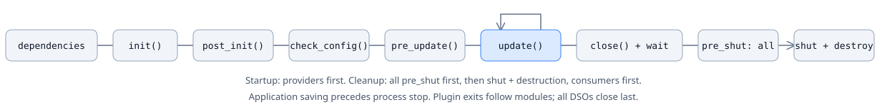

# Create a module

A module exposes a C++ service interface; its plugin registers the implementation and the manager drives its lifecycle. This counter and consumer run on one application thread. Pair them with [Create a plugin](plugins.md) to build the shared library.

## Define the interface and implementation

Save the public interfaces as `sample_module.hpp`, without concrete classes:

```cpp
#pragma once

#include <cstdint>

#include <ark/module.hpp>

namespace ark {

class counter_module : public module
{
public:
    virtual void increment() = 0;
    virtual std::uint64_t value() const = 0;
};

class sample_module : public module
{
};

} // namespace ark
```

Save factory declarations in plugin-private `sample_factory.hpp`; do not install it or expose it to interface consumers:

```cpp
#pragma once

#include <memory>

#include "sample_module.hpp"

namespace ark {

std::unique_ptr<counter_module> make_counter();
std::unique_ptr<sample_module> make_sample();

} // namespace ark
```

Define concrete classes and interface-returning factories in adjacent `sample_module.cpp`:

```cpp
#include <ark/module_base.hpp>

#include "sample_factory.hpp"

namespace ark {
namespace {

class counter_module_impl final : public module_base<counter_module>
{
public:
    void increment() override {
        ++value_;
    }

    std::uint64_t value() const override {
        return value_;
    }

private:
    std::uint64_t value_{};
};

class sample_module_impl final : public module_base<sample_module, counter_module>
{
public:
    bool post_init() override {
        counter_ = find_module<counter_module>();
        return counter_ != nullptr;
    }

    bool update() override {
        if (counter_ == nullptr)
        {
            return false;
        }
        counter_->increment();
        return true;
    }

    bool pre_shut() override {
        counter_ = nullptr;
        return true;
    }

private:
    counter_module* counter_{};
};

} // namespace

std::unique_ptr<counter_module> make_counter() {
    return std::make_unique<counter_module_impl>();
}

std::unique_ptr<sample_module> make_sample() {
    return std::make_unique<sample_module_impl>();
}

} // namespace ark
```

`module_base<interface_type, providers...>` supplies manager/name access, required-provider metadata and protected `find_module<T>()`, without adding lifecycle or `update()` overrides. The inheritance chain is implementation → base → interface → `module`. The consumer declares `counter_module` as required; [plugin registration](plugins.md#pair-registration-and-unregistration) explicitly enables its updates and disables the counter’s. Co-locate hpp/cpp by function; consumers need only the interface.

## Register and find the same interface

Register `counter_module_impl` under `counter_module`, then retrieve it with `find_module<counter_module>()`. The registration key comes from the interface type's RTTI name; an implementation name or a shared-library filename is a different key. Register one implementation per interface in a manager. Duplicate registration is not a supported multi-provider model.

Returned pointers are borrowed: do not delete them or retain them after module unregistration. The manager refuses any module removal while managed business tasks remain, since another module's task may borrow that provider. Build consumers/plugins with compatible headers, compiler/ABI settings and RTTI enabled.

| Lookup | Missing interface RTTI key or runtime-type mismatch | Calling constraints |
| --- | --- | --- |
| `find_module<T>()` | Asserts with assertions enabled; returns `nullptr` otherwise | Check before use; do not probe optional services through failed lookup in Debug; existing assertion contract unchanged |
| `plugin_manager::try_find_module<T>()` | Returns `nullptr` without logging, asserting or changing registration | Manager owner thread only; foreign-thread calls throw `std::logic_error`. Server startup uses it to report missing required modules through normal startup failure |

The two example modules share the application update thread. The counter is deliberately not atomic; it does not support calls from arbitrary worker threads. Queue worker completions for the owning module thread or use a service's documented asynchronous API. See the [network reference](../reference/network.md) for network callback dispatch.

## Declare startup dependencies

Use ordinary C++ template parameters to declare required providers. For example, the Timers sample uses the same form as:

```cpp
#include <ark/module_base.hpp>
#include <ark/utility/guid_module.hpp>
#include <ark/utility/timer_module.hpp>

class dependent_module final
    : public ark::module_base<ark::module, ark::timer_module, ark::guid_module>
{
};
```

| Dependency declaration | Contract |
| --- | --- |
| `module_base<interface_type, providers...>::get_dependencies()` | Returns provider interface RTTI keys; the first parameter selects the inherited interface. Providers add metadata, not bases or owned pointers |
| `module::get_dependencies()` | Empty by default; legacy implementations may override required keys directly. Do not mutate the registry while reading metadata |
| Validation | Repeated keys count once; self-dependency is a cycle. Optional lookups stay nullable, not required. Only key presence is checked; raw `add_module()` callers must supply the matching interface |
| Cache | Read once on the owner after installation. Legal idle additions/removals invalidate order; shutdown rebuilds when needed. Declarations stay stable while registered; polling/reentrant stop never reread them |
| Ordering | Stable registration-key order among ready nodes within compatible builds, not across compiler RTTI encodings |

Each row lists **direct declarations**, not every runtime lookup. Missing declared providers fail before startup hooks.

| Consumer | Required provider interfaces | Purpose / boundary |
| --- | --- | --- |
| [Net service manager](../reference/network.md) | `bus_module`, `timer_module` | Network service setup |
| [Bus messaging](../reference/bus.md) (`msg_module`) | `bus_module`, `net_service_manager_module` | Msg → Net → Bus is acyclic; Bus configuration (`bus_module`) is a separate node with no required providers |
| Timers sample | `timer_module`, `guid_module` | Looked up in `init()` |
| Utility Timer, Guid, Schedule, Compress | None | No required-provider declarations |
| Login, Master, Proxy, World, Dir, Router | `bus_module`, `net_service_manager_module` | Listener setup |
| [Kernel configuration](../reference/kernel.md#required-providers) (`config_module`) | `class_meta_module` | Configuration metadata |
| Kernel (`kernel_module`) | `class_meta_module`, `config_module`, `guid_module` | Register Utility with Kernel |
| Map (`map_module`) | None declared | Required Map ↔ Kernel runtime cycle stays outside the ordering graph; register both and use entity APIs after startup. Map/Kernel declarations alone do not validate their mutual presence or relative cleanup order |
| Game | `kernel_module`, `bus_module`, `net_service_manager_module`, `map_module`, `class_meta_module` | Active callbacks and Player setup. Guid is required transitively through Kernel; retained Guid/Msg lookups add no direct declarations |

The graph controls provider-first startup and consumer-first resource cleanup. Once tasks and native work are ready, all `pre_shut()` calls run consumer-first while every module object remains alive. A second reverse pass runs each module’s `shut()` and destroys its owned object before its providers. Plugin uninstallation follows all modules; all dynamic libraries close last. Declarations must cover real dependencies; topology does not unregister external callbacks or stop native workers. See [lifecycle status](../project/lifecycle-closeout.md).

<Aside type="caution" title="Rebuild modules and consumers together">

- **BREAKING CHANGE:** Removing `module::stop_accepting()` changes the vtable and manager layout. Remove its overrides; move announcements, ingress closure, player removal and saving into the application/operator procedure before process stop. Keep resource cancellation and unregistration in resource lifecycle hooks. Rebuild the launcher, all official/business plugins and affected consumers with compatible headers/compiler settings; do not mix older binaries. Lookup keys stay unchanged; no cross-compiler ABI is promised.
- Update references to former `module_base` specializations for Timers and the concrete role, Game, Kernel configuration and Kernel implementations, then rebuild their consumers.

</Aside>

## Choose lifecycle stages

| Callback | Appropriate work | Current boundary |
| --- | --- | --- |
| `init()` | Initialize local resources | Declared providers have completed this phase; independent modules may follow |
| `post_init()` | Resolve interfaces and use dependencies initialized in `init()` | Declared providers also finish `post_init()` before their consumers |
| `check_config()` | Check configuration and dependencies | A failure stops the remaining startup work |
| `pre_update()` | Prepare work before the application loop | Keep this stage bounded |
| `update()` | Publish queued service and bridge completions | Only explicitly enabled registrations participate; the manager then polls its shared executor once. Its Boolean result does not stop updates |
| `ready_to_shut()` | Establish task/native-callback resource safety | False waits while owner updates continue; exceptions retain resources |
| `pre_shut()` | Release subscriptions and prepare resource cleanup | Entered consumer-first after tasks, active stacks and readiness are safe; all objects stay alive through this pass; false/exception stops cleanup |
| `shut()` | Release module-owned resources | Follows all successful `pre_shut()` calls; reverse `shut()`/owned-object destruction releases consumers first; failure stops cleanup |



All four startup phases reuse validated provider-first order; independent ready nodes use registration-key order, not manifest/insertion order. Base callbacks return `true`; override only what is needed. This plugin explicitly disables counter updates and enables consumer updates, incrementing the counter once per manager update.

<Aside type="caution" title="Handle the manager's startup result">

| Startup failure | Result and diagnostic |
| --- | --- |
| Missing provider / cycle | `start()` returns false before hooks; `dependencies: <consumer> requires missing module '<provider>'`, or a blocked-module list including downstream nodes outside the cycle |
| Metadata exception | Propagates unchanged with `dependencies: <module>` |
| Any of four startup callbacks returns `false` / throws | Stops current and later stages. False makes `plugin_manager::start()` return `false`; exceptions propagate unchanged. Each callback runs at most once per stage; context is `phase: module` |
| Missing library / `DllEntryPlugin` | Returns false with `load_plugin: <plugin>`; library load/entry calls use `load_plugin: plugin`. A loaded library missing its entry stays retained until process exit because static initialization may have started work; no automatic unload |
| `get_startup_failure()` | Owner-thread reads only; empty after successful startup |

Installation/registration and completed stages are not rolled back. The launcher reports context/available exception details and exits `1` before updates or the Windows command thread, without `pre_shut()` / `shut()` or same-process retry. Deployment tools should start a fresh process. Other invariant assertions are unchanged. Custom loops must select all required plugins and check startup results; see the [launcher failure contract](applications.md#check-startup-and-stop-the-process).

</Aside>

## Clean up resources at process stop

The application or operator completes announcements, ingress closure, player removal and saving before requesting process stop. The framework does not classify business roots, provide a natural business-drain phase or promise follow-up saves/transactions during shutdown.

`manager.stop()` enters `stopping` and calls task-group `close()` to seal admission and request cancellation. Cancellation never forcibly destroys frames. Continue owner updates, service completion dispatch and shared-runtime polling until tasks, active stacks and native module resources are safe. `ready_to_shut()` returning false waits; an exception enters `failed`.

Then all `pre_shut()` calls run in reverse dependency order while every module object is alive, closing native callback sources. A second reverse pass runs each consumer’s `shut()` and owned-object destruction before its providers. Plugin uninstallation follows all modules, and every DSO closes last. Resource owners must stop external producers, unregister cross-module callbacks and wait for native workers. Undeclared dependencies and arbitrary external work are outside the graph’s proof.

`stop_until(timestamp, deadline)` is an optional resource-cleanup safeguard; the default wait is unlimited. Timeout/failure retains remaining resources and never permits pending-frame destruction. See [tasks and timeout states](tasks.md#shared-business-executor-for-modules).

Provider objects remain alive during consumer `shut()`/destruction, but their native resources may already be closed by the preceding `pre_shut()` pass. Release borrows or unregister metadata only where the interface permits; do not rely on database writes, network sends or business saving at this stage. Complete those operations while running, before process stop.

Raw `add_module()` registrations remain caller-owned; the manager cannot destroy borrowed objects. Callers must preserve the same consumer/provider lifetimes; ordering does not transfer ownership.

`plugin_base` is neither copyable nor movable; its registered address stays stable. Destroying a standalone plugin expires its destruction authority, and the caller must explicitly release retained modules. A module's stored task-group reference remains valid through its destructor; manager lookup is unavailable after unregistration. During normal shutdown, `uninstall()` acknowledges released registrations through existing `unregister_module()` calls; it must not access module objects. Put resource cleanup in module hooks.

## Keep callbacks within their owner's lifetime

The example only holds a borrowed pointer and clears it in `pre_shut()`. A real module may also register timers, event handlers or asynchronous operations that capture `this`. Record their identifiers or cancellation handles, stop accepting new work, and unregister or cancel them according to the owning service's API before destroying the module. Cancellation alone must not be assumed to mean that every completion has already run.

The manager tracks roots accepted by its task groups, but not arbitrary callbacks, native pool workers or background cleanup. Those operations must finish according to their own service contracts before their code or state can be released. Do not infer safe library replacement or a complete callback-drain guarantee from a zero managed-task count, `pre_shut()`, `shut()` or a successful `stop()` return. See [shared module tasks](tasks.md#shared-business-executor-for-modules) for the cancellation and resource-cleanup contract. Hot-update behavior is outside this guide.

## Continue

<CardGrid>

<LinkCard title="Create a plugin" href="plugins.md" description="Registration pairs, DLL entry points, build and runtime selection." />
<LinkCard title="Application launcher" href="applications.md" description="Process arguments and configuration paths." />
<LinkCard title="Coroutine tasks" href="tasks.md" description="Task ownership, admission and owner-thread polling." />
<LinkCard title="Kernel reference" href="../reference/kernel.md" description="Entity and data services from official modules." />

</CardGrid>

## Use a base class with a private implementation

The [complete example above](#define-the-interface-and-implementation) is the recommended recipe. Existing `ARK_DECLARE_MODULE_FUNCTIONS` modules remain supported. Preserve interface RTTI keys and update selection when following the [plugin compatibility table](plugins.md#use-typed-registration-and-explicit-entries). Return `std::unique_ptr<interface_type>` from a private factory, keep concrete classes in cpp and include the base only in the implementation.
