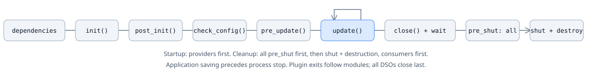

# 创建模块

模块通过 C++ 接口提供应用服务；插件注册实现，管理器驱动生命周期。以下计数器与消费者在同一应用线程运行。配合[创建插件](plugins_CN.md)即可构建动态库。

## 定义接口与实现

公开接口保存为 `sample_module.hpp`，不暴露具体类：

```cpp
#pragma once

#include <cstdint>

#include <ark/module.hpp>

namespace ark {

class counter_module : public module
{
public:
    virtual void increment() = 0;
    virtual std::uint64_t value() const = 0;
};

class sample_module : public module
{
};

} // namespace ark
```

将工厂声明保存为插件私有的 `sample_factory.hpp`，不安装或提供给接口消费者：

```cpp
#pragma once

#include <memory>

#include "sample_module.hpp"

namespace ark {

std::unique_ptr<counter_module> make_counter();
std::unique_ptr<sample_module> make_sample();

} // namespace ark
```

在同目录的 `sample_module.cpp` 中定义具体类及返回接口的工厂：

```cpp
#include <ark/module_base.hpp>

#include "sample_factory.hpp"

namespace ark {
namespace {

class counter_module_impl final : public module_base<counter_module>
{
public:
    void increment() override {
        ++value_;
    }

    std::uint64_t value() const override {
        return value_;
    }

private:
    std::uint64_t value_{};
};

class sample_module_impl final : public module_base<sample_module, counter_module>
{
public:
    bool post_init() override {
        counter_ = find_module<counter_module>();
        return counter_ != nullptr;
    }

    bool update() override {
        if (counter_ == nullptr)
        {
            return false;
        }
        counter_->increment();
        return true;
    }

    bool pre_shut() override {
        counter_ = nullptr;
        return true;
    }

private:
    counter_module* counter_{};
};

} // namespace

std::unique_ptr<counter_module> make_counter() {
    return std::make_unique<counter_module_impl>();
}

std::unique_ptr<sample_module> make_sample() {
    return std::make_unique<sample_module_impl>();
}

} // namespace ark
```

`module_base<interface_type, providers...>` 提供 manager／name 访问、必需 provider 元数据与受保护的 `find_module<T>()`，不增加生命周期或 `update()` 覆写。继承链为具体实现 → 基类 → 接口 → `module`。本例消费者声明必需的 `counter_module`；[插件注册](plugins_CN.md#配对注册与注销)显式为消费者启用 update、为计数器禁用。hpp／cpp 按功能共置，消费者只依赖接口。

## 使用同一个接口注册和查找

以 `counter_module` 为接口注册 `counter_module_impl`，再通过 `find_module<counter_module>()` 查找。注册键来自接口类型的 RTTI 名称；实现类名称和动态库文件名都是不同的键。同一个管理器中，每个接口只注册一个实现。重复注册不构成受支持的多实现模型。

返回值是借用指针，不得删除或在插件注销模块后继续使用。只要管理器仍有受管业务任务，就拒绝注销任何模块，因为其他模块的任务可能仍引用 provider。应用与插件须使用兼容的头文件、编译器／ABI 配置并启用 RTTI。

| 查询 | 接口 RTTI 键缺失或动态类型不匹配 | 调用约束 |
| --- | --- | --- |
| `find_module<T>()` | 启用断言时触发断言；关闭断言时返回 `nullptr` | 使用前检查结果；Debug 中不得通过失败查找探测可选服务；原有断言契约不变 |
| `plugin_manager::try_find_module<T>()` | 返回 `nullptr`，不记录日志、触发断言或改变注册 | 仅管理器所属线程可调用，其他线程抛出 `std::logic_error`；服务启动用它将缺少必需模块的情况交给正常启动失败处理 |

示例中的两个模块在应用更新线程中调用。计数器没有使用原子变量，不支持任意工作线程直接访问。工作线程的完成结果应投递到模块所属线程，或使用服务明确提供的异步 API。网络回调的分发方式见[网络接口](../reference/network_CN.md)。

## 声明启动依赖

用普通 C++ 模板参数声明必需 provider。Timers 示例采用相同形式：

```cpp
#include <ark/module_base.hpp>
#include <ark/utility/guid_module.hpp>
#include <ark/utility/timer_module.hpp>

class dependent_module final
    : public ark::module_base<ark::module, ark::timer_module, ark::guid_module>
{
};
```

| 依赖声明 | 契约 |
| --- | --- |
| `module_base<interface_type, providers...>::get_dependencies()` | 返回 provider 接口 RTTI 键；首参数选择继承接口，provider 仅加元数据，不加基类或自有指针 |
| `module::get_dependencies()` | 默认空列表；旧实现可直接覆写必需键；读取时不得修改 registry |
| 验证 | 重复键算一次，自依赖为环；可选查询保持可空，不声明为必需；只检查键存在，直接 `add_module()` 的调用方须保证对象实现该接口 |
| 缓存 | 安装后在 owner 线程读取一次并缓存顺序；合法 idle 新增／移除使缓存失效，停机时按需重建；声明在注册期间稳定，轮询与重入 stop 不重读 |
| 排序 | 当前可启动节点按注册键稳定排序；只在兼容构建内定义，不保证跨编译器 RTTI 顺序 |

下表只列出**直接声明**，不列出全部运行时查询。缺少已声明的 provider 时，在启动钩子前报错。

| 消费者 | 必需 provider 接口 | 用途／边界 |
| --- | --- | --- |
| [Net 服务管理器](../reference/network_CN.md) | `bus_module`、`timer_module` | 网络服务初始化 |
| [Bus 消息](../reference/bus_CN.md)（`msg_module`） | `bus_module`、`net_service_manager_module` | Msg → Net → Bus 不成环；Bus 配置（`bus_module`）是独立节点，无必需 provider |
| Timers 示例 | `timer_module`、`guid_module` | 在 `init()` 中查询 |
| Utility Timer、Guid、Schedule、Compress | 无 | 未声明必需 provider |
| Login、Master、Proxy、World、Dir、Router | `bus_module`、`net_service_manager_module` | 监听初始化 |
| [Kernel 配置](../reference/kernel_CN.md#必需提供方)（`config_module`） | `class_meta_module` | 配置元数据 |
| Kernel（`kernel_module`） | `class_meta_module`、`config_module`、`guid_module` | 与 Kernel 一起注册 Utility |
| Map（`map_module`） | 未声明 | 必需的 Map ↔ Kernel 运行时环仍在排序图之外；同时注册两者，启动后再调用实体 API。Map／Kernel 自身的声明不验证两者是否同时存在，也不约束两者的清理顺序 |
| Game | `kernel_module`、`bus_module`、`net_service_manager_module`、`map_module`、`class_meta_module` | 实际回调与 Player 初始化。Guid 通过 Kernel 成为传递依赖；保留的 Guid／Msg 查询不增加直接声明 |

依赖图控制提供方优先启动与消费者优先清理。全部任务与原生工作就绪后，先按反向拓扑执行全部 `pre_shut()`，保留全部模块对象；再反向逐个执行 `shut()` 并销毁拥有的对象，消费者先于提供方。所有模块释放后才注销插件，所有动态库最后关闭。声明必须覆盖真实依赖；拓扑本身不注销外部回调或停止原生线程。见[生命周期状态](../project/lifecycle-closeout_CN.md)。

<Aside type="caution" title="同时重建模块与消费者">

- **BREAKING CHANGE：** 移除 `module::stop_accepting()` 并改变管理器布局。删除该覆写，将公告、关入口、踢人和保存迁移到进程停止前的应用／运维流程；资源注销与取消放入资源生命周期。使用兼容头文件／编译器设置重建启动器、全部官方／业务插件与受影响消费者，不混用旧二进制。查找键不变，不提供跨编译器 ABI 保证。
- 更新 Timers 及角色、Game、Kernel 配置、Kernel 具体实现中原 `module_base` 特化的引用，并重建其消费者。

</Aside>

## 选择生命周期阶段

| 回调 | 适合处理的工作 | 当前约束 |
| --- | --- | --- |
| `init()` | 初始化本模块资源 | 声明的 provider 已完成同一阶段，独立模块可能稍后执行 |
| `post_init()` | 查找接口，使用已在 `init()` 中初始化的依赖 | 声明的 provider 也先于消费者完成 `post_init()` |
| `check_config()` | 检查配置和依赖 | 失败时停止剩余启动工作 |
| `pre_update()` | 准备进入应用循环 | 避免在这个阶段执行无期限的工作 |
| `update()` | 分发服务与桥接的完成结果 | 仅显式启用 update 的注册参与，随后统一轮询一次共享执行器；布尔返回值不会停止更新 |
| `ready_to_shut()` | 确认任务与原生回调资源可安全释放 | false 表示继续更新；异常保留资源 |
| `pre_shut()` | 解除订阅，准备清理资源 | 任务、活跃栈与资源就绪后消费者优先执行，整轮保持所有对象存活；首次 false／异常停止清理 |
| `shut()` | 释放模块持有的资源 | 全部 `pre_shut()` 成功后，反向逐个执行并销毁拥有的对象；首次失败停止后续清理 |



四个启动阶段复用已验证的 provider 优先顺序；独立节点按注册键排序，不按清单或插入顺序。基类回调默认返回 `true`，只覆写需要的阶段。本例插件显式禁用计数器 update、启用消费者 update，后者每次管理器更新递增一次计数器。

<Aside type="caution" title="检查管理器的启动结果">

| 启动失败 | 结果与诊断 |
| --- | --- |
| provider 缺失／成环 | 启动钩子前 `start()` 返回 false；`dependencies: <consumer> requires missing module '<provider>'`，或列出被环阻塞的模块（含环外下游） |
| 元数据异常 | 原样传播，保留 `dependencies: <module>` |
| 四个启动回调返回 `false`／抛异常 | 停止当前及后续阶段；false 使 `plugin_manager::start()` 返回 `false`，异常原样传播；每阶段每回调至多一次，保留 `phase: module` |
| 库或 `DllEntryPlugin` 缺失 | 返回 false，保留 `load_plugin: <plugin>`；库加载／入口调用期间使用 `load_plugin: plugin`。已加载但缺入口的库因静态初始化可能已启动工作，保留至进程退出，不自动卸载 |
| `get_startup_failure()` | 仅 owner 线程读取；成功启动后为空 |

安装／注册及已完成阶段不回滚。启动器输出上下文与可用异常信息，在更新循环或 Windows 命令线程启动前以 `1` 退出，不调用 `pre_shut()`／`shut()`，不在同进程重试；部署工具应启动新进程。其他不变量断言不变。自行管理循环时，完整选择插件并检查启动结果；详见[启动器失败合同](applications_CN.md#确认启动并停止进程)。

</Aside>

## 进程停止时清理资源

公告、关闭业务入口、踢人和保存由应用或运维在进程停止前完成。框架不判断业务根请求，不提供自然业务排空阶段，也不承诺停机时完成后续保存或事务。

`manager.stop()` 进入 `stopping`，对任务组调用 `close()` 关闭准入并请求取消。请求取消不会强制销毁帧；继续所属线程更新、服务完成派发与共享执行器轮询，直到任务、活跃栈与模块原生资源就绪。`ready_to_shut()` 的 false 表示继续等待，异常进入 `failed`。

随后按反向依赖执行全部 `pre_shut()`，在所有对象存活时关闭原生回调源；再反向逐个执行 `shut()` 并销毁拥有的对象，消费者先于提供方。插件注销在所有模块之后，所有 DSO 关闭在最后。停止外部生产者、注销跨模块回调并等待原生线程退出是资源所有者的责任。未声明依赖与任意外部工作不受拓扑证明覆盖。

`stop_until(timestamp, deadline)` 是可选的资源清理保护；默认无限等待。超时／失败保留剩余资源，不允许销毁待完成帧。详见[任务与超时状态](tasks_CN.md#模块共用业务执行器)。

原始 `add_module()` 注册仍由调用方拥有；管理器不能销毁借用对象。调用方必须保持相同的消费者／提供方生命周期，不能将排序误作所有权转移。

## 保证回调不超出对象生命周期

示例只保存其他模块的指针，并在 `pre_shut()` 中清空。实际模块还可能注册定时器、事件处理器或捕获 `this` 的异步操作。保存这些操作的标识符或取消句柄，先停止接收新任务，再按所属服务的 API 注销或取消，最后才销毁模块。不能仅凭取消操作推断所有完成回调都已执行。

管理器追踪自己任务组中受理的业务任务，不追踪任意外部回调、原生连接池线程或后台清理。这些操作仍需按所属服务的约定完成，才能释放相关代码或状态。不能根据受管理任务数归零、`pre_shut()`、`shut()` 或 `stop()` 返回成功，推断动态库可以安全替换，或所有回调都已排空。[模块共享任务](tasks_CN.md#模块共用业务执行器)说明了取消与资源清理约定。热更新不在本文范围内。

## 继续阅读

<CardGrid>

<LinkCard title="创建插件" href="plugins_CN.md" description="注册配对、DLL 入口、构建与运行时选择。" />
<LinkCard title="应用启动器" href="applications_CN.md" description="进程参数与配置路径。" />
<LinkCard title="协程任务" href="tasks_CN.md" description="任务所有权、准入与所属线程轮询。" />
<LinkCard title="Kernel 参考" href="../reference/kernel_CN.md" description="官方模块提供的实体与数据服务。" />

</CardGrid>

## 用基类隐藏具体实现

上面的[完整示例](#定义接口与实现)即推荐写法。已有 `ARK_DECLARE_MODULE_FUNCTIONS` 模块仍受支持；迁移时保持接口 RTTI 键与 update 选择，按[插件兼容表](plugins_CN.md#用类型化注册和显式入口)替换创建／注册宏。工厂返回 `std::unique_ptr<interface_type>`，具体类留在 cpp，基类只由实现包含。
