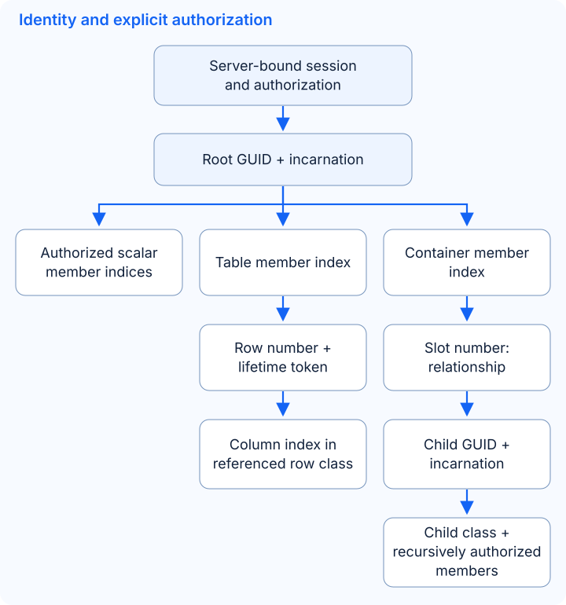
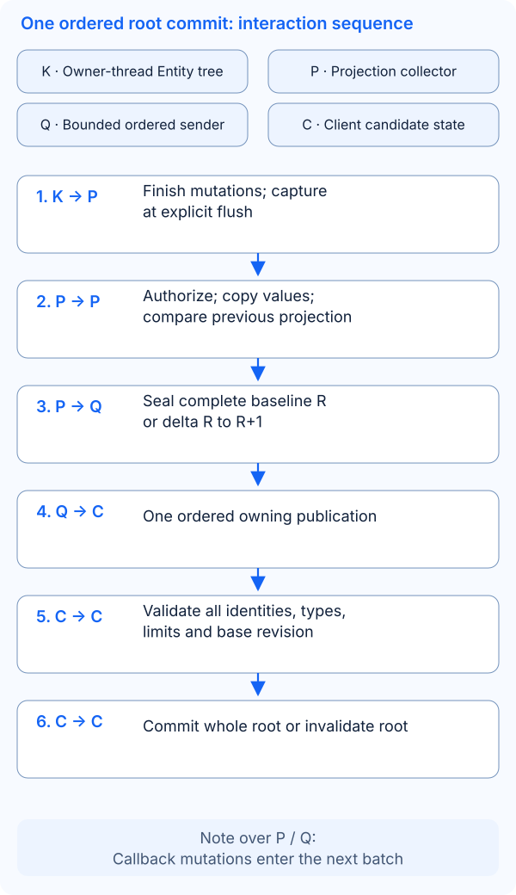
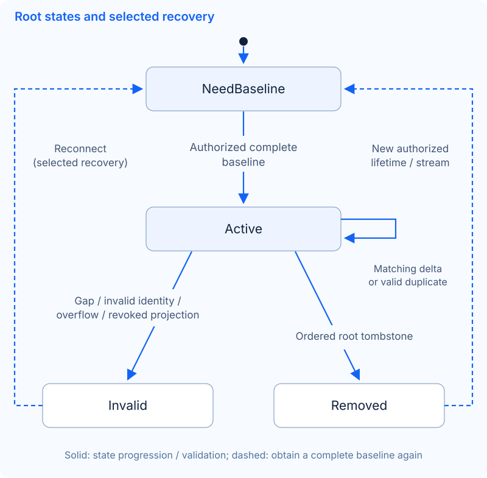

# General Entity replication design

The supported contract is a bounded, authorized root tree containing scalar fields, tables and container children. [Owning capture](../reference/kernel.md#owning-nested-snapshots), the [trusted-binding C++ publisher/replica](../reference/kernel.md#nested-baselines-and-deltas), the canonical [Protobuf codec](../reference/entity-protocol.md) and a portable C# replica are available. The [Godot guest room](../guides/examples.md#guest-room-entity-replication) uses this contract for inventory rows and equipment children. [Current capability](../concepts/entity-sync.md) separates these primitives from remaining subscription and authorization orchestration.

## Existing constraints determine the design

| Source contract | Consequence |
| --- | --- |
| [`table_impl`](../../src/plugins/kernel/table_impl.cpp): rows are map entries keyed by positive row numbers; `select_row()` reuses holes | Deleting row 2 from `{1,2,3}` leaves keys `{1,3}`. Its presentation positions become `{0,1}`; position 1 now means row 3. A later automatic add can reuse key 2. Neither array position nor row number alone identifies a row lifetime. |
| `remove_row()` calls the delete callback before erasing the owned row; `clear()` calls back before clearing | Record the operation's identity during the callback; capture final state after the mutation phase. Borrowed `row*` / `node*` cannot survive removal as pending payloads. A callback is not a committed-state snapshot. |
| [`container_impl`](../../src/plugins/kernel/container_impl.cpp): slots hold child Entity references; `remove()` detaches, `destroy()` invokes destruction callbacks; slots may be reused or swapped | A slot identifies a relationship, not a child lifetime. A relationship removal does not itself mean Entity destruction. Cross-container callbacks do not provide a replication transaction. |
| [JSON schema](../reference/kernel.md#json-entity-schema-and-business-data): explicit member indices, scalar-only table classes, referenced container classes | Resolve columns in the table's referenced class, and fields/relations in each child's class. Index 7 in two classes is not one global field. Array order and configuration ID are never runtime identities. |
| [`entity_snapshot.cpp`](../../src/plugins/kernel/entity_snapshot.cpp) and [`entity_stream.hpp`](../../src/plugins/kernel/entity_stream.hpp) | Reuse selected scalar values and validation. Capture requires the owner thread; the scalar publisher requires a fixed selection/type and cannot emit row/slot operations. |
| [Legacy delayed collection](../reference/kernel.md#delayed-synchronization-batches) borrows mutable nodes; Kernel destruction can defer self-destruction | The new collector must own values and observe completed lifecycle changes. Existing operation enums, immediate/deferred callbacks and `protobuf_delay_entity` are not the new contract. |

The supported nested scope is schema-declared scalar table columns and an explicitly bounded container tree. Custom fields, events, cyclic/shared graphs, cross-root transactions, RPC, Registry and persistence are outside this contract. Invalid repeated-child/cyclic relationships must fail capture rather than recurse indefinitely. Container mutation correctness remains a prerequisite; this design does not certify every existing swap or failure path.

## Identity and authorized projection

The diagram below describes semantic keys; the [protocol reference](../reference/entity-protocol.md) defines their message and C++ representations. An application binds the recipient, root GUID, schema identity and allowed projection on the server. No gateway or account service is required.

| Identity | Invariant |
| --- | --- |
| Root/child lifetime | GUID plus incarnation prevents reuse from reviving an old Entity. A stream generation identifies a rebuilt projection; do not confuse it with the Entity's lifetime or a business request sequence. The room binds root incarnation and stream generation separately from state. |
| Row lifetime | Table-owner lifetime + table member index + row number + non-reused lifetime token. Allocate on successful insertion, retire on deletion/clear, including delete/re-add between two flushes. A final-state diff alone cannot detect identical-value reuse. |
| Container relationship | Parent lifetime + container member index + slot number, with the current child lifetime as the value. A swap changes relationships while child identities stay stable. Removal/reuse must not redirect a stale child update to the new occupant. |
| Schema | Application-defined schema identity binds member kind/index, scalar type/width and referenced classes throughout the projection. JSON format `version = 1` only versions the file format. Removal, index reuse or type/reference changes require an explicit compatibility decision and a new compatible baseline; never reinterpret old bytes. |

Authorize root access, each table/column, each relationship and each child field separately. `sync_self` / `sync_view` are policy inputs, not session authentication; deny missing bindings/policy. Parent visibility grants no child-field access. Hidden changes do not advance that recipient's projected revision. Keep recipient progress separate from Kernel dirty flags and from other recipients.

## One ordered root commit

The consistency boundary is one selected root tree per recipient. A baseline is its complete authorized state, including empty tables/slots and type-correct zero values. Freeze it at revision R on the owner thread after initialization and business mutations; later mutations belong to the next capture. Do not publish a partially initialized Entity or infer flush order from module registration order.

A delta applies only to its matching schema, lifetime, projection generation and required revision. Valid duplicates do not regress state. A gap, unknown row lifetime/child binding or malformed operation invalidates the root; no prefix becomes visible. The C++ and portable C# replicas validate complete candidates before committing; `RoomSession` additionally stages complete room envelopes. The contract provides root atomicity and does not roll back server business mutations or provide cross-root transactions.

| Change before sealing | Required result relative to the previous published projection |
| --- | --- |
| Add row → set columns | Add the new row lifetime with complete final authorized values; later revisions may patch columns. |
| Set columns → delete row | Delete that lifetime; suppress its unsealed column patches. Already admitted revisions stay before deletion. |
| Delete row 2 → add row 2 | Retire old lifetime before introducing the replacement. Unchanged rows keep their keys; never encode a positional shift as a different row's update. |
| Clear → add rows | Retire prior row lifetimes; emit lifetime-checked removals, complete replacements and complete additions for the final captured state. |
| Place / swap / detach child | Include newly visible complete child subtrees in the container replacement and expose all affected slots in one root commit. Detach removes a relationship; drop child state once no authorized reference in the projection remains. |
| Destroy child / root | Remove visible relationships and child state in the same root commit, or tombstone the entire root. Suppress unsealed updates; retained owning publications remain valid in order. Unseen create/destroy may coalesce away. |
| Cross-root move | Excluded from incremental transfer. Reconnect with fresh independently bound streams if the application needs new root membership; no implicit atomic transfer. |

Use final-state capture for coalescing, plus successful lifecycle observations for row/Entity lifetime changes. Treat legacy callbacks as observations requiring an audit of success, exception and reentry paths. A thrown callback can occur after insertion, while deletion callbacks run before erase; blindly turning every callback into a durable operation log is insufficient. Immediate and deferred mutation paths must produce the same projected result. `real_time` can request an earlier flush, without bypassing authorization, revision order or limits.

## Recovery, authorization changes and memory

Each stream has a fixed projection. When authorization or selected membership changes, the application cancels unadmitted publications, closes the affected connection and discards local state. Reconnect obtains a fresh independently authorized binding and complete baseline; it does not reuse an installed replica as a reset target. Already transmitted bytes cannot be recalled, and transport close cannot itself prove remote erasure. General subscription/authorization orchestration and in-place generation reset remain TODO.

| Resource | Required bound and failure behavior |
| --- | --- |
| Captured root | Maximum depth, entities, rows, fields and total text/value bytes, including schema/identity metadata; reject before publishing an incomplete baseline. Iteration and copying must fit a per-flush work budget. |
| Sender/receiver | Encoded baseline/delta bytes, pending batches/bytes/age, concurrent captures/encodes and candidate-state memory. Bound both the old committed tree and replacement candidate, not only patch size. |
| Lifetime bookkeeping | Active row tokens, retired/tombstone identities and retained immutable handles; scope to a bounded session/generation, release on disconnect. Exhausted lifetime counters require replacing the affected source lifetime or terminating; changing only a stream generation never resets a table counter. |
| Delivery/recovery | Bound baseline/reset attempts and reconnect rate. Oversize, capture/encoding failure or enqueue/send rejection closes the affected stream/connection. No silent delta drop, implicit retry or ACK/replay history. |

Copy selected scalars, row values and child/slot identities into owned immutable publications. Never hand borrowed Entity/table/row/node pointers to IO. Asynchronous encoding, if later selected, must preserve publication order and bound in-flight work. `nested_snapshot_limits` and `nested_stream_limits` bound native state/work/history; [codec limits](../reference/entity-protocol.md#independent-limits-and-failures) separately bound encoded body size and parsing depth. They do not measure exact process memory. The room's 8192-byte body and eight-frame pending limit remain sample-specific; do not inherit them as general replication defaults. Fragmentation would require bounded assembly and atomic install and is excluded from the initial scope.

## Supported layers and remaining work

| Layer | Supported boundary | Remaining work |
| --- | --- | --- |
| Owning capture | Explicit authorized selections, stable row numbers and non-reused row/Entity incarnations; bounded tree capture on the owner thread | Custom fields, events and cyclic/shared graphs are outside the contract |
| C++ state | One revision for scalar/table/relationship changes, complete baselines, sparse row patches, container membership replacement, candidate commit and terminal rejection | No cross-root transaction, in-place reset, ACK or replay history |
| Wire | `entity_sync.proto` with nine explicit scalar types, repeated indexed records, row lifetimes and container replacement/patch; independently trusted binding and bounded codec | No fragmentation or automatic subscription protocol |
| Client/sample | Portable C# immutable model/replica; room table 200 for inventory and container 300 for equipment, seven actions and reconnect recovery | General subscriptions, dynamic authorization, AOI and interest management remain TODO |

Scalar-only C++ applications may continue using the native scalar publisher. The room uses one current nested protocol; it does not retain the former scalar-only wire path. Its handshake value is `2`, requiring coordinated server/client upgrades; message, file and API names have no version suffix. See the [room protocol](../../examples/guest_room/protocol.md).

Permanent local checks cover owning captures, row/Entity reuse, sparse and replacement changes, duplicate/gap handling, complete candidate/history limits, allocation failure and C++/C# wire samples. Native room and portable C# checks exercise the included application integration. Actual Godot execution, hosted/platform checks and deployment/capacity acceptance remain separate evidence. Future dynamic subscription/authorization work must additionally validate per-recipient visibility and queued revocation. The [roadmap priorities](roadmap.md#current-priorities) keep deployment and larger-load work behind their stated prerequisites.
