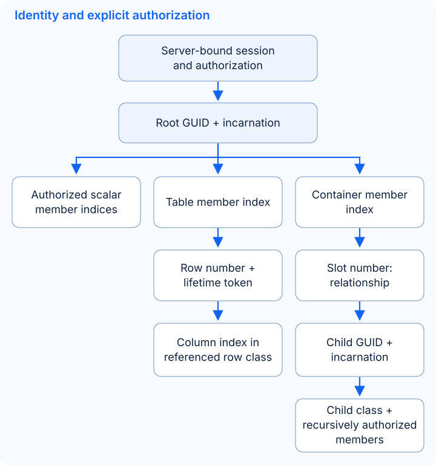
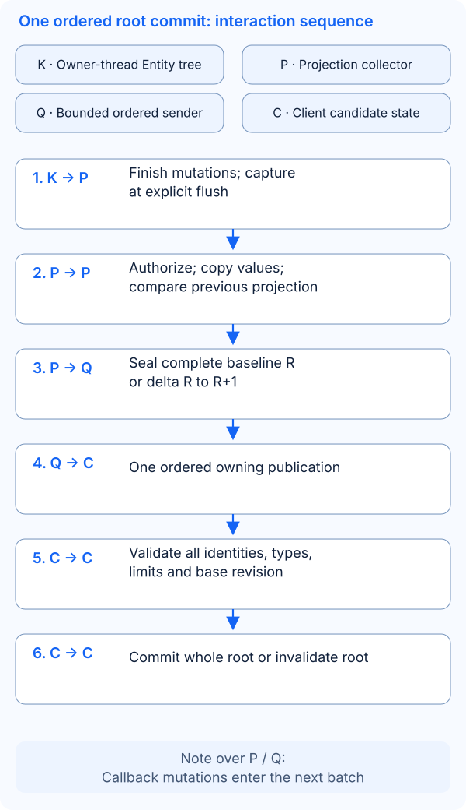
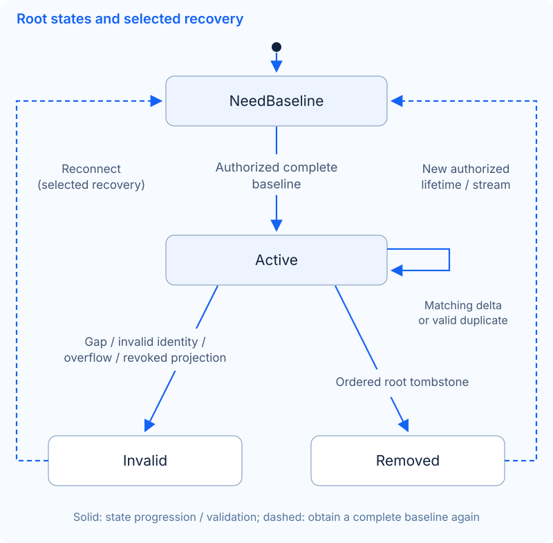

# General Entity replication design

**Selected direction; staged delivery.** Owning scalar capture/publication and [owning nested capture](../reference/kernel.md#owning-nested-snapshots) are available. The [trusted-binding C++ nested differ/replica](../reference/kernel.md#nested-baselines-and-deltas) is also available; a nested wire codec/client adapter remains separate. The target is a bounded root projection containing tables and container children; room v1 remains unchanged and no nested wire representation is selected. [Current capability](../concepts/entity-sync.md) remains the supported boundary.

## Existing constraints determine the design

| Source contract | Consequence |
| --- | --- |
| [`table_impl`](../../src/plugins/kernel/table_impl.cpp): rows are map entries keyed by positive row numbers; `select_row()` reuses holes | Deleting row 2 from `{1,2,3}` leaves keys `{1,3}`. Its presentation positions become `{0,1}`; position 1 now means row 3. A later automatic add can reuse key 2. Neither array position nor row number alone identifies a row lifetime. |
| `remove_row()` calls the delete callback before erasing the owned row; `clear()` calls back before clearing | Record the operation's identity during the callback; capture final state after the mutation phase. Borrowed `row*` / `node*` cannot survive removal as pending payloads. A callback is not a committed-state snapshot. |
| [`container_impl`](../../src/plugins/kernel/container_impl.cpp): slots hold child Entity references; `remove()` detaches, `destroy()` invokes destruction callbacks; slots may be reused or swapped | A slot identifies a relationship, not a child lifetime. A relationship removal does not itself mean Entity destruction. Cross-container callbacks do not provide a replication transaction. |
| [JSON schema](../reference/kernel.md#json-entity-schema-and-business-data): explicit member indices, scalar-only table classes, referenced container classes | Resolve columns in the table's referenced class, and fields/relations in each child's class. Index 7 in two classes is not one global field. Array order and configuration ID are never runtime identities. |
| [`entity_snapshot.cpp`](../../src/plugins/kernel/entity_snapshot.cpp) and [`entity_stream.hpp`](../../src/plugins/kernel/entity_stream.hpp) | Reuse selected scalar values and validation. Capture requires the owner thread; the scalar publisher requires a fixed selection/type and cannot emit row/slot operations. |
| [Legacy delayed collection](../reference/kernel.md#delayed-synchronization-batches) borrows mutable nodes; Kernel destruction can defer self-destruction | The new collector must own values and observe completed lifecycle changes. Existing operation enums, immediate/deferred callbacks and `protobuf_delay_entity` are not the new contract. |

The initial nested scope is schema-declared scalar table columns and an explicitly bounded container tree. Custom fields, events, cyclic/shared graphs, cross-root transactions, RPC, Registry and persistence are outside this proposal. Invalid repeated-child/cyclic relationships must fail capture rather than recurse indefinitely. Container mutation correctness remains a prerequisite; this design does not certify every existing swap or failure path.

## Identity and authorized projection

The notation below describes semantic keys, not proposed fields or C++ types. An application binds the recipient, root GUID, schema identity and allowed projection on the server. No gateway or account service is required.

| Identity | Proposed invariant |
| --- | --- |
| Root/child lifetime | GUID plus incarnation prevents reuse from reviving an old Entity. A stream generation identifies a rebuilt projection; do not confuse it with the Entity's lifetime or a business request sequence. Room v1 continues using its existing GUID/generation contract. |
| Row lifetime | Table-owner lifetime + table member index + row number + non-reused lifetime token. Allocate on successful insertion, retire on deletion/clear, including delete/re-add between two flushes. A final-state diff alone cannot detect identical-value reuse. See decision 1 for a smaller alternative. |
| Container relationship | Parent lifetime + container member index + slot number, with the current child lifetime as the value. A swap changes relationships while child identities stay stable. Removal/reuse must not redirect a stale child update to the new occupant. |
| Schema | Application-defined schema identity binds member kind/index, scalar type/width and referenced classes throughout the projection. JSON format `version = 1` only versions the file format. Removal, index reuse or type/reference changes require an explicit compatibility decision and a new compatible baseline; never reinterpret old bytes. |

Authorize root access, each table/column, each relationship and each child field separately. `sync_self` / `sync_view` are policy inputs, not session authentication; deny missing bindings/policy. Parent visibility grants no child-field access. Hidden changes do not advance that recipient's projected revision. Keep recipient progress separate from Kernel dirty flags and from other recipients.

## One ordered root commit

The proposed consistency boundary is one selected root tree per recipient. A baseline is its complete authorized state, including empty tables/slots and type-correct zero values. Freeze it at revision R on the owner thread after initialization and business mutations; later mutations belong to the next capture. Do not publish a partially initialized Entity or infer flush order from module registration order.

A delta applies only to its matching schema, lifetime, projection generation and required revision. Valid duplicates do not regress state. A gap, unknown row lifetime/child binding or malformed operation invalidates the root; no prefix becomes visible. Validate a candidate before committing, as Godot's existing `RoomSession` does for a whole room envelope. This proposes root atomicity, not cross-root atomicity or rollback of server business mutations.

| Change before sealing | Required result relative to the previous published projection |
| --- | --- |
| Add row → set columns | Add the new row lifetime with complete final authorized values; later revisions may patch columns. |
| Set columns → delete row | Delete that lifetime; suppress its unsealed column patches. Already admitted revisions stay before deletion. |
| Delete row 2 → add row 2 | Retire old lifetime before introducing the replacement. Unchanged rows keep their keys; never encode a positional shift as a different row's update. |
| Clear → add rows | Clear barrier retires prior row lifetimes, then add complete new rows. A validated full-table replacement is an alternative encoding of the same state transition. |
| Place / swap / detach child | Introduce a previously unseen child's authorized baseline before exposing its relationship; replace all affected slots in one root commit. Detach removes a relationship; drop child state once no authorized reference in the projection remains. |
| Destroy child / root | Remove visible relationships and child state in the same root commit, or tombstone the entire root. Suppress unsealed updates; retained owning publications remain valid in order. Unseen create/destroy may coalesce away. |
| Cross-root move | Coordinate explicit replacement baselines for affected roots or reject the unsupported replication transition; no implicit atomic transfer. See decision 2. |

Use final-state capture for coalescing, plus successful lifecycle observations for row/Entity lifetime changes. Treat legacy callbacks as observations requiring an audit of success, exception and reentry paths. A thrown callback can occur after insertion, while deletion callbacks run before erase; blindly turning every callback into a durable operation log is insufficient. Immediate and deferred mutation paths must produce the same projected result. `real_time` can request an earlier flush, without bypassing authorization, revision order or limits.

## Recovery, authorization changes and memory

Recheck authorization before sender admission. Expansion needs a replacement projection baseline before its deltas. Revocation removes omitted fields/rows/children from client state and cancels unadmitted unauthorized publications. If already admitted bytes cannot be withdrawn, close the affected connection and discard local state; bytes already transmitted cannot be recalled. A transport close cannot itself prove remote erasure. Reconnect obtains a fresh server binding and complete authorized state. In-place generation reset requires the separately chosen reset contract below.

| Resource | Required bound and failure behavior |
| --- | --- |
| Captured root | Maximum depth, entities, rows, fields and total text/value bytes, including schema/identity metadata; reject before publishing an incomplete baseline. Iteration and copying must fit a per-flush work budget. |
| Sender/receiver | Encoded baseline/delta bytes, pending batches/bytes/age, concurrent captures/encodes and candidate-state memory. Bound both the old committed tree and replacement candidate, not only patch size. |
| Lifetime bookkeeping | Active row tokens, retired/tombstone identities and retained immutable handles; scope to a bounded session/generation, release on disconnect. Exhausted lifetime counters require replacing the affected source lifetime or terminating; changing only a stream generation never resets a table counter. |
| Delivery/recovery | Bound baseline/reset attempts and reconnect rate. Oversize, capture/encoding failure or enqueue/send rejection closes the affected stream/connection. No silent delta drop, implicit retry or ACK/replay history. |

Copy selected scalars, row values and child/slot identities into owned immutable publications. Never hand borrowed Entity/table/row/node pointers to IO. Asynchronous encoding, if later selected, must preserve publication order and bound in-flight work. `snapshot_limits` bounds scalar field/text state, not exact process memory or encoded Protobuf size. Room v1's 8192-byte body and eight-frame pending limit remain sample-specific; do not inherit them as general replication defaults. Fragmentation would require bounded assembly and atomic install and is excluded from the initial scope.

## Selected decisions and delivery stages

| Decision | Selected boundary | Deferred alternative and cost |
| --- | --- | --- |
| 1. Stable rows | Preserve current row numbers and add a lifetime token in the replication layer; verify every successful insert/delete/clear path. | Start with a new table generation and complete table replacement on structural changes, with row-number patches only inside that generation. This avoids row-token hooks initially but increases copying/bandwidth. An opaque permanent row ID changes the identity model further. |
| 2. Consistency across roots | Keep one root atomic; exclude cross-root transfer from incremental MVP and require explicit affected-root baselines. | A coordinated transfer across roots needs a new transaction/ordering contract and authorization failure semantics. Existing container swap callbacks do not supply it. |
| 3. Subscription reset/recovery | Begin with reconnect-only recovery and fixed projections per connection, matching room v1's recovery scope. | In-place per-root resets avoid disconnecting unrelated roots but require generation negotiation, discard rules for queued old deltas, revocation handling and reset-rate bounds. |

Stage 1 provides owning nested capture, lifetime identities and bounded explicit projection input. Stage 2 provides the root C++ differ/replica with atomic candidate commits and terminal invalidation, fixed trusted bindings and independently bounded state/patch/lifetime metadata. Its local tests include injected allocation failures and real Kernel captures; this does not establish network delivery. A codec requires separate review. Reuse `capture_scalar_snapshot` for each authorized Entity's scalar leaf; reuse `scalar_value` for row columns. Keep existing scalar publishers for scalar-only roots. The nested coordinator uses one outer revision for scalar, table and relationship changes; feeding only scalar deltas through today's publisher cannot advance a table-only revision or atomically commit the tree. This does not require changing today's scalar API or room messages.

Acceptance must exercise `{1,2,3} → {1,3} → {1,2(new),3}`, identical-value row reuse, clear/re-add, slot reuse/swap/detach/destroy, container-only changes, two recipients with different permissions, revocation while queued, late join, duplicates/gaps, schema/type mismatch, GUID reuse, counter exhaustion, allocation/admission failure and shutdown with retained owning values. Compare final authorized projections from immediate/deferred paths. Wire work then needs C++/C# parity, malformed-input/golden tests and real two-client Godot integration; local correctness does not establish deployment or capacity.
