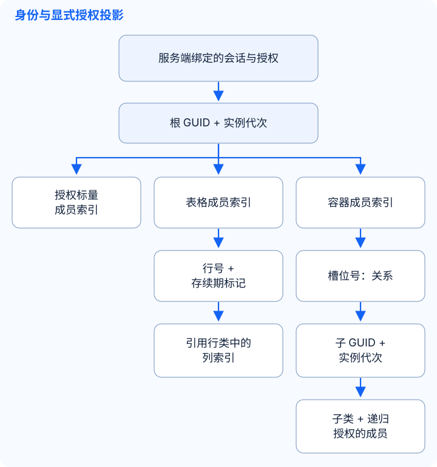
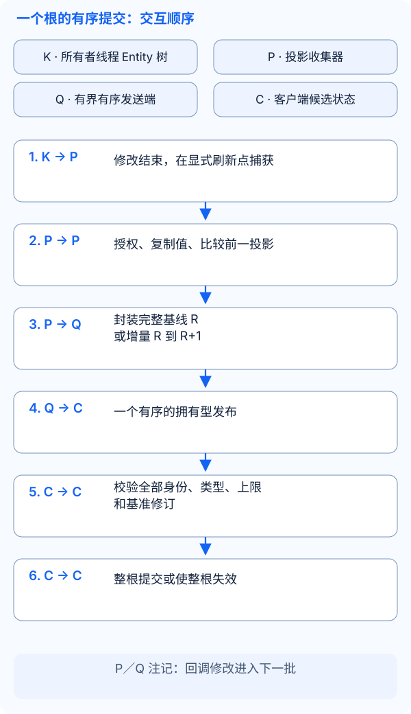
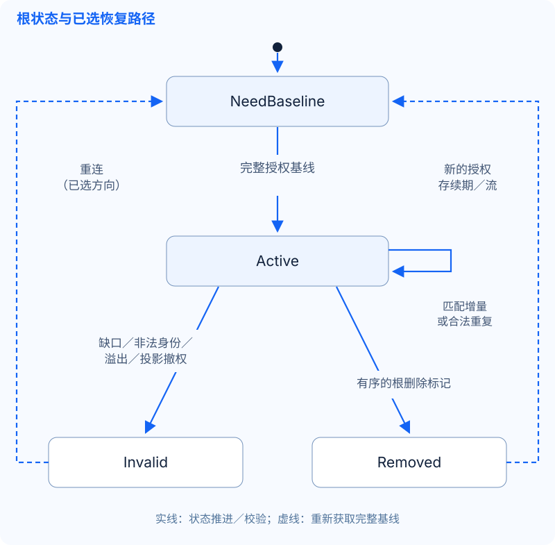

# 通用 Entity 复制设计

**方向已选定，分阶段交付。** 拥有型标量捕获／发布及[拥有型嵌套捕获](../reference/kernel_CN.md#拥有型嵌套快照)已提供，嵌套差异器／接收端另行交付。目标是包含表格及容器子 Entity 的有界根投影；房间 v1 保持不变，尚未选择嵌套线协议表示。[当前能力](../concepts/entity-sync_CN.md)仍是已支持的边界。

## 现有约束决定设计

| 源码契约 | 设计影响 |
| --- | --- |
| [`table_impl`](../../src/plugins/kernel/table_impl.cpp)：以正行号作为 map 键，`select_row()` 复用空洞 | 从 `{1,2,3}` 删除行 2 后，键仍为 `{1,3}`。展示位置变成 `{0,1}`，位置 1 此时对应行 3；下一次自动新增可能复用键 2。数组位置和行号本身都不能标识行的一次存续期。 |
| `remove_row()` 在删除持有的行之前触发删除回调；`clear()` 在清空之前回调 | 在回调中记录操作身份，在修改阶段结束后捕获最终状态。借用的 `row*`／`node*` 不能作为待发载荷跨越删除；回调不是已提交状态的快照。 |
| [`container_impl`](../../src/plugins/kernel/container_impl.cpp)：槽位持有子 Entity 引用；`remove()` 解除关系，`destroy()` 触发销毁回调；槽位可复用或交换 | 槽位标识关系，不标识子 Entity 的存续期。关系移除本身不等于 Entity 销毁；跨容器回调不提供复制事务。 |
| [JSON Schema](../reference/kernel_CN.md#json-实体定义与业务配置)：显式成员索引、仅含标量的表格类、容器引用的子类 | 列索引在表格引用的行类中解析；子字段／关系在各子类中解析。两个类中的索引 7 不是同一个全局字段。数组顺序和配置 ID 都不是运行时身份。 |
| [`entity_snapshot.cpp`](../../src/plugins/kernel/entity_snapshot.cpp) 和 [`entity_stream.hpp`](../../src/plugins/kernel/entity_stream.hpp) | 复用已选标量值及校验。捕获要求所有者线程；标量发布端要求固定选择／类型，不能发布行／槽位操作。 |
| [旧延迟收集](../reference/kernel_CN.md#延迟同步批次)借用可变节点；Kernel 可延迟销毁正在执行的 Entity | 新收集器须拥有值，并观察已完成的生命周期变化。现有操作枚举、即时／延迟回调和 `protobuf_delay_entity` 不是新契约。 |

首期嵌套范围为 Schema 声明的标量表格列，以及显式有界的容器树。自定义字段、事件、循环／共享图、跨根事务、RPC、Registry 和持久化不在本提案内。重复子引用或循环关系必须使捕获失败，不能无限递归。容器修改本身正确是前置条件；本设计不构成全部既有交换或失败路径的验收。

## 身份与授权投影

下图表示语义键，不是拟新增的字段或 C++ 类型。应用在服务端绑定接收者、根 GUID、Schema 身份和允许的投影，无需网关或账号服务。

| 身份 | 拟议不变量 |
| --- | --- |
| 根／子 Entity 存续期 | GUID 加实例代次，防止复用后旧 Entity 复活。流代次标识重建的投影，不等于 Entity 存续期或业务请求序列号。房间 v1 保持既有 GUID／generation 契约。 |
| 行存续期 | 表格所有者存续期 + 表格成员索引 + 行号 + 不复用的存续期标记。成功插入时分配，删除／清空时退役；两次刷新之间的删除再新增也须换标记。只比较最终值无法发现值相同的复用；更小方案见选型 1。 |
| 容器关系 | 父存续期 + 容器成员索引 + 槽位号，值为当前子 Entity 的存续期。交换改变关系，子身份保持稳定。移除／复用不能让旧子更新指向新占用者。 |
| Schema | 应用定义的 Schema 身份绑定整个投影中的成员种类／索引、标量类型／宽度及引用类。JSON 的 `version = 1` 只标识文件格式。删除、复用索引或改变类型／引用类须明确兼容策略，并安装兼容的新基线，不能重新解释旧字节。 |

分别授权根访问、表格／列、每条关系及每个子字段。`sync_self`／`sync_view` 是策略输入，不是会话认证；绑定／策略缺失时拒绝。父可见性不授予子字段访问权。隐藏变化不推进该接收者的投影修订号。接收者进度与 Kernel 脏标记、其他接收者进度分开维护。

## 一个根的有序提交

拟议一致性边界为每个接收者的一棵选定根树。基线是完整授权状态，包括空表格／槽位和类型正确的零值。在初始化和业务修改结束后，于所有者线程冻结修订 R；后续修改进入下一次捕获。不能发布部分初始化的 Entity，也不能通过模块注册顺序推断刷新顺序。

增量仅应用到匹配的 Schema、存续期、投影流代次及基准修订。合法重复不能使状态回退。缺口、未知行存续期／子绑定或非法操作使根失效，不暴露已应用的前半部分。提交前先校验候选状态，与 Godot 现有 `RoomSession` 对整个房间消息的处理方式一致。本方案要求根原子性，不提供跨根原子性，也不回滚服务端业务修改。

| 封装前的变化 | 相对上一已发布投影的必要结果 |
| --- | --- |
| 新增行 → 设置列 | 以完整的最终授权值新增该行存续期；后续修订可修改列。 |
| 修改列 → 删除行 | 删除该存续期，抑制未封装的列修改；已入队修订仍先于删除。 |
| 删除行 2 → 新增行 2 | 先退役旧存续期，再引入替代行。未变行保留键，不能把展示位置左移编码为另一行的更新。 |
| 清空 → 新增行 | 清空屏障退役旧行存续期，再新增完整行。经完整校验的整表替换是同一状态转换的另一种表示。 |
| 放入／交换／移除子 Entity | 先引入未见子 Entity 的授权基线，再暴露关系；一个根提交替换所有受影响槽位。移除只解除关系；投影中不再有授权引用时释放子状态。 |
| 销毁子 Entity／根 | 同一根提交移除可见关系和子状态，或以删除标记移除整根。抑制未封装更新；已保留的拥有型发布仍按顺序有效。未见的创建后销毁可合并消失。 |
| 跨根移动 | 协调受影响根的显式替代基线，或拒绝不支持的复制转换；不隐含原子转移。参见选型 2。 |

使用最终状态捕获合并状态，同时观察成功的生命周期变化以识别行／Entity 存续期。旧回调只能作为观察输入，须审查成功、异常和重入路径：插入完成后回调可能抛出异常，删除回调则先于擦除，不能直接把每次回调当成持久操作日志。即时和延迟修改路径必须得到相同的投影结果。`real_time` 可以提示提前刷新，不能绕过授权、修订顺序或上限。

## 恢复、权限变化与内存

发送端入队前再次校验权限。扩权须先安装替代投影基线，再接收增量。撤权从客户端状态移除被省略的字段／行／子 Entity，并取消尚未入队的越权发布。已入队字节无法撤回时，关闭受影响连接并丢弃本地状态；已经传出的字节无法收回，传输关闭本身也不能证明远端已擦除。重连取得新服务端绑定与完整授权状态。原地流代次重置需要下表单独选择的重置契约。

| 资源 | 必须限制的内容与失败处理 |
| --- | --- |
| 捕获的根 | 最大深度、Entity 数、行数、字段数及文本／值总字节数，包括 Schema／身份元数据；不能发布不完整基线。遍历与复制须符合每次刷新工作量预算。 |
| 发送端／接收端 | 编码后基线／增量字节数、待发批次数／字节数／年龄、并行捕获／编码数及候选状态内存。限制旧已提交树与替代候选同时存在的内存，不能只限制补丁。 |
| 存续期记录 | 活跃行标记、已退役／删除身份与保留的不可变句柄；限制在有界会话／流代次内，断线时释放。存续期计数耗尽须替换对应源存续期或终止；只更换流代次不重置表格计数器。 |
| 交付／恢复 | 限制基线／重置尝试与重连频率。超限、捕获／编码失败或入队／发送拒绝须关闭受影响流／连接。不静默丢增量、不隐式重试、不保留 ACK／重放历史。 |

将选定标量、行值及子／槽位身份复制为拥有型不可变发布，不向 IO 线程传递借用的 Entity／table／row／node 指针。未来若选择异步编码，须保持发布顺序并限制在途工作。`snapshot_limits` 限制标量字段／文本状态，不代表进程精确内存或 Protobuf 编码大小。房间 v1 的 8192 字节消息体和八帧待发上限只适用于示例，不能作为通用复制默认值。分片需要有界组装与原子安装，不纳入首期。

## 已选方向与交付阶段

| 选型 | 已选边界 | 暂缓的替代方案与成本 |
| --- | --- | --- |
| 1. 稳定行身份 | 保留现有行号，在复制层加入存续期标记；核对每条成功插入／删除／清空路径。 | 首期在结构变化时更换表格代次并完整替换表格，仅在同一代次内按行号修改列。这样暂不需要行标记钩子，但增加复制量／带宽。永久不透明行 ID 会进一步改变身份模型。 |
| 2. 跨根一致性 | 保持单根原子；增量 MVP 排除跨根转移，要求受影响根的显式基线。 | 跨根协调转移需要新事务／顺序契约及授权失败语义，现有容器交换回调不提供这些保证。 |
| 3. 订阅重置／恢复 | 首期仅重连恢复，每条连接保持固定投影，与房间 v1 的恢复范围一致。 | 原地按根重置可避免断开无关根，但须定义流代次协商、排队旧增量的丢弃规则、撤权处理和重置频率上限。 |

阶段 1 提供拥有型嵌套捕获、存续期身份及有界显式投影输入。阶段 2 单独交付根差异器／接收端；此处的原子提交和恢复仍是设计目标。先完成核心的进程内测试，再单独评审编解码。复用 `capture_scalar_snapshot` 捕获每个授权 Entity 的标量叶子，复用 `scalar_value` 表示行列值。纯标量根继续使用现有标量发布端。嵌套协调器需要一个外层修订统一标量、表格和关系变化；只通过现有发布端传递标量增量，无法推进仅表格变化的修订，也无法原子提交整树。这不要求修改现有标量 API 或房间消息。

验收须覆盖 `{1,2,3} → {1,3} → {1,2(new),3}`、同值行复用、清空再新增、槽位复用／交换／移除／销毁、仅容器变化、权限不同的两个接收者、排队期间撤权、后加入、重复／缺口、Schema／类型错误、GUID 复用、计数耗尽、分配／入队失败及停机后保留拥有型值。对比即时／延迟路径的最终授权投影。线协议阶段再加入 C++／C# 对应、非法输入／共享样本测试及真实双客户端 Godot 集成；本地正确性不构成部署或容量验收。
