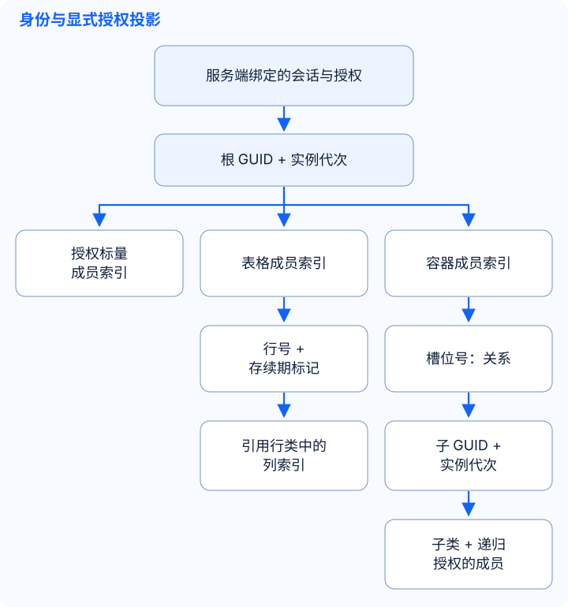
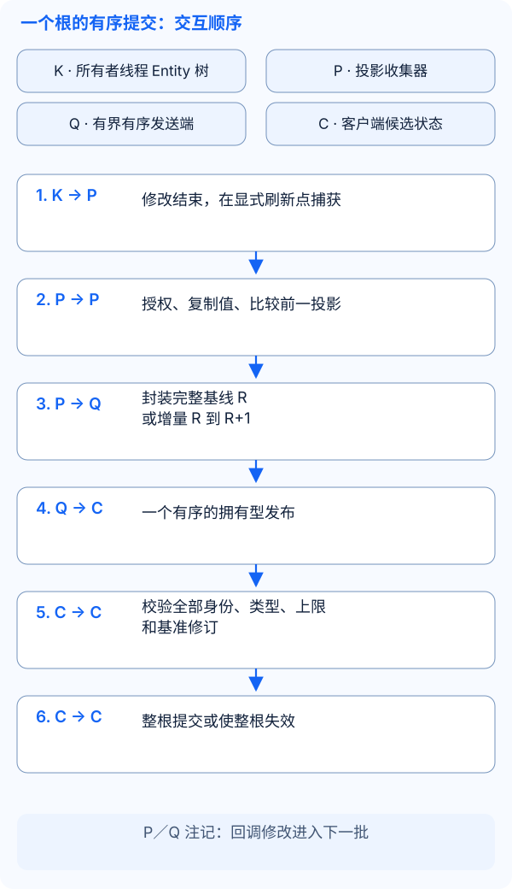
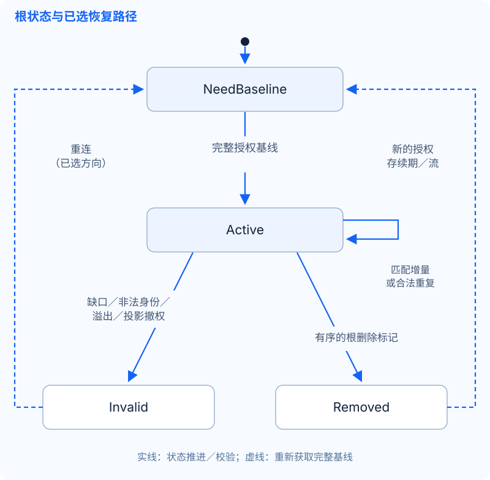

# 通用 Entity 复制设计

当前契约是一棵有界、已授权的根树，包含标量字段、表格和容器子 Entity。[拥有型捕获](../reference/kernel_CN.md#拥有型嵌套快照)、[可信绑定的 C++ 发布端／接收端](../reference/kernel_CN.md#嵌套基线与增量)、规范 [Protobuf 编解码](../reference/entity-protocol_CN.md)及可移植 C# 接收端均已提供。[Godot 访客房间](../guides/examples_CN.md#访客房间-entity-复制)通过该契约同步背包行和装备子 Entity。[当前能力](../concepts/entity-sync_CN.md)区分这些基础能力与仍待实现的订阅／授权编排。

## 现有约束决定设计

| 源码契约 | 设计影响 |
| --- | --- |
| [`table_impl`](../../src/plugins/kernel/table_impl.cpp)：以正行号作为 map 键，`select_row()` 复用空洞 | 从 `{1,2,3}` 删除行 2 后，键仍为 `{1,3}`。展示位置变成 `{0,1}`，位置 1 此时对应行 3；下一次自动新增可能复用键 2。数组位置和行号本身都不能标识行的一次存续期。 |
| `remove_row()` 在删除持有的行之前触发删除回调；`clear()` 在清空之前回调 | 在回调中记录操作身份，在修改阶段结束后捕获最终状态。借用的 `row*`／`node*` 不能作为待发载荷跨越删除；回调不是已提交状态的快照。 |
| [`container_impl`](../../src/plugins/kernel/container_impl.cpp)：槽位持有子 Entity 引用；`remove()` 解除关系，`destroy()` 触发销毁回调；槽位可复用或交换 | 槽位标识关系，不标识子 Entity 的存续期。关系移除本身不等于 Entity 销毁；跨容器回调不提供复制事务。 |
| [JSON Schema](../reference/kernel_CN.md#json-实体定义与业务配置)：显式成员索引、仅含标量的表格类、容器引用的子类 | 列索引在表格引用的行类中解析；子字段／关系在各子类中解析。两个类中的索引 7 不是同一个全局字段。数组顺序和配置 ID 都不是运行时身份。 |
| [`entity_snapshot.cpp`](../../src/plugins/kernel/entity_snapshot.cpp) 和 [`entity_stream.hpp`](../../src/plugins/kernel/entity_stream.hpp) | 复用已选标量值及校验。捕获要求所有者线程；标量发布端要求固定选择／类型，不能发布行／槽位操作。 |
| [旧延迟收集](../reference/kernel_CN.md#延迟同步批次)借用可变节点；Kernel 可延迟销毁正在执行的 Entity | 新收集器须拥有值，并观察已完成的生命周期变化。现有操作枚举、即时／延迟回调和 `protobuf_delay_entity` 不是新契约。 |

已支持的嵌套范围为 Schema 声明的标量表格列，以及显式有界的容器树。自定义字段、事件、循环／共享图、跨根事务、RPC、Registry 和持久化不在该契约内。重复子引用或循环关系必须使捕获失败，不能无限递归。容器修改本身正确是前置条件；本设计不构成全部既有交换或失败路径的验收。

## 身份与授权投影

下图表示语义键；[协议参考](../reference/entity-protocol_CN.md)定义对应消息及 C++ 表示。应用在服务端绑定接收者、根 GUID、Schema 身份和允许的投影，无需网关或账号服务。



| 身份 | 不变量 |
| --- | --- |
| 根／子 Entity 存续期 | GUID 加实例代次，防止复用后旧 Entity 复活。流代次标识重建的投影，不等于 Entity 存续期或业务请求序列号。房间将根实例标记及流代次与状态分别绑定。 |
| 行存续期 | 表格所有者存续期 + 表格成员索引 + 行号 + 不复用的存续期标记。成功插入时分配，删除／清空时退役；两次刷新之间的删除再新增也须换标记。只比较最终值无法发现值相同的复用。 |
| 容器关系 | 父存续期 + 容器成员索引 + 槽位号，值为当前子 Entity 的存续期。交换改变关系，子身份保持稳定。移除／复用不能让旧子更新指向新占用者。 |
| Schema | 应用定义的 Schema 身份绑定整个投影中的成员种类／索引、标量类型／宽度及引用类。JSON 的 `version = 1` 只标识文件格式。删除、复用索引或改变类型／引用类须明确兼容策略，并安装兼容的新基线，不能重新解释旧字节。 |

分别授权根访问、表格／列、每条关系及每个子字段。`sync_self`／`sync_view` 是策略输入，不是会话认证；绑定／策略缺失时拒绝。父可见性不授予子字段访问权。隐藏变化不推进该接收者的投影修订号。接收者进度与 Kernel 脏标记、其他接收者进度分开维护。

## 配置驱动的订阅（计划）

下一层根据游戏配置与当前业务状态推导订阅关系。**范围、可见条件，以及允许同步的标量字段、表格列和子实体投影，全部可配置。** 框架不写死个人、小队、装备或外观的字段集合。已有 mask 名称可以生成默认分组，但不限制游戏自定义分组的名称与数量。

| 输入 | 职责 |
| --- | --- |
| 范围 | 通过注册的实现获取候选：九宫格、圆形、小队成员、自己或业务定义的其他范围。Entity 定义选择配置并提供参数，地图／玩法配置选择空间算法。 |
| 可见条件 | 根据观察者与目标的实时状态判断。小队／公会关系可以过滤空间范围；独立的关系范围也可明确允许视野外追踪。 |
| 数据视图 | 从 Entity 定义中选择具名字段、表格列及嵌套子视图。名称与成员集合均由游戏配置，新增分组不要求修改框架枚举或手写 C++／C# 字段列表。 |
| 场景可见性 | 决定接收方是否显示场景角色；目标离开视野后，仍可保留仅坐标订阅。 |

每条规则组合范围、条件、一个或多个数据视图及场景可见性。同一规则内条件全部通过才生效；命中规则合并允许的成员，形成每个接收者／根的最终投影。只有生效规则才能允许场景角色显示。没有授权规则就不发数据；坐标追踪不会同时授予外观或装备查看权限。

以下 JSON 仅为使用房间字段名的**逻辑配置草案**，当前 Entity JSON v1 解析器与运行时不接受它。文件组织与表格／导出表示仍需确定。

```json
{
  "views": {
    "nearby_actor": {
      "class": "GuestPlayer",
      "fields": ["name", "x", "y", "hp"],
      "containers": {"equipment": {"view": "equipped_item"}}
    },
    "party_position": {"class": "GuestPlayer", "fields": ["x", "y"]},
    "personal_state": {
      "class": "GuestPlayer",
      "fields": ["mp"],
      "tables": {"inventory": {"columns": ["item_id", "quantity"]}}
    },
    "equipped_item": {"class": "GuestEquipment", "fields": ["item_id", "power"]}
  },
  "rules": [
    {"scope": "vision", "condition": "can_observe", "views": ["nearby_actor"], "scene_visible": true},
    {"scope": "party", "condition": "outside_vision", "views": ["party_position"], "scene_visible": false},
    {"scope": "self", "condition": "is_owner", "views": ["nearby_actor", "personal_state"], "scene_visible": true}
  ]
}
```

以上名称和字段集合均为游戏选择。移除小队规则即可隐藏视野外队友，改用其他视图即可改变允许的数据。范围／条件名称引用已注册实现，无需引入表达式语言。沿用原生导出工具，从同一配置解析类与成员引用，生成服务端选择信息和客户端可信类型目录。未知引用、不兼容的类／类型选择及递归视图定义必须校验失败；允许容器不隐含允许所有子字段。

装备和外观使用同一份装备 Entity 状态，客户端据此渲染。装备查看作为独立业务请求，按当前好友列表或已授权的视野内关系判断；首版返回允许的快照，不额外建立永久查看订阅。

| 运行时变化 | 计划中的订阅结果 |
| --- | --- |
| 进入视野 | 安装完整允许基线，显示场景角色。 |
| 离开视野但保留配置的小队追踪 | 移除不再允许的字段，仅保留选定追踪数据，不再显示场景角色。 |
| 小队／公会、可见状态或选用配置变化 | 重算受影响授权；投影变化时替换订阅绑定及基线。这不表示支持配置文件热加载。 |
| 失去全部授权 | 结束订阅并移除副本，服务端 Entity 可以继续存在。 |
| 根销毁 | 结束该 Entity 存续期的全部订阅。 |

投影替换须清除不再可见的成员，并退役尚未入队的旧发布；需要显式的连接内订阅重置，不能借用根销毁标记。当前房间仍通过断开重连恢复，尚未实现此重置。字段结构受可信定义约束，允许的表行及子实体成员仍可动态变化。

计划中的修订语义由服务端给出变化属性最终值，允许发布 `base=10, revision=15`。补丁必须完整覆盖接收端基准到目标版本的选定变化，不要求目标修订逐个加一；缺少结构前提时仍需新基线。客户端根据已提交权威状态表现插值、HP/MP 过渡及换装效果。当前发布端／编解码／接收端仍要求连续修订，修改须协调验证 C++／Protobuf／C#。

验收须覆盖可配置字段／表格／子实体选择、空间与关系变化、视野外队友隐藏或仅坐标同步、授权合并与撤销、装备查看条件、连接内基线替换，以及合法版本跳跃与错误基准。保留单根原子性、拥有型值、存续期检查和资源上限。这些是计划中的检查，不代表已通过验收。

## 一个根的有序提交

一致性边界为每个接收者的一棵选定根树。基线是完整授权状态，包括空表格／槽位和类型正确的零值。在初始化和业务修改结束后，于所有者线程冻结修订 R；后续修改进入下一次捕获。不能发布部分初始化的 Entity，也不能通过模块注册顺序推断刷新顺序。



增量仅应用到匹配的 Schema、存续期、投影流代次及基准修订。合法重复不能使状态回退。缺口、未知行存续期／子绑定或非法操作使根失效，不暴露已应用的前半部分。C++ 和可移植 C# 接收端在提交前验证完整候选；`RoomSession` 还暂存完整房间消息。契约提供根原子性，不回滚服务端业务修改，也不提供跨根事务。

| 封装前的变化 | 相对上一已发布投影的必要结果 |
| --- | --- |
| 新增行 → 设置列 | 以完整的最终授权值新增该行存续期；后续修订可修改列。 |
| 修改列 → 删除行 | 删除该存续期，抑制未封装的列修改；已入队修订仍先于删除。 |
| 删除行 2 → 新增行 2 | 先退役旧存续期，再引入替代行。未变行保留键，不能把展示位置左移编码为另一行的更新。 |
| 清空 → 新增行 | 退役旧行存续期，按最终捕获状态输出核对存续期的删除、完整替换及完整新增。 |
| 放入／交换／移除子 Entity | 容器替换包含新可见的完整子树，一个根提交一起暴露所有受影响槽位。移除只解除关系；投影中不再有授权引用时释放子状态。 |
| 销毁子 Entity／根 | 同一根提交移除可见关系和子状态，或以删除标记移除整根。抑制未封装更新；已保留的拥有型发布仍按顺序有效。未见的创建后销毁可合并消失。 |
| 跨根移动 | 不支持增量转移。应用需要新根成员时，通过重连获取独立绑定的新流；不隐含原子转移。 |

使用最终状态捕获合并状态，同时观察成功的生命周期变化以识别行／Entity 存续期。旧回调只能作为观察输入，须审查成功、异常和重入路径：插入完成后回调可能抛出异常，删除回调则先于擦除，不能直接把每次回调当成持久操作日志。即时和延迟修改路径必须得到相同的投影结果。`real_time` 可以提示提前刷新，不能绕过授权、修订顺序或上限。

## 恢复、权限变化与内存



每条流保持固定投影。权限或选择成员变化时，应用取消尚未入队的发布、关闭受影响连接并丢弃本地状态。重连取得独立授权的新绑定与完整基线，不复用已安装接收端作为重置目标。已经传出的字节无法收回，传输关闭本身也不能证明远端已擦除。通用订阅／授权编排及原地流代次重置仍为 TODO。

| 资源 | 必须限制的内容与失败处理 |
| --- | --- |
| 捕获的根 | 最大深度、Entity 数、行数、字段数及文本／值总字节数，包括 Schema／身份元数据；不能发布不完整基线。遍历与复制须符合每次刷新工作量预算。 |
| 发送端／接收端 | 编码后基线／增量字节数、待发批次数／字节数／年龄、并行捕获／编码数及候选状态内存。限制旧已提交树与替代候选同时存在的内存，不能只限制补丁。 |
| 存续期记录 | 活跃行标记、已退役／删除身份与保留的不可变句柄；限制在有界会话／流代次内，断线时释放。存续期计数耗尽须替换对应源存续期或终止；只更换流代次不重置表格计数器。 |
| 交付／恢复 | 限制基线／重置尝试与重连频率。超限、捕获／编码失败或入队／发送拒绝须关闭受影响流／连接。不静默丢增量、不隐式重试、不保留 ACK／重放历史。 |

将选定标量、行值及子／槽位身份复制为拥有型不可变发布，不向 IO 线程传递借用的 Entity／table／row／node 指针。未来若选择异步编码，须保持发布顺序并限制在途工作。`nested_snapshot_limits` 和 `nested_stream_limits` 限制原生状态／工作量／身份历史，[编解码上限](../reference/entity-protocol_CN.md#独立上限与失败处理)另行限制编码后消息体及解析层数；它们不测量进程精确内存。房间的 8192 字节消息体和八帧待发上限只适用于示例，不能作为通用复制默认值。分片需要有界组装与原子安装，不纳入首期。

## 已支持的层次与剩余工作

| 层次 | 已支持边界 | 剩余工作 |
| --- | --- | --- |
| 拥有型捕获 | 显式授权选择、稳定行号、不复用的行／Entity 实例标记、所属线程的有界树捕获 | 自定义字段、事件及循环／共享图不在契约内 |
| C++ 状态 | 一个修订统一标量／表格／关系变化，完整基线、稀疏行补丁、容器成员替换、候选提交及终态拒绝 | 不提供跨根事务、原地重置、ACK 或重放历史 |
| 线协议 | `entity_sync.proto` 包含九种显式标量、repeated 索引记录、行存续期及容器替换／补丁；独立可信绑定和有界编解码 | 不提供分片或自动订阅协议 |
| 客户端／示例 | 可移植 C# 不可变模型／接收端；房间表格 200 同步背包、容器 300 同步装备，提供七种操作与重连恢复 | 通用订阅、动态授权、AOI 和兴趣管理仍为 TODO |

纯标量 C++ 应用仍可使用原生标量发布端。房间只保留一套当前嵌套协议，不保留原标量线协议分支。握手值为 `2`，要求协调升级服务端与客户端；消息、文件和 API 名称不带版本后缀。见[房间协议](../../examples/guest_room/protocol_CN.md)。

永久本地检查覆盖拥有型捕获、行／Entity 复用、稀疏及替换变化、重复／缺口、完整候选／历史上限、分配失败和 C++／C# 共享线协议样本。原生房间及可移植 C# 检查验证内置应用集成。实际 Godot 执行、托管／平台检查与部署／容量验收属于不同证据。未来动态订阅／授权工作还须验证各接收者可见性及排队期间撤权。[路线图优先级](roadmap_CN.md#当前优先级)保留部署及更大负载工作的前置条件。
