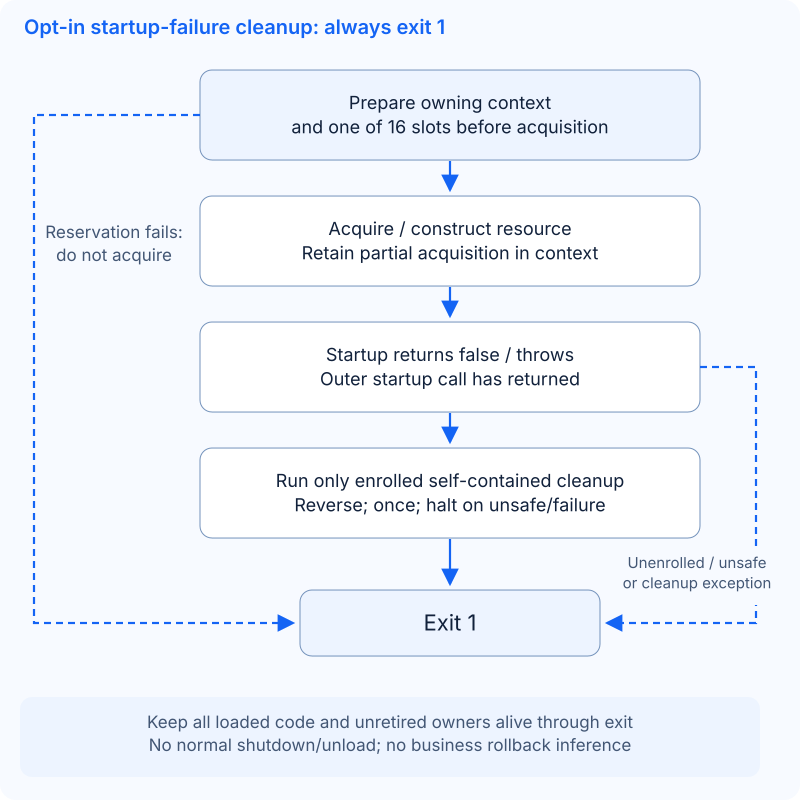

# Opt-in startup-failure cleanup

**Design only; no cleanup runtime is implemented here.** Source map: [d9618a66](https://github.com/OpenArkStudio/ark/tree/d9618a663fc2069b734007812590c88736d17ed5). The [selected lifecycle route](lifecycle-closeout.md) keeps default startup failure as immediate exit `1`. Only an explicitly enrolled, owned resource may run its failure cleanup first. There is no same-process restart, normal `stop()`/`pre_shut()`/`shut()` rollback, external business/transaction rollback, Registry or hot-update work.

## What exists when startup fails

[The loader](https://github.com/OpenArkStudio/ark/blob/d9618a663fc2069b734007812590c88736d17ed5/src/core/plugin_manager.hpp#L635) retains a successfully loaded DSO before its entry call; [plugin registration](https://github.com/OpenArkStudio/ark/blob/d9618a663fc2069b734007812590c88736d17ed5/src/core/plugin_manager.hpp#L372) releases its local plugin candidate **before** `install()` and inserts the plugin into the successful-plugin map only afterward. That map cannot be a complete failure-cleanup inventory.

| Failure point | Actual ownership / live resources |
| --- | --- |
| Plugin constructor throws | The DSO is already loaded. No complete plugin pointer returns; C++ unwinds completed bases/members, not the incomplete object's destructor. Escaped callbacks/threads need their own ownership proof. |
| Module factory or registration throws | [Private factories](https://github.com/OpenArkStudio/ark/blob/d9618a663fc2069b734007812590c88736d17ed5/src/plugins/utility/timer_module_impl.cpp) return `unique_ptr<interface>`; [typed registration](https://github.com/OpenArkStudio/ark/blob/d9618a663fc2069b734007812590c88736d17ed5/src/core/plugin_base.hpp#L54) keeps it until bookkeeping succeeds. A complete unpublished candidate is destroyed on rejection; completed constructor subobjects unwind on construction failure. Previously registered modules remain live. A destructor's existence does not prove nonblocking retirement. |
| Install throws after registering modules; or successful-plugin insertion allocates and throws | The released plugin and its published module/update entries may exist without a successful-plugin entry. No automatic uninstall or rollback occurs. |
| Dependency validation fails | Installation/constructor resources already exist; no module `init()` has run. |
| `init()` returns false / throws | All plugins have installed; earlier modules' init resources and the failing hook's partial resources can exist. Constructor-started IO can already run. |
| `post_init()` returns false / throws | All init calls passed; earlier post-init callbacks/timers/queued work and the failing hook's acquisitions can exist. |
| `check_config()` returns false / throws | Init/post-init passed. The name does not make this hook read-only; earlier resources and its partial acquisitions remain. |
| `pre_update()` returns false / throws | The first three stages passed; partial preparation remains possible. The launcher's ordinary update loop and Windows command thread have not started. |

The four-stage [driver](https://github.com/OpenArkStudio/ark/blob/d9618a663fc2069b734007812590c88736d17ed5/src/core/plugin_manager.hpp#L117) stops at the first false/exception. [The launcher](https://github.com/OpenArkStudio/ark/blob/d9618a663fc2069b734007812590c88736d17ed5/src/application/main.cpp#L309) flushes a diagnostic, then uses `_Exit(1)` (also `TerminateProcess` on Windows), bypassing normal object/static destruction. This retention is a process-failure policy, not proof that callbacks stopped or native workers joined.

| Concrete acquisition | Source consequence |
| --- | --- |
| [Utility Timer init](https://github.com/OpenArkStudio/ark/blob/d9618a663fc2069b734007812590c88736d17ed5/src/plugins/utility/timer_module_impl.cpp#L48) creates/initializes a wheel; Timers [post_init](https://github.com/OpenArkStudio/ark/blob/d9618a663fc2069b734007812590c88736d17ed5/examples/timers/timers_module.cpp) registers a callback | [Wheel initialization](https://github.com/OpenArkStudio/ark/blob/d9618a663fc2069b734007812590c88736d17ed5/src/core/time/timer.hpp#L79) builds local owners before commit. Wheel clear releases owned storage; it is not the module shutdown contract. |
| [HTTP client constructor](https://github.com/OpenArkStudio/ark/blob/d9618a663fc2069b734007812590c88736d17ed5/src/plugins/net/http_client_module_impl.cpp#L244) starts its IO pool | Workers can exist during install, before any init hook. Its destructor/pre-shutdown calls synchronous runtime stop. |
| Net [post_init](https://github.com/OpenArkStudio/ark/blob/d9618a663fc2069b734007812590c88736d17ed5/src/plugins/net/net_service_manager_module_impl.cpp#L111) queues configured clients and registers a health timer; [update](https://github.com/OpenArkStudio/ark/blob/d9618a663fc2069b734007812590c88736d17ed5/src/plugins/net/net_client_service_impl.cpp#L248) starts queued clients | Queueing is not connection completion. [create_server](https://github.com/OpenArkStudio/ark/blob/d9618a663fc2069b734007812590c88736d17ed5/src/plugins/net/net_service_manager_module_impl.cpp#L282) can acquire a listener during a calling startup hook. Record the call site, not one assumed phase. |
| HTTP [endpoint reservation](https://github.com/OpenArkStudio/ark/blob/d9618a663fc2069b734007812590c88736d17ed5/src/plugins/http/http_server_module_impl.cpp#L111) precedes native construction/start | Later throws leave the reservation without an owner; even the false-return branch copies a string before release. See the independent exception-safety candidate below. |
| MySQL [constructor/init/configure](https://github.com/OpenArkStudio/ark/blob/d9618a663fc2069b734007812590c88736d17ed5/src/plugins/mysql/mysql_module.cpp#L218) | Constructor owns state; init binds the owner runtime. `configure()` constructs the native pool **before** named-map insertion, so workers can exist if insertion later throws. Pool construction starts IO in pinned arknet `a0dfe09c`. |

## Smallest implementable slice

Use one controlled module with its **own private `time_wheel_manager`**, no scheduled business callbacks, threads, external publication or borrowed providers. This exercises real Timer allocation/partial initialization without certifying cleanup of the shared Utility Timer or its consumers.

Propose one owner-thread enrollment operation, `prepare_cleanup(owner_key, owning_context, release_function)`. Names are placeholders, not an available API. The manager keeps a bounded attempt-local slot and a strong `shared_ptr<void>` context; the release function is a plain function pointer returning `done`, `unsafe` or `failed`, with exceptions caught by the host. No new module virtual hook or coroutine promise is needed. Factory opt-in passes that capsule explicitly:

```cpp
// Pseudocode: prepare before the constructor can acquire anything.
auto capsule = std::make_shared<owned_timer_context>();
prepare_cleanup(owner_key, capsule, release_timer_context);
return std::make_unique<isolated_timer_module>(capsule, now);
```

The constructor stores the shared capsule, publishes a wheel handle into it by nonthrowing move, then initializes that wheel. If construction throws, the incomplete module is never used by cleanup; the host still owns the capsule. The action checks for an absent/partial wheel, calls the **owned resource's** `time_wheel_manager::shut()`, resets it and reports done. It never calls `timer_module_impl::pre_shut()` or invokes timer callbacks. Success transfers ongoing ownership to the complete module and disarms attempt-only records without cleaning its resources.



Keep two records distinct:

| Record | Minimum contents / update rule |
| --- | --- |
| Object/phase | Preassigned owner/DSO key; constructor/install and each of four hooks: not entered, entered, passed, false return or exception. Mark entry **before** calling user code; mark the result afterward. Do not call virtual naming methods during failure cleanup. |
| Resource action | Slot prepared before acquisition; independent owning capsule, code owner, release-entered and release-result. Capsule ownership tracks partial acquisition; a missing “acquired” marker is never evidence that no resource exists. |

After the outer startup frame has returned/unwound, seal enrollment/new roots and guard lifecycle/registry reentry; run eligible self-contained actions once on the owner thread, then exit `1` even if every action succeeds. The first slice needs one slot; later independent slots may be visited in reverse preparation order, **not** as a general reverse-dependency guarantee. Stop on an unsafe result/exception, retain other owners and take the same failure exit. Never run the ordinary update loop, manager stop, uninstall or DSO close. Keep **all loaded code and unretired owners alive through exit**, including action functions, context/control-block destructors and callback receivers. This also covers an installation absent from the successful-plugin map.

Allocate the bounded slot/labels/context before acquiring resources; full capacity or allocation failure aborts enrollment before this acquisition. Existing contexts/DSOs stay pinned and the launcher takes its default failure exit. No last-minute `std::function` capture, vector growth or label copy may be needed after acquisition. A non-enrolled acquisition keeps its existing RAII/default-exit behavior; the ledger does not repair arbitrary constructor unwinding. Existing RAII destructor calls during unwinding are unchanged.

**Existing allocation-path gap, source-derived:** `exit_startup_failure()` builds/appends a `std::string` before reaching exit. Persistent allocation failure while this function is called from main's exception handler can escape that handler before `_Exit`. A dedicated child repro should arm persistent global-allocation failure immediately before a startup exception and check exit/status/diagnostic; it was **not executed in this documentation task**. Runtime implementation must first add an allocation-free, bounded emergency diagnostic/exit path; this does not require changing lifecycle order. No source fix is included here.

**Independent HTTP candidate, not framework cleanup:** after a successful reservation, exceptions from construction/binding/start or the later `listen_key_ = endpoint` copy can leave `http_endpoints` reserved. A private local reservation owner can release only its own key on false/exception, then transfer it by nonthrowing string swap after native start. This needs no public injection API or lifecycle change. A dedicated allocation-failure test can compile the production cpp in its own translation unit and arm failure for the first allocation after the internal set contains the key, before worker creation; afterward the same endpoint must be reusable. Keep existing duplicate-owner/restart checks and prove the final commit performs no string allocation. This is a source-derived repro plan, not an executed result.

## IO stays outside the first slice

For Net/HTTP/MySQL opt-in, first prove constructor/member unwinding cannot lose a live owner or block before the failure runner. Contexts must exist before worker creation and callbacks must retain complete state rather than an incomplete module `this`. Keep callback code, receivers, bridge/runtime and native owners alive until a proven retirement barrier. Ordinary module update may execute business code on partial startup and is not a cleanup pump.

Pinned arknet's `io_pool::stop()` can wait/join; MySQL [retirement](https://github.com/OpenArkStudio/ark/blob/d9618a663fc2069b734007812590c88736d17ed5/src/plugins/mysql/detail/mysql_service.hpp#L432) uses `close_and_wait()`, while service `stop()` only requests close/suppresses callbacks. See the [pinned pool implementation](https://github.com/OpenArkStudio/arknet/blob/a0dfe09cd543e75cfb5996e537ce2fa49f2a758f/include/arknet/mysql/pool.hpp#L972). These calls are not a nonblocking startup-cleanup contract. Require an existing or separately reviewed request/retired observation, bounded host driving and callback policy before enrollment; do not hide a blocking close in a detached thread or add a new promise/compensation transaction here. Closing a local pool does not establish SQL/business rollback or rewrite an unknown native outcome.

## Acceptance before runtime delivery

Extend permanent C++ factory/launcher tests: constructor throw before/after wheel acquisition; install throw after partial registration; false/throw in all four stages; cleanup done/unsafe/throw and duplicate entry; allocation failure at capsule/slot/phase recording and emergency diagnostic. Require exactly one eligible release before exit `1`, retained primary failure, no later startup/normal-stop/uninstall/unload calls and no resource release through an incomplete `this`. Existing [factory rejection tests](https://github.com/OpenArkStudio/ark/blob/d9618a663fc2069b734007812590c88736d17ed5/tests/core/plugin_construction.cpp#L263) and [real-listener failure tests](https://github.com/OpenArkStudio/ark/blob/d9618a663fc2069b734007812590c88736d17ed5/tests/app/startup_failures.cmake) establish earlier scoped contracts, not this proposed cleanup. No runtime or hosted acceptance is claimed here.

Two IO decisions genuinely require application input; neither blocks the private-wheel slice:

1. Which first IO owner is allowed to enroll, and for its already accepted startup operations which must finish versus may cancel? Source code cannot choose that business/completion policy.
2. What absolute startup-failure cleanup wait budget does that deployment permit? Expiry still means retained owners and exit `1`; the value must come from its operational requirement, and cannot preempt a blocking API.
