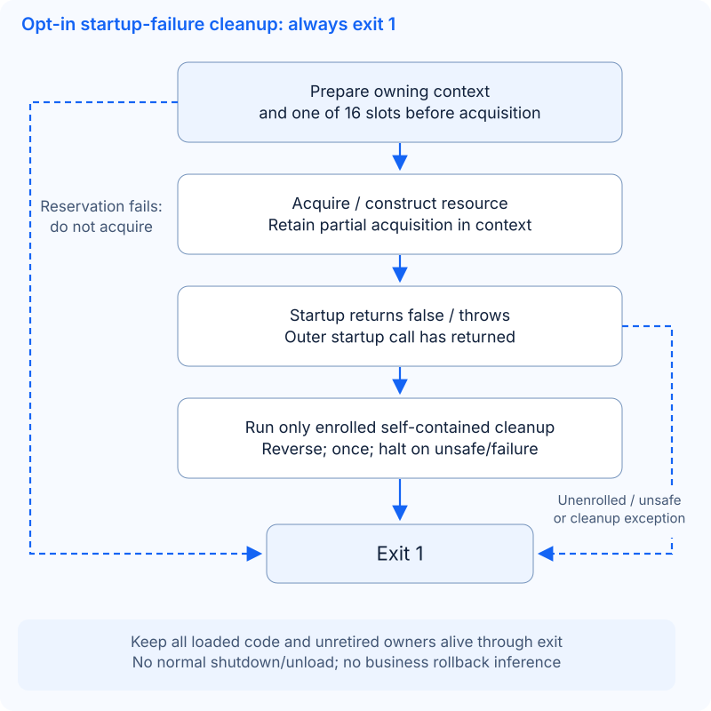

# Opt-in startup-failure cleanup

Startup failure defaults to immediate exit `1`. An independent owned resource explicitly enrolled through `plugin_manager::prepare_startup_cleanup()` may run its failure cleanup once first. The preallocated registry supports up to 16 independently owned resources across modules and covers callback-free Utility Timer wheels and a quiet Net HTTP client runtime; accepted work and other shared IO require separate retirement. Acquisition source-map baseline: [d9618a66](https://github.com/OpenArkStudio/ark/tree/d9618a663fc2069b734007812590c88736d17ed5). There is no same-process retry, normal-shutdown rollback or inferred external business/transaction rollback; Registry and hot update remain paused.

## What exists when startup fails

[The loader](https://github.com/OpenArkStudio/ark/blob/d9618a663fc2069b734007812590c88736d17ed5/src/core/plugin_manager.hpp#L635) retains a successfully loaded DSO before its entry call; [plugin registration](https://github.com/OpenArkStudio/ark/blob/d9618a663fc2069b734007812590c88736d17ed5/src/core/plugin_manager.hpp#L372) releases its local plugin candidate **before** `install()` and inserts the plugin into the successful-plugin map only afterward. That map cannot be a complete failure-cleanup inventory.

| Failure point | Actual ownership / live resources |
| --- | --- |
| Plugin constructor throws | The DSO is already loaded. No complete plugin pointer returns; C++ unwinds completed bases/members, not the incomplete object's destructor. Escaped callbacks/threads need their own ownership proof. |
| Module factory or registration throws | [Private factories](https://github.com/OpenArkStudio/ark/blob/d9618a663fc2069b734007812590c88736d17ed5/src/plugins/utility/timer_module_impl.cpp) return `unique_ptr<interface>`; [typed registration](https://github.com/OpenArkStudio/ark/blob/d9618a663fc2069b734007812590c88736d17ed5/src/core/plugin_base.hpp#L54) keeps it until bookkeeping succeeds. A complete unpublished candidate is destroyed on rejection; completed constructor subobjects unwind on construction failure. Previously registered modules remain live. A destructor's existence does not prove nonblocking retirement. |
| Install throws after registering modules; or successful-plugin insertion allocates and throws | The released plugin and its published module/update entries may exist without a successful-plugin entry. No automatic uninstall or rollback occurs. |
| Dependency validation fails | Installation/constructor resources already exist; no module `init()` has run. |
| `init()` returns false / throws | All plugins have installed; earlier modules' init resources and the failing hook's partial resources can exist. Constructor-started IO can already run. |
| `post_init()` returns false / throws | All init calls passed; earlier post-init callbacks/timers/queued work and the failing hook's acquisitions can exist. |
| `check_config()` returns false / throws | Init/post-init passed. The name does not make this hook read-only; earlier resources and its partial acquisitions remain. |
| `pre_update()` returns false / throws | The first three stages passed; partial preparation remains possible. The launcher's ordinary update loop and Windows command thread have not started. |

The four-stage [driver](https://github.com/OpenArkStudio/ark/blob/d9618a663fc2069b734007812590c88736d17ed5/src/core/plugin_manager.hpp#L117) stops at the first false/exception. [The launcher](https://github.com/OpenArkStudio/ark/blob/d9618a663fc2069b734007812590c88736d17ed5/src/application/main.cpp#L309) flushes a diagnostic, then uses `_Exit(1)` (also `TerminateProcess` on Windows), bypassing normal object/static destruction. This retention is a process-failure policy, not proof that callbacks stopped or native workers joined.

| Concrete acquisition | Source consequence |
| --- | --- |
| [Utility Timer init](https://github.com/OpenArkStudio/ark/blob/d9618a663fc2069b734007812590c88736d17ed5/src/plugins/utility/timer_module_impl.cpp#L48) creates/initializes a wheel; Timers [post_init](https://github.com/OpenArkStudio/ark/blob/d9618a663fc2069b734007812590c88736d17ed5/examples/timers/timers_module.cpp) registers a callback | [Wheel initialization](https://github.com/OpenArkStudio/ark/blob/d9618a663fc2069b734007812590c88736d17ed5/src/core/time/timer.hpp#L79) builds local owners before commit. Wheel clear releases owned storage; it is not the module shutdown contract. |
| [HTTP client constructor](https://github.com/OpenArkStudio/ark/blob/d9618a663fc2069b734007812590c88736d17ed5/src/plugins/net/http_client_module_impl.cpp#L244) starts its IO pool | Workers can exist during install, before any init hook. Its destructor/pre-shutdown calls synchronous runtime stop. |
| Net [post_init](https://github.com/OpenArkStudio/ark/blob/d9618a663fc2069b734007812590c88736d17ed5/src/plugins/net/net_service_manager_module_impl.cpp#L111) queues configured clients and registers a health timer; [update](https://github.com/OpenArkStudio/ark/blob/d9618a663fc2069b734007812590c88736d17ed5/src/plugins/net/net_client_service_impl.cpp#L248) starts queued clients | Queueing is not connection completion. [create_server](https://github.com/OpenArkStudio/ark/blob/d9618a663fc2069b734007812590c88736d17ed5/src/plugins/net/net_service_manager_module_impl.cpp#L282) can acquire a listener during a calling startup hook. Record the call site, not one assumed phase. |
| HTTP [endpoint reservation](https://github.com/OpenArkStudio/ark/blob/main/src/plugins/http/http_server_module_impl.cpp) precedes native construction/start | A complete independent HTTP owner is enrolled before native acquisition. Each native attempt and its reservation remain owned through binding/start exceptions and module-candidate destruction; see the guarded HTTP ownership boundary below. |
| MySQL [constructor/init/configure](https://github.com/OpenArkStudio/ark/blob/d9618a663fc2069b734007812590c88736d17ed5/src/plugins/mysql/mysql_module.cpp#L218) | Constructor owns state; init binds the owner runtime. `configure()` constructs the native pool **before** named-map insertion, so workers can exist if insertion later throws. Pool construction starts IO in pinned arknet `a0dfe09c`. |

## Independent resource enrollment and execution

On the owner thread, create a complete owning capsule and enroll it **before** acquisition:

```cpp
auto capsule = std::make_shared<owned_timer_context>();
if (!manager.prepare_startup_cleanup(
        "isolated-wheel", "my-plugin", capsule, release_timer_context)) {
    throw std::runtime_error("startup cleanup enrollment rejected");
}
return std::make_unique<isolated_timer_module>(capsule);
```

The API accepts owner and code-owner keys, a strong `shared_ptr<void>` and a plain `startup_cleanup_result (*)(void*)`. Each key must be nonempty, NUL-free and at most 95 bytes. The named `startup_cleanup_capacity` is **16**, preallocated in each manager. Resource owner IDs must be unique across all code owners; several resources may share a code-owner key. Invalid keys, duplicate owners, full capacity, a foreign thread, executor reentry or finished startup return false without retaining the rejected capsule. Preparation is `noexcept` and does not allocate. Acquire nothing after rejection. Capsule allocation happens before acquisition and retains the default failure exit if it fails.

Preparation is allowed at idle before startup or during starting/installing; cleanup is eligible only after the single `start()` returned false or threw and unwound. A finished attempt cannot start again. Embedded callers must still exit `1` after cleanup; this is no retry/recovery API. A separate constructor failure before entering start keeps its existing RAII/default-exit behavior.

The constructor retains the capsule, moves the wheel handle into it without throwing, then initializes the wheel. Cleanup never accesses an incomplete module; the host retains the capsule if construction throws. The action checks absent/partial ownership, calls the **owned resource's** `time_wheel_manager::shut()`, resets the handle and returns `done`. It does not call module pre-shutdown/shutdown or invoke business callbacks. The permanent fixture owns a private wheel without threads, external publication or borrowed providers; it does not certify cleanup of shared Utility Timer consumers; the guarded Timer integration below retains their business callbacks.



| Record | Bounded meaning |
| --- | --- |
| `get_startup_call()` | Only the most recently entered host-managed call: plugin constructor/install, loading/dependency check and four module hooks. Fixed owner/phase buffers hold 95/23 bytes. Entry precedes user code; completion records passed/false/exception. This is not every object's phase history or a resource inventory. |
| Owned resource registry | Up to 16 entries with keys, strong capsules, code owners and actions prepared before acquisition; one attempt-wide entered marker and sticky result. The capsule represents partial acquisition; phases or a missing acquired marker do not prove resource absence. |

The launcher preserves the primary diagnostic, then calls `cleanup_failed_startup()` after the outer start frame returned/unwound. The manager seals enrollment and managed task root admission without cancellation/polling, and guards lifecycle/registry reentry. It runs actions in reverse successful enrollment order, independently of module startup order. Each action runs at most once. The first `unsafe`, `failed` or exception halts traversal and retains that owner and every older owner; exceptions and `not_run` action results become `failed`. Repeated calls return the cached result without resuming traversal. Enrollment, traversal and emergency diagnostics allocate no memory; resource actions must preserve ownership when their native operations fail. Allocation-free registry traversal does not make native closure allocation-free. It never calls normal stop, uninstall or DSO close. Successful startup only disarms attempt enrollment; the complete module must retain ongoing resource ownership.

Every cleanup outcome still exits `1`. All loaded code, unretired owners and capsule/control-block deleter code stay alive until process exit, including a successfully emptied capsule. Unenrolled modules, partially installed objects absent from the successful-plugin map and existing constructor unwinding retain their previous behavior. An enrolled action must be independent, finite and nonblocking; the host cannot preempt a blocking function.

The emergency diagnostic uses a 1024-byte stack buffer and native stderr writes, prioritizing phase/owner over exception detail and truncating long text. It constructs no strings, formats no logger message and calls no virtual naming method. If allocation interrupted ordinary phase diagnostics, it uses the fixed call record. Windows retains `TerminateProcess`; other platforms retain `_Exit(1)`. Native write failure still proceeds to exit.

**Compatibility:** no module virtual method or ordinary shutdown order changes. Expanding the inline registry changes the public `plugin_manager` class layout: rebuild the host, every plugin and consumers against the same headers; do not mix old binaries.

## Guarded HTTP listener ownership

The official HTTP plugin enrolls an `HTTPServer` capsule before native acquisition. It retains complete per-attempt endpoint owners, endpoint reservations and independent routing/callback state. Native receive callbacks capture routing state rather than module `this`; candidate destruction during failed construction/installation/startup does not call ordinary shutdown. Successful host startup disarms enrollment while the module keeps its resource state and ordinary destructor/shutdown behavior. The public module interface and vtable are unchanged.

An action returns `unsafe` whenever any native endpoint object exists, even if its endpoint reports stopped, or the mutable router was exposed and may retain business handlers. It neither stops native IO nor seals live routing, clears captures, cancels accepted work or dispatches callbacks. Endpoint stopped state alone does not establish pool retirement or an allocation-safe destructor. Only a capsule without a native object, exposed router or active lease is sealed and returns `done`; all capsules and required code still stay retained until the mandatory exit `1`. Results are sticky and an unsafe HTTP owner prevents cleanup of older owners.

Each attempt is linked into the complete owner before native construction/binding/start. Construction failure before an endpoint exists releases only its own reservation. Native start returning false preserves the existing ordinary synchronous stop and releases the reservation after that stop completes, allowing same-endpoint or different-endpoint fallback within the current attempt. If start or this ordinary stop throws, ownership survives unwinding. During a managed startup attempt, failed native objects are retained across fallback rather than destroyed or overwritten; normal `pre_shut()` retires all attempts. Standalone use and completed host startup preserve ordinary failed-endpoint destruction, so later failure/retry cycles do not accumulate native history. This preserves caller fallback without adding native stop to the startup cleanup action. Duplicate rejection cannot release another owner's reservation; port `0` continues to bypass fixed-endpoint reservation. A nonthrowing string swap transfers each successfully reserved key before binding/start can throw.

`check-http-startup-failure` retains the before-construction allocation, native listen-false, duplicate-owner, string-transfer and local endpoint-reuse checks. `check-http-server-startup-ownership` adds all four later startup phases as false/exception, empty-owner sealing, full registry rejection, normal successful disarm, managed same-endpoint fallback and retained business captures. An explicit test request after candidate destruction verifies callback-state independence; cleanup itself sends no request. A real DSO throws during install after destroying its candidate and must retain native workers, callback captures and code without ordinary uninstall or destruction.

A separate child persistently rejects owner-thread C++ allocation only after every native worker lane reports an initialized thread ID. Against the prior implementation this terminated in native destruction before the failure runner; the guarded implementation must reach that runner, preserve workers and older owners, return sticky `unsafe` and exit `1`. The ordinary test process has a 20-second bound; both retained-owner children require their assertions/marker and exit `1` within 10 seconds. These are ownership/unwinding checks, not native retirement or a cleanup deadline guarantee.

## Utility Timer

Timer prepares its independent capsule before allocating the wheel object or storage. Cleanup uses `has_retained_callbacks()` to inspect every owned record, including completed timers and additions interrupted before active-ID registration.

| Wheel state | Failure cleanup |
| --- | --- |
| No retained callbacks | Release the wheel and return `done` |
| Any retained business callback | Return `unsafe`; retain the wheel, callback and required code until exit |

Explicit timer removal permits release only if no other callback remains. Successful startup disarms enrollment while Timer keeps its wheel. No normal hooks, business polling, shared IO closure or consumer rollback run.

`check-timer` and `check-startup-cleanup` cover real Timer initialization and later failures, persistent allocation failure, and composition with other cleanup owners. A retained callback stops traversal before older owners; repeated cleanup does not retry.

## Quiet Net HTTP client cleanup

Net enrolls one `NetHttpClient` capsule before the HTTP client constructor starts its owned IO pool. The capsule owns the existing complete request state; it does not borrow the module or call ordinary shutdown hooks. Rejected enrollment fails construction before worker acquisition. During the attempt, candidate destruction leaves the state with the capsule so registration/installation unwinding cannot start a native close before the failure runner. Successful startup disarms the capsule and restores ordinary module destruction.

The action checks requests, queued results and active callback frames under the state mutex. Any retained work returns `unsafe` without cancelling, dispatching, clearing captures or stopping the pool. Otherwise it seals new request starts and joins the idle worker outside the state mutex. A final callback-state check protects older owners if concurrent rejection delivery queued a callback. Only a completed native join returns `done`; a thrown native close becomes the registry's sticky `failed` result and retains the capsule and older owners. This action may perform native allocation and synchronous thread joining; it is not a preemptible cleanup deadline or a general nonblocking IO-close API.

| State at failed-start cleanup | Result |
| --- | --- |
| No requests, queued callbacks or active callback frames | Seal resource starts and join the idle runtime; `done` after retirement |
| Accepted request, queued result or active callback frame | `unsafe`; retain state, receivers, pool and older owners |
| Native close throws | `failed`; retain owners and stop registry traversal |
| Successful startup | Disarm attempt ownership; keep normal request/destructor behavior |

Actions still run in reverse enrollment order. A newer unsafe owner can prevent this capsule from being visited; an idle HTTP client is not a guarantee that the complete startup attempt is clean. Fail-fast exit `1` remains mandatory, with no same-process retry.

## Remaining IO boundaries

For Net listeners/clients, native HTTP retirement, MySQL/Redis pools and further IO opt-in, first prove constructor/member unwinding cannot lose a live owner or block before the failure runner. Contexts must exist before worker creation and callbacks must retain complete state rather than an incomplete module `this`. Keep callback code, receivers, bridge/runtime and native owners alive until a proven retirement barrier. Ordinary module update may execute business code on partial startup and is not a cleanup pump.

Pinned arknet's `io_pool::stop()` can wait/join; MySQL [retirement](https://github.com/OpenArkStudio/ark/blob/d9618a663fc2069b734007812590c88736d17ed5/src/plugins/mysql/detail/mysql_service.hpp#L432) uses `close_and_wait()`, while service `stop()` only requests close/suppresses callbacks. See the [pinned pool implementation](https://github.com/OpenArkStudio/arknet/blob/a0dfe09cd543e75cfb5996e537ce2fa49f2a758f/include/arknet/mysql/pool.hpp#L972). The quiet HTTP client slice above admits only its already-idle private pool. These calls do not otherwise form a nonblocking startup-cleanup contract. Require an existing or separately reviewed request/retired observation, bounded host driving and callback policy before enrollment; do not hide a blocking close in a detached thread or add a new promise/compensation transaction here. Closing a local pool does not establish SQL/business rollback or rewrite an unknown native outcome.

## Scoped validation

`cmake --build <build> --target check-startup-cleanup --parallel 1` runs permanent C++ checks for false/exception in four stages, 16-owner capacity, invalid/duplicate/foreign/late enrollment without retained rejected ownership, reverse order, successful disarm, early halt, sticky results and reentry. The actual launcher loads a separate DSO to exercise constructor failures before/partway/after acquisition, partial-install failure and every startup stage; it checks one release per visited owner, exit1, no later update/ordinary shutdown/uninstall/DSO or capsule destruction. Three-module cases verify reverse cleanup and retention of older owners after unsafe/failed/throwing cleanup. Isolated allocation-failure children keep global new failing through the real emergency exit: capsule allocation failure, allocation-free enrollment/recording and full-capacity traversal, interrupted phase diagnostics and partial wheel initialization. `check-app-startup-failures` retains the existing unenrolled real-listener scenarios.

Prepare owning call arguments before arming startup allocation failures. A separate pre-entry failure case verifies that an enrolled resource stays retained and cleanup does not run before `start()` is entered. An unexpected-termination control must report context and exit with failure, without waiting for a Windows crash dialog.

`check-http-client-startup-cleanup` uses the production HTTP implementation and a bounded test controller. It checks all four later failure phases as false/exception, constructor enrollment rejection, successful disarm, pending requests, queued captures and active callback frames. A separate real DSO throws from `install()` after creating the client; the failed-start child must join the idle pool, retain code/owners and exit `1`. Another child keeps owning-thread C++ `new` failing while destroying the module candidate and closing its independently retained idle runtime, then exits `1`. This does not inject faults into every native C allocator or worker-creation path. The original controlled negative run observed an idle runtime still started after failure cleanup; the regression requires its native stopped state and retired worker ID.

The controlled children use the launcher's immediate failure-exit policy: `TerminateProcess` on Windows and `_Exit` elsewhere. Windows DLL process-detach callbacks must not run against deliberately retained owners; the DSO fixture reports forbidden static destruction or uninstall. The controller requires the resource assertions, success marker and exit `1` within the unchanged 10-second child deadline; a marker followed by a hang is a failure. This verifies the test child's exit contract, not a general DLL cleanup policy.

These are scoped correctness checks, not generic IO retirement, business rollback, hard cleanup-deadline or hosted-platform proof. HTTP listener coverage includes reservation exception safety, retained startup ownership and ordinary local listener reuse; live native listeners remain unsafe. Raw logs stay in the local receipt.

Two decisions remain open for additional IO owners:

1. Which accepted startup operations must finish versus may cancel? The quiet client slice deliberately refuses both policies for retained work; source code cannot choose a business/completion policy.
2. What absolute startup-failure cleanup wait budget does that deployment permit? Expiry still means retained owners and exit `1`; the value must come from its operational requirement, and cannot preempt a blocking API.
