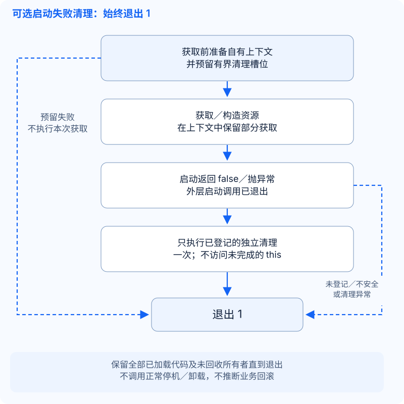

# 可选启动失败清理

**仅设计，本次不实现清理 runtime。** 源码基准：[d9618a66](https://github.com/OpenArkStudio/ark/tree/d9618a663fc2069b734007812590c88736d17ed5)。[已选生命周期路线](lifecycle-closeout_CN.md)仍以启动失败立即退出 `1` 为默认；只有显式登记的自有资源先执行失败清理。不做同进程重启，不把正常 `stop()`／`pre_shut()`／`shut()` 当成回滚，不推断外部业务／事务回滚，不涉及 Registry 或热更新。

## 启动失败时已经存在什么

[加载器](https://github.com/OpenArkStudio/ark/blob/d9618a663fc2069b734007812590c88736d17ed5/src/core/plugin_manager.hpp#L635)在调用入口前保留已加载 DSO；[插件登记](https://github.com/OpenArkStudio/ark/blob/d9618a663fc2069b734007812590c88736d17ed5/src/core/plugin_manager.hpp#L372)在 `install()` **之前**释放局部插件候选所有权，安装返回后才写入成功插件表。因此，成功插件表不能作为完整的失败清理清单。

| 失败点 | 实际所有权／已有资源 |
| --- | --- |
| 插件构造抛异常 | DSO 已加载，没有完整插件指针返回；C++ 只析构已完成的基类／成员，不调用未完成对象的析构函数。已逃逸的回调／线程仍需独立所有权证明。 |
| 模块工厂或登记抛异常 | [私有工厂](https://github.com/OpenArkStudio/ark/blob/d9618a663fc2069b734007812590c88736d17ed5/src/plugins/utility/timer_module_impl.cpp)返回 `unique_ptr<interface>`，[类型化登记](https://github.com/OpenArkStudio/ark/blob/d9618a663fc2069b734007812590c88736d17ed5/src/core/plugin_base.hpp#L54)在记账成功前持有它。拒绝时销毁完整的未发布候选；构造失败时展开已完成子对象。此前已登记模块继续存活；有析构函数不等于非阻塞回收。 |
| 部分安装后抛异常，或安装成功后的插件表插入分配失败 | 已释放的插件及其模块／update 条目可能存在，但成功插件表尚无记录；不会自动卸载或回滚。 |
| 依赖验证失败 | 构造／安装资源已存在；尚未执行模块 `init()`。 |
| `init()` 返回 false／抛异常 | 全部插件已安装；此前模块的初始化资源及当前钩子的部分资源可能存在。构造时启动的 IO 已可能运行。 |
| `post_init()` 返回 false／抛异常 | 全部 init 已通过；此前 post-init 的回调、定时器、已排队工作及当前获取的资源可能存在。 |
| `check_config()` 返回 false／抛异常 | init／post-init 已通过。函数名称不保证只读；此前资源和本次部分获取继续存在。 |
| `pre_update()` 返回 false／抛异常 | 前三个阶段已通过，仍可能留下部分准备。启动器的普通更新循环和 Windows 命令线程尚未开始。 |

四阶段[驱动](https://github.com/OpenArkStudio/ark/blob/d9618a663fc2069b734007812590c88736d17ed5/src/core/plugin_manager.hpp#L117)在首个 false／异常处停止。[启动器](https://github.com/OpenArkStudio/ark/blob/d9618a663fc2069b734007812590c88736d17ed5/src/application/main.cpp#L309)刷新诊断后调用 `_Exit(1)`，Windows 还调用 `TerminateProcess`，绕过正常对象／静态析构。这是进程失败保留策略，不证明回调停止或原生线程已回收。

| 真实获取点 | 源码含义 |
| --- | --- |
| [Utility Timer init](https://github.com/OpenArkStudio/ark/blob/d9618a663fc2069b734007812590c88736d17ed5/src/plugins/utility/timer_module_impl.cpp#L48)创建并初始化时间轮；Timers 的 [post_init](https://github.com/OpenArkStudio/ark/blob/d9618a663fc2069b734007812590c88736d17ed5/examples/timers/timers_module.cpp)登记回调 | [时间轮初始化](https://github.com/OpenArkStudio/ark/blob/d9618a663fc2069b734007812590c88736d17ed5/src/core/time/timer.hpp#L79)先用局部所有者构建，再提交。清空时间轮释放自有存储，不等于模块停机契约。 |
| [HTTP 客户端构造](https://github.com/OpenArkStudio/ark/blob/d9618a663fc2069b734007812590c88736d17ed5/src/plugins/net/http_client_module_impl.cpp#L244)启动 IO 池 | install 期间、任何 init 之前就可能有工作线程；其析构／正常停机调用同步 runtime stop。 |
| Net [post_init](https://github.com/OpenArkStudio/ark/blob/d9618a663fc2069b734007812590c88736d17ed5/src/plugins/net/net_service_manager_module_impl.cpp#L111)排队配置客户端并登记健康定时器；[update](https://github.com/OpenArkStudio/ark/blob/d9618a663fc2069b734007812590c88736d17ed5/src/plugins/net/net_client_service_impl.cpp#L248)才启动排队客户端 | 排队不等于连接完成。[create_server](https://github.com/OpenArkStudio/ark/blob/d9618a663fc2069b734007812590c88736d17ed5/src/plugins/net/net_service_manager_module_impl.cpp#L282)可在调用它的启动钩子中获取监听器，须记录真实调用点，不能假定统一阶段。 |
| HTTP [端点预约](https://github.com/OpenArkStudio/ark/blob/d9618a663fc2069b734007812590c88736d17ed5/src/plugins/http/http_server_module_impl.cpp#L111)先于原生构造／启动 | 后续异常会使预约缺少所有者；返回 false 分支也在释放前复制字符串。独立异常安全候选见下文。 |
| MySQL [构造／init／configure](https://github.com/OpenArkStudio/ark/blob/d9618a663fc2069b734007812590c88736d17ed5/src/plugins/mysql/mysql_module.cpp#L218) | 构造持有状态，init 绑定所属 runtime；`configure()` 在写入具名连接表**之前**构造原生池，后续插入抛异常时线程可能已启动。固定版 arknet `a0dfe09c` 在池构造中启动 IO。 |

## 最小可实施切片

首个受控模块独立持有**私有 `time_wheel_manager`**，不登记业务回调、不启动线程、不向外发布资源，也不借用 provider。这样可以验证真实 Timer 分配／部分初始化，但不声称已经能清理共享 Utility Timer 及其消费者。

拟议的唯一所属线程登记操作为 `prepare_cleanup(owner_key, owning_context, release_function)`，名称只是设计占位，尚无此 API。管理器保留有界、仅属于本次启动尝试的槽位，以及强持有的 `shared_ptr<void>` 上下文；释放函数为普通函数指针，返回 `done`、`unsafe` 或 `failed`，异常由宿主捕获。不增加模块虚钩子或协程 promise；工厂显式传入上下文：

```cpp
// 伪代码：在构造函数可能获取资源之前登记。
auto capsule = std::make_shared<owned_timer_context>();
prepare_cleanup(owner_key, capsule, release_timer_context);
return std::make_unique<isolated_timer_module>(capsule, now);
```

构造函数保存共享上下文，通过无异常移动把时间轮句柄写入其中，再初始化时间轮。构造抛异常时，清理不会访问未完成模块，宿主仍持有独立上下文。动作检查时间轮缺席／部分初始化状态，直接调用**自有资源的** `time_wheel_manager::shut()`，随后清空句柄并报告完成；不调用 `timer_module_impl::pre_shut()`，也不触发定时器回调。启动成功后，由完整模块继续持有资源，解除本次尝试的清理登记，不清理正常运行资源。



区分两类记录：

| 记录 | 最小字段／更新规则 |
| --- | --- |
| 对象／阶段 | 预先确定的 owner／DSO 键；构造、安装及四个钩子分别记录未进入、已进入、通过、返回 false 或异常。**调用用户代码前**记录进入，返回后记录结果；失败清理中不再调用虚命名方法。 |
| 资源动作 | 获取前预留槽位，独立自有上下文、代码所有者、释放进入标记和释放结果。由上下文持有部分获取；缺少「已获取」标记不能证明资源不存在。 |

外层启动调用已经返回／展开后，先关闭继续登记／新根接收并保护生命周期／registry 重入，再在所属线程对符合条件的独立动作执行一次；即使全部成功，也退出 `1`。首个切片只需一个槽位；后续独立槽位可逆登记顺序访问，**不构成**通用反向依赖保证。遇到不安全结果／异常即停止，继续保留其余所有者并走相同失败退出。不运行普通更新循环、管理器 stop、卸载入口或 DSO close。**全部已加载代码和未回收所有者保留到退出**，包括动作函数、上下文／控制块析构代码及回调接收者；部分安装但未进入成功插件表的对象同样适用。

槽位、标签和上下文须在获取资源前完成有界分配；容量耗尽或分配失败在本次获取前终止登记。原有上下文／DSO 继续保留，启动器走默认失败退出。获取后不得再依赖临时 `std::function` 捕获、vector 扩容或标签复制。未登记的获取保留原有 RAII／立即退出行为；登记表不会修复任意构造展开，也不改变原有 RAII 析构调用。

**已有分配失败路径缺口，仅据源码推导：** `exit_startup_failure()` 在到达退出调用前构造／拼接 `std::string`。main 的异常处理分支调用它时，持续分配失败可能再次抛异常，从而在 `_Exit` 前逃出处理分支。专项子进程复现应在启动异常前启用持续全局分配失败，检查退出／状态／诊断；**本次文档任务未执行该复现**。runtime 实施前须补充无分配、有界的紧急诊断／退出路径，不需要改变生命周期顺序；本提交不修改源码。

**独立 HTTP 候选，不等于框架失败清理：** 预约成功后，构造／绑定／启动或后续 `listen_key_ = endpoint` 复制抛异常，可使 `http_endpoints` 残留预约。可用 cpp 私有的局部预约所有者在 false／异常时只释放自己持有的键，原生启动成功后用无异常字符串 swap 转交。无需公开注入 API，也不改变生命周期。独立分配故障测试可在单独翻译单元编译生产 cpp，在内部集合已包含该键后的首个分配点、工作线程创建前注入失败，随后要求同端点可复用；保留既有重复所有者／重启检查，并证明最终提交不分配字符串。这里只给据源码推导的复现计划，未执行。

## IO 不进入首个切片

Net／HTTP／MySQL 接入前，先证明构造／成员展开不会丢失活跃所有者，也不会在失败清理入口前阻塞。线程创建前就须有独立上下文，回调持有完整状态，不能依赖未完成模块的 `this`。回调代码、接收者、bridge／runtime 和原生所有者须存活到可证明的回收屏障完成。普通模块 update 可能运行部分启动的业务代码，不能作为清理 pump。

固定版 arknet 的 `io_pool::stop()` 可能等待／join；MySQL 的[回收](https://github.com/OpenArkStudio/ark/blob/d9618a663fc2069b734007812590c88736d17ed5/src/plugins/mysql/detail/mysql_service.hpp#L432)使用 `close_and_wait()`，服务 `stop()` 仅请求关闭／抑制回调。见[固定版原生池](https://github.com/OpenArkStudio/arknet/blob/a0dfe09cd543e75cfb5996e537ce2fa49f2a758f/include/arknet/mysql/pool.hpp#L972)。这些不是非阻塞启动失败清理契约。登记前必须有现成或单独评审的「请求／已回收」观察、有界宿主驱动及回调策略；不能用分离线程隐藏阻塞关闭，也不在这里增加 promise 或补偿事务。关闭本地池不证明 SQL／业务回滚，也不改写未知原生结果。

## runtime 交付前验收

扩展永久 C++ 工厂／启动器测试：时间轮获取前／后构造抛异常、部分登记后 install 抛异常、四阶段 false／异常、清理完成／不安全／抛异常／重复进入，以及上下文／槽位／阶段记录／紧急诊断处的分配失败。要求符合条件的释放在退出 `1` 前恰好执行一次，主启动失败保留，没有后续启动、正常停机、卸载或 DSO close，也不通过未完成 `this` 释放资源。已有[工厂拒绝测试](https://github.com/OpenArkStudio/ark/blob/d9618a663fc2069b734007812590c88736d17ed5/tests/core/plugin_construction.cpp#L263)与[真实监听器失败测试](https://github.com/OpenArkStudio/ark/blob/d9618a663fc2069b734007812590c88736d17ed5/tests/app/startup_failures.cmake)只验证较早的有限契约，不证明本提案的清理。此处不声称 runtime 或托管验收通过。

两项 IO 决策确实需要应用信息，不阻塞私有时间轮切片：

1. 哪个 IO 所有者首先接入；它已接收的启动操作中，哪些必须完成、哪些允许取消？源码不能替业务选择完成策略。
2. 该部署允许启动失败清理等待多少绝对时间？超时仍保留所有者并退出 `1`；具体数值须来自运维要求，且不能抢占阻塞 API。
