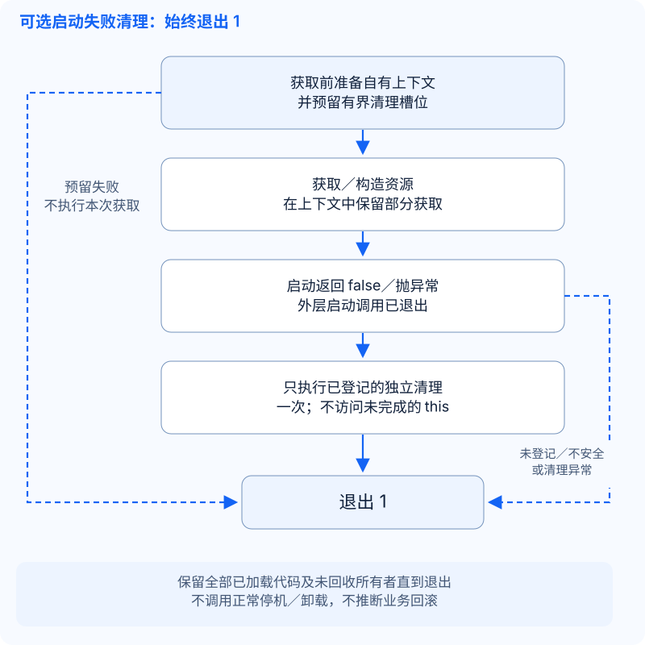

# 可选启动失败清理

启动失败默认立即退出 `1`；只有通过 `plugin_manager::prepare_startup_cleanup()` 预登记的独立自有资源，可先执行一次失败清理。预分配登记表支持跨模块最多 16 个独立自有资源。下述接入分别说明可退役的无回调／空闲资源，以及必须保留的完整所有者。不做同进程重试，不调用正常停服充当回滚，不推断外部业务／事务回滚；Registry 和热更新继续暂停。

## 启动失败时已经存在什么

[加载器](https://github.com/OpenArkStudio/ark/blob/d9618a663fc2069b734007812590c88736d17ed5/src/core/plugin_manager.hpp#L635)在调用入口前保留已加载 DSO；[插件登记](https://github.com/OpenArkStudio/ark/blob/d9618a663fc2069b734007812590c88736d17ed5/src/core/plugin_manager.hpp#L372)在 `install()` **之前**释放局部插件候选所有权，安装返回后才写入成功插件表。因此，成功插件表不能作为完整的失败清理清单。

| 失败点 | 实际所有权／已有资源 |
| --- | --- |
| 插件构造抛异常 | DSO 已加载，没有完整插件指针返回；C++ 只析构已完成的基类／成员，不调用未完成对象的析构函数。已逃逸的回调／线程仍需独立所有权证明。 |
| 模块工厂或登记抛异常 | [私有工厂](https://github.com/OpenArkStudio/ark/blob/d9618a663fc2069b734007812590c88736d17ed5/src/plugins/utility/timer_module_impl.cpp)返回 `unique_ptr<interface>`，[类型化登记](https://github.com/OpenArkStudio/ark/blob/d9618a663fc2069b734007812590c88736d17ed5/src/core/plugin_base.hpp#L54)在记账成功前持有它。拒绝时销毁完整的未发布候选；构造失败时展开已完成子对象。此前已登记模块继续存活；有析构函数不等于非阻塞回收。 |
| 部分安装后抛异常，或安装成功后的插件表插入分配失败 | 已释放的插件及其模块／update 条目可能存在，但成功插件表尚无记录；不会自动卸载或回滚。 |
| 依赖验证失败 | 构造／安装资源已存在；尚未执行模块 `init()`。 |
| `init()` 返回 false／抛异常 | 全部插件已安装；此前模块的初始化资源及当前钩子的部分资源可能存在。构造时启动的 IO 已可能运行。 |
| `post_init()` 返回 false／抛异常 | 全部 init 已通过；此前 post-init 的回调、定时器、已排队工作及当前获取的资源可能存在。 |
| `check_config()` 返回 false／抛异常 | init／post-init 已通过。函数名称不保证只读；此前资源和本次部分获取继续存在。 |
| `pre_update()` 返回 false／抛异常 | 前三个阶段已通过，仍可能留下部分准备。启动器的普通更新循环和 Windows 命令线程尚未开始。 |

四阶段[驱动](https://github.com/OpenArkStudio/ark/blob/d9618a663fc2069b734007812590c88736d17ed5/src/core/plugin_manager.hpp#L117)在首个 false／异常处停止。[启动器](https://github.com/OpenArkStudio/ark/blob/d9618a663fc2069b734007812590c88736d17ed5/src/application/main.cpp#L309)刷新诊断后调用 `_Exit(1)`，Windows 还调用 `TerminateProcess`，绕过正常对象／静态析构。这是进程失败保留策略，不证明回调停止或原生线程已回收。

| 真实获取点 | 源码含义 |
| --- | --- |
| [Utility Timer init](https://github.com/OpenArkStudio/ark/blob/d9618a663fc2069b734007812590c88736d17ed5/src/plugins/utility/timer_module_impl.cpp#L48)创建并初始化时间轮；Timers 的 [post_init](https://github.com/OpenArkStudio/ark/blob/d9618a663fc2069b734007812590c88736d17ed5/examples/timers/timers_module.cpp)登记回调 | [时间轮初始化](https://github.com/OpenArkStudio/ark/blob/d9618a663fc2069b734007812590c88736d17ed5/src/core/time/timer.hpp#L79)先用局部所有者构建，再提交。清空时间轮释放自有存储，不等于模块停机契约。 |
| [HTTP 客户端构造](https://github.com/OpenArkStudio/ark/blob/d9618a663fc2069b734007812590c88736d17ed5/src/plugins/net/http_client_module_impl.cpp#L244)启动 IO 池 | install 期间、任何 init 之前就可能有工作线程；其析构／正常停机调用同步 runtime stop。 |
| Net [post_init](https://github.com/OpenArkStudio/ark/blob/d9618a663fc2069b734007812590c88736d17ed5/src/plugins/net/net_service_manager_module_impl.cpp#L111)排队配置客户端并登记健康定时器；[update](https://github.com/OpenArkStudio/ark/blob/d9618a663fc2069b734007812590c88736d17ed5/src/plugins/net/net_client_service_impl.cpp#L248)才启动排队客户端 | 排队不等于连接完成。[create_server](https://github.com/OpenArkStudio/ark/blob/d9618a663fc2069b734007812590c88736d17ed5/src/plugins/net/net_service_manager_module_impl.cpp#L282)可在调用它的启动钩子中获取监听器，须记录真实调用点，不能假定统一阶段。 |
| HTTP [端点预约](https://github.com/OpenArkStudio/ark/blob/main/src/plugins/http/http_server_module_impl.cpp)先于原生构造／启动 | 完整、独立的 HTTP 所有者在获取原生资源前登记。每次原生尝试和预约跨绑定／启动异常及候选模块析构保持所有权；受保护的 HTTP 所有权边界见下文。 |
| [MySQL](https://github.com/OpenArkStudio/ark/blob/10e385b49dab960a075a0b317b6d2d4d8638959c/src/plugins/mysql/mysql_module.cpp#L254)／[Redis](https://github.com/OpenArkStudio/ark/blob/10e385b49dab960a075a0b317b6d2d4d8638959c/src/plugins/redis/redis_module.cpp#L148) 连接构造 | `configure()` 先预留具名连接表槽位，再创建连接。服务的被动记账、bridge 及 MySQL 事务状态均在原生池启动线程前准备；之后发布连接不再分配。未发布构造失败时移除空槽位。这项构造边界没有把数据库池登记为启动失败清理资源。 |

## 独立资源登记与执行

所属线程在资源获取前创建完整的 owning capsule，并调用：

```cpp
auto capsule = std::make_shared<owned_timer_context>();
if (!manager.prepare_startup_cleanup(
        "isolated-wheel", "my-plugin", capsule, release_timer_context)) {
    throw std::runtime_error("startup cleanup enrollment rejected");
}
return std::make_unique<isolated_timer_module>(capsule);
```

API 接收 owner 键、代码所有者键、强持有的 `shared_ptr<void>` 和普通函数指针 `startup_cleanup_result (*)(void*)`。两个键均为非空、无 NUL、最多 95 字节；具名常量 `startup_cleanup_capacity` 为 **16**，每个管理器预分配全部条目。资源 owner ID 在全部代码所有者之间必须唯一；多个资源可使用相同代码所有者键。无效键、重复 owner、容量已满、错误线程、重入执行器或已结束启动均返回 false，且不持有被拒绝的 capsule。登记本身 `noexcept` 且不分配。失败后不得获取本次资源。上下文分配失败发生在获取之前，走默认退出。

允许启动前 idle 或启动／安装阶段预登记，但只在一次 `start()` 已返回 false 或抛异常并展开后，才可执行失败清理。启动尝试结束后不能再次 start。同进程嵌入调用者必须在清理后退出 `1`；清理函数不会提供重试或恢复入口。启动前、尚未进入 start 的独立构造异常仍采用原有 RAII／默认退出。

构造函数保存 capsule，通过无异常移动把时间轮句柄交给它，再初始化。未完成模块的析构不参与清理；宿主在构造抛异常后仍持有 capsule。动作检查缺席／部分时间轮，调用**自有资源** `time_wheel_manager::shut()` 后清空句柄，返回 `done`。不调用模块 `pre_shut()`／`shut()`，不触发业务回调。永久测试的私有 wheel 不启动线程、不向外发布，也不借用 provider；它不授权销毁共享 Utility Timer 的消费者回调；下述 Timer 接入会保留这些回调。



| 记录 | 有界范围与含义 |
| --- | --- |
| `get_startup_call()` | 仅保留最近进入的受宿主管理调用：插件构造／install、加载／依赖检查、四个模块钩子。owner 95 字节、phase 23 字节固定缓冲，调用前记录进入，返回后记录通过／false，异常时记录 exception；不是全部对象的阶段历史。依赖检查不会据此推断资源。 |
| 自有资源登记表 | 获取前最多 16 个条目固定键、strong capsule、代码所有者及 action；整次尝试共用进入标记及缓存结果。由 capsule 表达真实部分获取；阶段和缺少 acquired 标记都不证明资源不存在。 |

启动器先保留主失败诊断，再在外层 start 已返回／展开后调用 `cleanup_failed_startup()`。管理器封闭新登记及 managed task root admission，不 cancel、不 poll；保护生命周期／registry 重入。动作按成功登记的逆序执行，与模块启动顺序无关，每个动作最多调用一次。首个 `unsafe`、`failed` 或异常立即停止遍历，保留该所有者及全部更早所有者；异常及动作返回的 `not_run` 转为 `failed`。重复调用只返回缓存结果，不继续遍历。登记、遍历和紧急诊断均不分配内存；资源动作须在原生操作失败时保留所有权。登记表遍历不分配内存，不代表原生关闭也不分配内存。不调用正常 stop、uninstall 或 DSO close。成功启动只解除尝试登记，完整模块必须继续持有资源。

清理后无论结果如何都退出 `1`。全部已加载代码、未回收所有者及 capsule／控制块析构代码保留到进程退出；即使动作返回 done，也不在失败路径销毁 capsule。普通未登记模块、部分安装但未进入成功插件表的对象和原有构造展开保持既有行为。动作必须独立、有限且不会阻塞；宿主不能抢占一个阻塞函数。

紧急诊断使用 1024 字节栈缓冲和原生 stderr 写入，保留 phase／owner 优先于异常详情，超长文本截断；不构造字符串、格式化日志或调用虚命名方法。若分配故障打断普通阶段诊断构建，使用固定调用记录。Windows 继续 `TerminateProcess`，其余平台继续 `_Exit(1)`，绕过正常析构。原生写失败也继续退出。

**兼容性：** 不增加 module 虚方法，不改变正常停服顺序；扩大的内联登记表改变 `plugin_manager` 公开类布局，宿主和全部插件／消费方须使用同一头文件重新构建。不得混用旧二进制。

## 受保护的 HTTP 监听器所有权

官方 HTTP 插件在获取原生资源前登记 `HTTPServer` capsule，持有每次尝试的完整端点所有者、端点预约及独立路由／回调状态。原生接收回调捕获路由状态，不捕获模块 `this`；构造／安装／启动失败期间，候选模块析构不调用正常停服。宿主启动成功后解除登记，模块继续持有资源状态，恢复普通析构／停服行为。公开模块接口和虚函数表不变。

只要存在任何原生端点对象，即使端点报告 stopped，或可变 router 已暴露、可能保留业务 handler，动作就返回 `unsafe`。动作不停止原生 IO、不封闭活跃路由、不清除捕获、不取消已受理工作，也不派发回调。端点 stopped 不证明线程池已退役，也不证明析构不需要分配。只有不存在原生对象、暴露的 router 或活跃 lease 的 capsule 才被封闭并返回 `done`；所有 capsule 和必要代码仍保留到强制 exit1。结果不可重试，不安全的 HTTP 所有者会阻止清理更早所有者。

每次尝试在原生构造／绑定／启动前接入完整所有者。端点对象尚未形成时，构造失败只释放本次预约。原生 start 返回 false 时保留原有普通同步 stop，stop 完成后释放预约，允许本次启动中回退到同一或其他端点；start 或该普通 stop 抛异常时，所有权跨展开保留。受管启动尝试期间，失败的原生对象跨回退保留，既不析构也不被覆盖，由正常 `pre_shut()` 退役全部尝试。独立使用或宿主已启动成功时，保留普通失败端点析构，之后的失败／重试不会累积原生历史。这保留调用方回退行为，不把原生 stop 加入失败清理动作。重复预约被拒绝时不会释放其他所有者的键；端口 `0` 继续跳过固定端点预约。成功预约的键在绑定／启动可能抛异常前以无异常字符串 swap 转交。

`check-http-startup-failure` 保留构造前分配失败、原生监听 false、重复所有者、字符串转交和本地端点复用检查。`check-http-server-startup-ownership` 增加四个后续启动阶段的 false／异常、空所有者封闭、登记表满拒绝、成功解除登记、受管同端点回退和业务捕获保留。候选模块析构后的显式测试请求验证独立回调状态；清理本身不发请求。真实 DSO 在销毁候选模块后从 install 抛异常，须保留原生工作线程、回调捕获和代码，不执行普通卸载或析构。

独立子进程仅在全部原生工作 lane 报告已初始化线程 ID 后，才持续拒绝所属线程的 C++ 分配。原实现会在到达失败清理入口前因原生析构终止；修复后必须到达入口、保留工作线程和更早所有者、返回缓存的 `unsafe`，并以 `1` 退出。普通测试进程限 20 秒；两个保留所有者的子进程各须在 10 秒内完成断言／标记并 exit1。这些检查证明所有权与异常展开，不证明原生退役或清理硬期限。

## Utility Timer

Timer 在申请时间轮对象及存储前登记独立胶囊。清理通过 `has_retained_callbacks()` 检查全部自有记录，包括已执行的计时器和登记活动 ID 前中断的添加操作。

| 时间轮状态 | 启动失败清理 |
| --- | --- |
| 没有保留回调 | 释放时间轮，返回 `done` |
| 保留任意业务回调 | 返回 `unsafe`；时间轮、回调及所需代码保留至退出 |

显式移除计时器后，仍须确认没有其他保留回调。启动成功后解除清理登记，Timer 继续持有时间轮。不调用常规钩子、不推进业务工作、不关闭共享 IO，也不回滚消费者状态。

`check-timer` 与 `check-startup-cleanup` 覆盖真实 Timer 初始化及后续阶段失败、持续分配失败，以及与其他清理所有者的组合。保留回调会阻止更早所有者的清理；重复调用不会重试。

## Utility Schedule

Schedule 在创建 16 个回调工作线程和内部派发线程之前登记独立所有者，占用一个登记槽位。

| 状态 | 失败清理 |
| --- | --- |
| 从未开始回调登记 | 关闭登记入口，结束内部派发，确认完成后等待工作线程退出 |
| 曾开始登记，即使登记失败或队列已空 | 返回 `unsafe`，保留调度器、捕获对象与更早的所有者；不派发或取消业务回调 |
| 内部派发失败 | 原生线程退出后返回 `failed`，保留所有者及异常对象 |

成功启动后保留正常 Schedule 行为；没有管理器的直接初始化仍由调用方负责。
清理可同步等待内部派发与原生线程退出，不提供可抢占期限。
线程构造异常会等待已创建的线程退出；任务入队成功前保留回调所有权。
`check-scheduler-startup-cleanup` 与 `check-scheduler-construction` 均纳入 `check-core`；
测试进程超时仍是失败，不代表可以销毁未结束的生产工作。

## 空闲 Net HTTP 客户端清理

Net 在 HTTP 客户端构造函数启动自有 IO 池前登记一个 `NetHttpClient` capsule。capsule 持有原有的完整请求状态，不借用模块，也不调用正常停服钩子。登记被拒时，构造在获取工作线程前失败。启动尝试期间，候选模块析构把状态留给 capsule，避免登记／安装展开在失败清理入口前启动原生关闭。启动成功后解除 capsule 登记，恢复普通模块析构行为。

清理动作在状态互斥量内检查请求、排队结果和活跃回调帧。只要仍有工作，就返回 `unsafe`，不取消、派发、清空捕获或停止线程池；否则关闭新请求启动，并在互斥量外等待空闲工作线程退出。随后再次检查回调状态；如果并发拒绝交付排入了回调，就保留更早的所有者。只有原生 join 完成才返回 `done`；原生关闭抛异常时，登记表缓存 `failed`，保留 capsule 和更早所有者。该动作可能进行原生分配和同步线程 join，不提供可抢占的清理期限或通用非阻塞 IO 关闭 API。

| 失败清理时的状态 | 结果 |
| --- | --- |
| 没有请求、排队回调或活跃回调帧 | 关闭资源启动并等待空闲运行时退出；完成后返回 `done` |
| 有已受理请求、排队结果或活跃回调帧 | 返回 `unsafe`，保留状态、接收者、线程池和更早所有者 |
| 原生关闭抛异常 | 返回 `failed`，保留所有者并停止遍历 |
| 启动成功 | 解除尝试所有权，保留普通请求／析构行为 |

动作仍按登记逆序执行；较新的不安全所有者可能阻止本 capsule 被访问。HTTP 客户端空闲不代表整次启动尝试都可清理。调用方仍须以 `1` 立即退出，不得在同一进程重试。

## Net TCP 与 RUDP 监听器所有权

`create_server()` 在 TCP／RUDP 原生启动前完成服务回调登记和稳定的 bus 槽位。已安装的 Net 模块在获取工作线程前就持有完整服务、接收者与传输对象图；原生启动成功本身不代表已经发布。

| 结果 | 所有权与可见性 |
| --- | --- |
| 启动成功 | 发布条目，供普通 getter／update 使用；已有 bus 槽位拒绝再次启动，不替换原所有者 |
| 普通 false 返回 | 执行原有同步服务 shutdown，完成后才移除槽位；清理完成后允许再次调用 |
| 原生启动或 false 返回清理抛异常 | 保留完整未发布条目；getter／update 跳过它，再次调用不能覆盖已占用槽位 |

这是已安装模块中的所有权保留，不是新增启动清理动作。受管启动失败后，不驱动业务 update 或正常停机来退役该对象图；模块、借用的提供方和代码保留到强制 exit1。回调生命周期 token 不证明原生退役。正常进程停机仍先关闭自有服务再清空条目；没有增加同进程启动重试或通用监听器回滚。`check-net-listener-startup` 已接入启用 Protobuf 的 `check-core` 路径。

## 其他 IO 边界

| 资源 | 已有边界 | 不属于自动启动失败退役的范围 |
| --- | --- | --- |
| 路由 HTTP 监听器 | [完整所有者](#受保护的-http-监听器所有权)在绑定／启动可能失败前持有每次原生尝试、预约和独立回调状态 | 任一原生端点对象、已暴露 router 或活跃 lease 均返回 `unsafe`；动作不停止 IO、不销毁业务捕获 |
| MySQL／Redis 连接 | 具名槽位、服务被动记账、bridge 和事务状态先于原生池获取 | 没有数据库启动清理 capsule；普通 `stop()`／`close_and_wait()` 不等于登记表失败动作或 SQL 回滚 |
| Net 监听器／其他客户端 | [TCP／RUDP 监听器](#net-tcp-与-rudp-监听器所有权)把未完成启动留在已安装所有者中；[空闲 HTTP 客户端](#空闲-net-http-客户端清理)是单独登记的资源 | 没有登记失败动作来退役 TCP／RUDP 监听器或其他客户端对象图；原生退役与借用的回调／提供方生命周期仍须专门策略 |

新增 IO 登记须让回调代码、接收者、bridge／runtime 与完整原生所有者存活到可证明的回收屏障。普通模块 update 可能执行部分启动的业务代码，不能作为清理 pump。无回调 Schedule 路径与空闲 HTTP 客户端可同步等待原生线程退出，均不提供可抢占期限。固定版 arknet 的[池关闭](https://github.com/OpenArkStudio/arknet/blob/a0dfe09cd543e75cfb5996e537ce2fa49f2a758f/include/arknet/mysql/pool.hpp#L972)也可能等待。因此，仍被保留的工作需要明确的完成／取消策略及退役观察，不能用分离线程关闭或推断外部回滚代替。

## 有限验收

`cmake --build <build> --target check-startup-cleanup --parallel 1` 运行常驻 C++ 测试：四阶段 false／异常、16 个 owner 容量、无效／重复／错误线程／迟到登记拒绝且不持有被拒 capsule、逆序执行、成功解除登记、提前停止、缓存结果与重入；真实 launcher 加载独立 DSO，覆盖获取前／部分／完成后的构造异常、部分安装异常及四阶段失败，检查每个已访问 owner 释放一次、exit1、没有后续 update／正常停服／uninstall／DSO 或 capsule 析构。三模块场景验证逆序清理，并在 unsafe／failed／异常时保留更早所有者。隔离分配故障子进程保持 global new 持续失败直到真实紧急退出，验证 capsule 分配失败、无分配登记／记录及满容量遍历、阶段诊断失败及部分 wheel 初始化失败。原有未登记真实监听器场景由 `check-app-startup-failures` 保留。

启动分配故障注入前先准备好调用参数。另设调用前失败用例，验证尚未进入 `start()` 时保留已登记资源，不执行清理。异常终止对照用例必须输出上下文并以失败状态退出，不等待 Windows 崩溃对话框。

`check-http-client-startup-cleanup` 使用生产 HTTP 实现和有界测试控制器，覆盖四个后续启动阶段的 false／异常、构造时登记拒绝、成功解除登记、挂起请求、排队捕获和活跃回调帧。独立真实 DSO 在创建客户端后从 `install()` 抛出异常；失败子进程须等待空闲池退出、保留代码／所有者并以 `1` 退出。另一子进程在所属线程的 C++ `new` 持续失败时析构候选模块，随后关闭独立保留的空闲运行时，再以 `1` 退出；它不向全部原生 C 分配器或线程创建路径注入故障。原有受控负例观察到失败清理后空闲运行时仍在运行；回归用例要求原生停止状态和已退役的工作线程 ID。

受控子进程使用启动器的立即失败退出策略：Windows 调用 `TerminateProcess`，其他平台调用 `_Exit`。刻意保留所有者时不得执行 Windows DLL 进程分离回调；DSO fixture 会报告禁止发生的静态析构或卸载。控制器要求资源断言、成功标记和退出码 `1` 全部在原有 10 秒子进程期限内满足；输出标记后挂起仍然失败。这只验证测试子进程的退出契约，不构成通用 DLL 清理策略。

这些是有限正确性检查，不证明通用 IO 回收、业务回滚、硬清理期限或托管平台通过。HTTP 监听器验证覆盖预约异常安全、启动所有权保留和普通本地监听器复用；活跃原生监听器仍为 unsafe。原始日志留在本地 receipt。

其他 IO 所有者仍需明确两项决策：

1. 已受理的启动操作中，哪些必须完成、哪些允许取消？空闲客户端切片对保留工作不执行这两种策略；源码不能替业务选择完成策略。
2. 该部署允许启动失败清理等待多少绝对时间？超时仍保留所有者并退出 `1`；具体数值须来自运维要求，且不能抢占阻塞 API。
