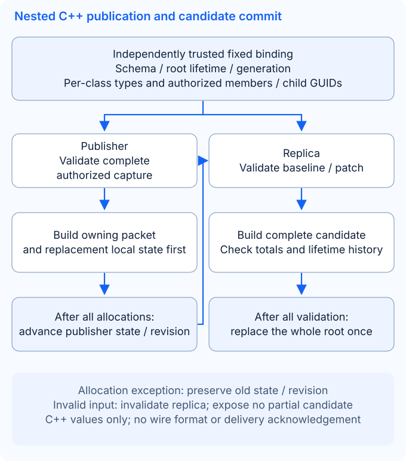

# Kernel plugin

Kernel manages runtime entities, entity schemas, static configuration and map instances. Application modules use `kernel_module` to create, find and destroy entities, then use `entity` to access fields, tables and containers.

## Modules and data model

| Object / module | Responsibility | Main interfaces |
| --- | --- | --- |
| `class_meta_module` | Load entity and configuration schemas; manage class event callbacks | `find_meta()`, `find_static_meta()`, `add_class_call_back()` |
| `config_module` | Find loaded static data by configuration ID | `find_static_entity()` |
| `map_module` | Create maps and instances; track entities in each instance | `create_map()`, `create_map_instance()`, `get_inst_entity_list()` |
| `kernel_module` | Manage entities and events; convert entity data | `create_entity()`, `get_entity()`, `destroy_entity()`, `entity_to_db_data()` |
| `entity` | Runtime fields, tables, containers and spatial position | `get_int32()`, `set_int32()`, `find_table()`, `find_container()` |
| `static_entity` | A configuration record loaded from resource files | `get_config_id()`, `get_int32()`, `get_string()` |

Schemas and configuration values are separate data: a schema defines field names, types, indices and attributes; static configuration supplies values for a configuration ID; runtime entities have their own IDs and mutable data.

### Resource loading

When no JSON schema is selected, the metadata module loads `resource/meta/config_class.config` and `resource/meta/entity_class.config` during `init()`. These files reference individual schema files; configuration schemas may also specify data resources. During `post_init()`, `config_module` loads static records using this metadata.

XML configuration loading releases its temporary ID node on normal return or C++ exception unwinding. Debug assertions and process exit do not guarantee stack unwinding. A rejected later row does not roll back records already added to the configuration manager; normal `shut()` still releases the manager. Shared configuration records held by callers remain valid until their last owner releases them. Failures after plugin installation retain the existing application exit policy.

Query configuration after the framework has completed the relevant initialization. Creating a runtime entity requires its class schema, map and map instance to exist. Register class event callbacks before creating entities of that class. See [Create a module](../guides/modules.md) for module integration.

## JSON Entity schema and business data

Kernel selects `resource/meta/entity_schema.json` when that file exists. It validates the complete versioned document during metadata `init()` and retains static rows as an owning startup snapshot. Configuration `post_init()` consumes that same snapshot; replacing the file between phases does not mix schemas and rows. Invalid selected JSON reports its source path and JSON pointer and fails startup, with no XML fallback. When the JSON file is absent, the existing XML resource paths and readers remain available.

The file defines classes, scalar fields, tables, containers and configuration profiles. Indices are explicit and stable: array order does not assign indices, and JSON loading does not depend on generated `meta_name_index`. Inheritance must be flattened by the authoring/export step. The following example keeps application fields above the legacy BaseEntity indices `1..4`:

```json
{
  "format": "ark.entity-schema",
  "version": 1,
  "classes": [
    {
      "name": "GuestPlayer",
      "description": "Guest attributes",
      "fields": [
        {"name": "id", "index": 99, "type": "uint32"},
        {"name": "name", "index": 100, "type": "string", "mask": ["sync_view", "sync_self"]},
        {"name": "x", "index": 101, "type": "double"},
        {"name": "y", "index": 102, "type": "double"},
        {"name": "move_seq", "index": 103, "type": "uint32"},
        {"name": "hp", "index": 104, "type": "uint32", "mask": ["save", "real_time"]},
        {"name": "mp", "index": 105, "type": "uint32"},
        {"name": "hp_max", "index": 106, "type": "uint32"},
        {"name": "mp_max", "index": 107, "type": "uint32"},
        {"name": "action_seq", "index": 108, "type": "uint32"}
      ],
      "tables": [{"name": "inventory", "index": 200, "class": "Item", "mask": ["save"]}],
      "containers": [{"name": "bag", "index": 201, "class": "Item", "mask": ["save"]}]
    },
    {
      "name": "Item",
      "fields": [{"name": "count", "index": 1, "type": "uint32"}],
      "tables": [],
      "containers": []
    }
  ],
  "configs": [{"class": "GuestPlayer", "rows": [
    {"id": 1, "name": "Guest", "x": 80.0, "y": 100.0, "move_seq": 0,
     "hp": 100, "mp": 100, "hp_max": 100, "mp_max": 100, "action_seq": 0}
  ]}]
}
```

A class requires `name`, `fields`, `tables` and `containers`; the arrays may be empty. Scalar fields require `name`, `index` and `type`; relations require `name`, `index` and referenced `class`. Optional `description` strings on classes, fields and relations round-trip through export and have no runtime effect. Optional `mask` defaults to an empty array. Supported mask names, in bit order, are `sync_view`, `sync_self`, `real_time`, `save`, `sync_team`, `sync_guild`, `sync_map` and `log`.

| Scalar type | JSON value and validation |
| --- | --- |
| `bool` | A JSON boolean |
| `int32`, `uint32`, `int64`, `uint64` | A JSON integer within the declared signed/unsigned range; no string or floating-point coercion |
| `float`, `double` | A finite JSON number within the declared range; `float` normalizes to its native precision |
| `string` | A UTF-8 JSON string without NUL bytes |
| `guid` | A canonical signed 64-bit decimal string; runtime loading also enforces the configured GUID width |

Version 1 rejects enum-only or unsupported field primitives such as `vector3d`, `wstring`, `array`, pointers and userdata. Table columns reference a scalar-only class. Containers reference an existing class; their existing entity ownership and explicit destruction APIs remain in use. The common container-destruction callback is registered for every declared class and container, including classes other than `Player`; this does not add automatic cascade destruction of arbitrary entity graphs.

Class names and member names/indices must be unique; member indices are `1..4294967295`. Unknown keys, duplicate JSON object keys, duplicate masks, invalid references, wrong scalar types and out-of-range values fail validation. Each configuration class reuses its class's scalar schema and must declare `id` as `uint32`. Every row supplies every scalar field; IDs are positive and globally unique across configuration classes. Version 1 provides no implicit per-field `default` property or nested table/container row defaults.

Create a configured entity using profile `1`, then access ordinary typed fields and table columns:

```cpp
const auto player = kernel.create_entity(ark::null_guid, map_id, 0, "GuestPlayer", 1, args);
if (player)
{
    const auto hp = player->get_u_int32("hp");
    player->set_u_int32("hp", hp > 0 ? hp - 1 : 0);
    if (auto* inventory = player->find_table("inventory"))
    {
        if (auto* row = inventory->add_row(0))
        {
            row->set_u_int32("count", 3);
        }
    }
}
```

Schema/lazy-zero construction, selected static profile and per-field arguments retain the precedence described below. A profile's class must match the entity class. Profile values are copied into independent nodes; arguments override only the supplied fields, including explicit zero. Without a profile, retain the existing lazy-node initialization rules before reading a field. The `id` field at index `99` is configuration data, separate from the runtime entity GUID and the `config_id` constructor parameter.

Offline tools and Kernel share `<ark/kernel/entity_json.hpp>` and compiled target `ark::kernel_json`. Its plain C++ model exposes `document`, `class_definition`, `field`, `relation`, `config_definition` and typed scalar `value`; `parse()`, `load()`, `validate()` and `serialize()` use one validator. The header exposes no nlohmann types and the target has no Net, Boost or Protobuf dependency. Installed consumers can request component `kernel_json` separately. See [Configuration tools](../guides/tools.md) for authoring/export workflows.

**Build and ABI change:** Kernel application builds now require `nlohmann_json`; the `application` vcpkg feature includes it. `class_meta` retains a plain C++ configuration snapshot, changing its layout. Rebuild Kernel and its C++ consumers together. Existing XML resources do not need to be converted merely to keep running.

`check-entity-json` validates typed models, scalar/range errors, exact duplicate-key pointers, masks, references and deterministic export. `check-kernel-initialization` covers XML/JSON loading, profile/argument precedence, independent fields, table columns, container ownership, coherent startup snapshots and selected-JSON failures. `check-kernel-plugin` loads real Kernel/Utility DSOs in separate XML and JSON process runs. These checks establish the exercised native behavior, not arbitrary live reload or production deployment acceptance.

## Create and find entities

The following function runs in a process with the Kernel plugin loaded. The application chooses `map_id`; `create_map()` creates its default instance with ID `0`. This example uses the existing `Player` schema, with no configuration record or application field writes.

```cpp
#include <memory>

#include "ark/kernel/data_list_impl.hpp"
#include "ark/kernel/kernel_module.hpp"
#include "ark/kernel/map_module.hpp"
#include "ark/meta_define.hpp"
#include "ark/plugin_manager.hpp"

std::shared_ptr<ark::entity> create_player(ark::plugin_manager& manager, int map_id) {
    auto* kernel = manager.find_module<ark::kernel_module>();
    auto* maps = manager.find_module<ark::map_module>();
    if (kernel == nullptr || maps == nullptr)
    {
        return nullptr;
    }

    if (!maps->exist_map(map_id) && !maps->create_map(map_id))
    {
        return nullptr;
    }

    ark::data_list_impl args;
    return kernel->create_entity(ark::null_guid, map_id, 0, ark::entity_meta_player::self_name(), 0, args);
}
```

`create_entity()` returns `nullptr` on failure, for example when the class schema, map or instance is missing, the entity ID already exists, or the argument count is invalid. Passing `null_guid` requests an ID from the Guid module. Initialization arguments are value/field-index pairs; this example passes an empty list. Use `get_entity(id)` to find an entity, `exist(id)` to test registration and `destroy_entity(id)` to request destruction.

Holding a `shared_ptr<entity>` does not mean the entity remains registered with Kernel. After destruction, do not treat an externally retained pointer as a live application entity; look it up by ID again when needed.

## Configuration defaults and initialization arguments

When `config_id > 0`, the configuration record must exist and match the entity class. Configuration supplies defaults for unspecified fields; valid `args` override the same field, including an explicit `0` or empty string. If a field appears more than once in valid arguments, the last value wins. Entity data is independent of the configuration record, so modifying an entity does not modify the source configuration.

Node creation releases an unpublished node if copying its value or inserting it fails, then propagates the exception. Deep copies remain independent; duplicate indices preserve the existing value.

Arguments are `(value, uint32_t field_index)` pairs: add the value first, then add its index with `add_u_int()`. Indices must belong to the loaded entity schema, and each value type must exactly match its field type. Do not rely on implicit conversions.

DataList rejects unrepresentable append sizes with `std::length_error` and allocation failures with `std::bad_alloc`. A failed single-value append or growing string replacement preserves existing values and the item count, although internal capacity may have grown.

DataList copy and tokenizing construction release partial storage on allocation failure and leave the source unchanged; self-assignment preserves the list. Other assignments may leave the target modified if allocation fails.

The following example uses `Player.level` declared as int32 and `Player.name` declared as string. It explicitly sets the level to `0` and the name to an empty string, while retaining configuration defaults for the other fields. The target map, instance and matching Player configuration record must already exist.

```cpp
#include <memory>

#include "ark/kernel/data_list_impl.hpp"
#include "ark/kernel/kernel_module.hpp"
#include "ark/meta_define.hpp"

std::shared_ptr<ark::entity> create_configured_player(
    ark::kernel_module& kernel, int map_id, int instance_id, ark::id_type config_id) {
    ark::data_list_impl args;
    args.add_int(0);
    args.add_u_int(ark::entity_meta_player::level_index());
    args.add_string("");
    args.add_u_int(ark::entity_meta_player::name_index());

    return kernel.create_entity(
        ark::null_guid, map_id, instance_id, ark::entity_meta_player::self_name(), config_id, args);
}
```

Defaults and argument values are ready before the first class event, `entity_evt_pre_load_data`. `create_container_entity()` has no `args` parameter and initializes from configuration. `create_entity(protobuf_data)` restores saved data without automatically merging configuration defaults.

## Access fields, tables and configuration

Field access belongs to `entity`, using a field name or metadata index. The accessor type must match the schema. Do not use a numeric field value to determine whether an entity or field exists.

`set_u_int64()` accepts declared `uint64` fields through either the name or index overload and preserves the full `UINT64_MAX` range. A changed value invokes the field callback with unsigned old/new values; setting the same value returns `false` without invoking that callback.

GUID field callbacks retain the `dt_guid` tag. Read their native signed value with `data::get_int64()` in the default GUID64 build, or `data::get_int()` with `ARK_USE_GUID_32`. `data_impl::from_guid()` constructs an explicit tagged value; copying, assignment, node conversion and equality preserve its GUID type. The ordinary numeric constructors continue to require their matching numeric types.

`data_impl`/`data_base` report null string or user-data allocations as `std::bad_alloc`. Failed assignment and setters preserve the destination; copies preserve the source. Setters accept valid input that refers to their own storage.

Heap-backed values in `data_impl`/`data_base` must fit their 32-bit storage length, including the string terminator or user-data length header. Oversized input throws `std::length_error` before invoking the storage allocator and preserves the existing value.

```cpp
#include <cstdint>
#include <string>

#include "ark/kernel/kernel_module.hpp"

bool set_int32_field(ark::kernel_module& kernel, const ark::guid_t& id, const std::string& field, std::int32_t value) {
    auto object = kernel.get_entity(id);
    if (object == nullptr || object->get_node_type(field) != ark::data_type::dt_int32)
    {
        return false;
    }

    return object->set_int32(field, value);
}
```

| Data | Access |
| --- | --- |
| Scalar fields | `entity::get_bool()`, `get_int32()`, `get_int64()`, `get_string()`, `get_guid()` and related methods; write using the matching `set_*()` |
| Tables | `entity::find_table()` returns `table*`; use `find_row()` / `add_row()` to obtain `row*`, then access columns by name or index |
| Containers | `entity::find_container()` returns a container; `kernel_module::create_container_entity()` creates an entity inside it |
| Static configuration | `config_module::find_static_entity(config_id)` returns `shared_ptr<static_entity>`; check for null, then read fields with their known schema types |

`table*` and `row*` are borrowed pointers, with no independent ownership of entity data. Do not retain them after removing the row, clearing the table or destroying the owning entity.

With assertions disabled, a failed row allocation returns `nullptr`, preserves existing rows and the next automatic index, and emits no `table_add` event. Retry after memory recovers; Debug builds retain the existing failed-add assertion. A map insertion exception reclaims the unpublished row before propagating; existing rows remain owned by the table.

Container slot swaps retain the child handles before removing map entries. Moving to an empty slot and exchanging occupied slots preserve the selected children and existing callback order; cross-container exchanges update each child's parent through the existing remove/place callbacks. `remove()` detaches a child, while `destroy()` follows the Kernel destruction callback. These operations do not provide cross-container rollback or support arbitrary structural mutation from their callbacks.

### Custom scalar ownership

Custom scalar creation releases an unpublished value if value construction or map insertion throws; the exception propagates without adding the name. Successful values remain owned by the entity.

### Custom unsigned values

`entity::add_custom_u_int32(name, value)` creates a named runtime `uint32_t` value separate from schema fields. After creation, `set_custom_u_int32(name, value)` updates that value across the full range from `0` to `UINT32_MAX`; read it with `get_custom_u_int32(name)`. Setting a missing name or a name containing another scalar type returns `false` without creating data, converting its type or changing the existing value, in both Debug and Release builds. Use `find_custom_data()` to check existence; a stored zero is a valid value.

`check-kernel-initialization` exercises these operations through the public `entity` interface, including other custom scalar controls. With applications, Kernel/Utility and examples enabled, `check-typed-examples` also verifies unsigned updates on entities created by the real Kernel/EntityOperations libraries.

## Register events

Class callbacks cover creation / destruction, field changes, table changes and container operations. Individual entities can also have application event handlers. Register common class callbacks with `add_common_class_event()`.

```cpp
#include <string>

#include "ark/kernel/kernel_module.hpp"

class entity_observer
{
public:
    bool attach(ark::kernel_module& kernel, const std::string& class_name) {
        return kernel.add_class_call_back(class_name, this, &entity_observer::on_class_event);
    }

private:
    int on_class_event(
        const ark::guid_t& id, const std::string& class_name, ark::entity_event event, const ark::data_list& args) {
        if (event == ark::entity_event::entity_evt_data_finished)
        {
            // Handle the entity after its creation stages complete.
        }
        return 0;
    }
};
```

Registration retains the object pointer. Keep `entity_observer` alive while its callback can run; do not register a local object that immediately leaves scope. The current interface has no matching public unregister method.

The ordinary `create_entity()` overload dispatches class events synchronously in this order:

| Stage | `entity_event` |
| --- | --- |
| Before loading | `entity_evt_pre_load_data` |
| Loading | `entity_evt_load_data` |
| Before applying data | `entity_evt_pre_effect_data` |
| Applying data | `entity_evt_effect_data` |
| After applying data | `entity_evt_post_effect_data` |
| Data stages complete | `entity_evt_data_finished` |

The application may explicitly dispatch `entity_evt_all_finished`; the creation function above does not send it automatically. Normal entity destruction dispatches `entity_evt_pre_destroy` followed by `entity_evt_destroy`.

Use `add_node_call_back()` and `add_table_call_back()` for field and table changes. Their arguments include the entity ID, changed location and old / new values. `do_event(id, event_id, args)` dispatches an application event for one entity. Consult the public headers for callback signatures and priority parameters.

### Delayed synchronization batches

Changes with `sync_view` or `sync_self` and without `real_time` are collected until `kernel_module::update()`. A container-only batch follows the same `protobuf_delay_entity` serialization and mask callback dispatch as scalar, table and mixed batches; only a batch with no scalar, table or container entries is skipped. Existing container payloads retain full entity data or entity references, empty-slot markers and destruction markers according to the current sent state.

Each `class_call_back_manager::on_delay_sync()` call detaches its current collection before invoking callbacks. Entries collected during a callback remain pending for the next flush instead of being discarded by an end-of-flush clear. A recursive flush returns `false` without consuming pending changes. If a callback throws, the exception propagates, the flush guard resets and newly collected entries remain pending; the detached batch is not automatically replayed.

`kernel_module_impl::update()` retains its existing behavior of ignoring the collector's boolean result and returning `true` when no exception escapes. A nested Kernel update therefore does not report the recursive-flush rejection to the application.

This boundary fixes collection membership, not a point-in-time snapshot of values. Delayed scalar and table entries still borrow `node*` pointers, and serialization reads their current values. If one mask callback changes a scalar already in the detached batch, a later mask can read that new value in the same flush; the newly collected entry remains pending for the next flush as well. Keep referenced nodes and their owning entities/rows alive until all relevant pending and active batches finish. Do not destroy or replace them from a delivery callback. The collector remains single-threaded and does not provide ownership, retry, rollback or delivery acknowledgement.

`check-kernel-initialization` exercises real container mutations through delayed collection, Kernel update, serialization and the existing delivery callback, with empty, scalar, table and mixed controls. Its test-only callback observer does not provide network delivery. The existing `send_to_self()` path remains a stub; these checks do not establish a client replication protocol, acknowledgements or AOI behavior.

### Owning scalar snapshots

`<ark/kernel/entity_snapshot.hpp>` defines the Entity-independent value types in `ark::entity_sync`: `guid_value`, `scalar_value`, `scalar_snapshot` and `snapshot_limits`. This value-only header does not include Entity or Protobuf. GUID values retain the configured `guid_t` width in a distinct variant alternative. A snapshot owns its entity ID, class name and a field-index map containing `bool`, signed/unsigned 32-bit and 64-bit integers, `float`, `double`, byte strings or GUIDs. Copies remain valid after source mutation or destruction.

**Breaking vtable ABI change:** `kernel_module` adds the virtual `capture_scalar_snapshot()` method. Rebuild every plugin and host/consumer together before loading them; existing plugin binaries must not be mixed with the new interface. External source subclasses can retain the default implementation, which throws `std::logic_error`, or override it. The framework `kernel_module_impl` implements capture. No new module, free-function export or lifecycle phase is introduced.

```cpp
#include <array>
#include <ark/kernel/kernel_module.hpp>

const std::array<std::uint32_t, 2> authorized_fields{100, 104};
ark::kernel_module* kernel = manager.find_module<ark::kernel_module>();
auto snapshot = kernel->capture_scalar_snapshot(*entity, authorized_fields);
```

The caller must authorize and explicitly select every field. An empty selection captures the ID and class name with no fields; it never means all fields. Capture reads only selected schema/node entries, including fields without synchronization masks if the caller selects them. Declared lazy fields produce type-correct zero/empty values without creating nodes. Unknown, zero or duplicate indices, unsupported types (including wide strings, tables, containers and pointers), non-finite selected floating values and custom `entity` implementations throw `std::invalid_argument`. Capture currently supports the framework `entity_impl` only.

`snapshot_limits` defaults to `max_fields = 1024` and `max_string_bytes = 1024 * 1024`. The byte limit sums the class name and selected string fields, including embedded NUL bytes; the class name is counted even with no selected fields. These are structural/text limits, not exact heap-memory or encoded-message limits. Capture checks selections, types, finite values and cumulative bytes before copying strings. Limit violations throw `std::length_error`; allocation failures propagate normally. Failure returns no partial snapshot and leaves the source unchanged.

Capture requires stable schema/nodes on the source's owner thread for the duration of the call. It does not synchronize concurrent mutation. This API does not alter delayed-sync callbacks, authorize fields, define a wire format or provide transport/delivery guarantees. Its aggregate value types can also be constructed directly; capture validation does not validate arbitrary caller-constructed snapshots. Call capture through the existing `kernel_module` pointer returned by the plugin manager. The independent `check-kernel-plugin` host links only the public interface and calls the actual loaded Kernel DSO, including owning values retained after normal entity destruction and plugin stop. This does not certify arbitrary hot update or caller-retained Entity lifetimes after unloading.

### Owning nested snapshots

`<ark/kernel/entity_nested_snapshot.hpp>` adds value-only table/row/container-tree snapshots. Call `kernel_module::capture_nested_snapshot()` on the owner thread with a stable source and an explicitly authorized `nested_projection`. The projection binds a nonzero root GUID, application `schema_id`, class names, scalar indices, table-column selections and individual allowed child GUIDs. Missing members/children are denied; empty selections never mean all fields. A table selection covers all its rows. Child projections authorize their own fields and descendants; container access alone does not select children. Capture validates actual schema-local indices/types, not session credentials or the meaning of the application schema ID.

```cpp
ark::entity_sync::nested_projection projection{
    "inventory/v1", player->get_id(),
    {"GuestPlayer", {100, 104}, {{200, {1}}},
        {{201, {{item->get_id(), {"Item", {1}, {}, {}}}}}}}};
auto snapshot = kernel->capture_nested_snapshot(*player, projection);
```

Snapshots own every selected scalar value, row key/incarnation and child GUID/incarnation/slot relationship. A declared but unmaterialized table/container is captured as empty; lazy scalar/column values retain their type-correct zero without materialization. Tables use the referenced row class's indices. Container child class bindings are checked even for absent children; field/type checks apply when an authorized child is present. Selected duplicate GUIDs/references, cycles, zero slots, stale parent relationships, unsupported values and non-finite selected values are rejected. No custom fields or arbitrary entity implementations are captured.

| Limit | Default / scope |
| --- | --- |
| `max_depth` | 8; root depth is zero; bounds projection input and captured tree |
| `max_entities` | 1024; bounds projection nodes, captured entities and separately the total inspected container entries, including hidden entries in selected nonempty containers |
| `max_rows` | 65536; total rows across captured tables |
| `max_fields` | 65536; scalar values plus selected table/container members, aggregated separately for projection input and captured state |
| `max_string_bytes` | 1 MiB; schema ID, class names and selected byte strings, including embedded NULs; checked separately for projection input and captured state |

Invalid bindings/selections/values throw `std::invalid_argument`; exceeded limits throw `std::length_error`; allocation failures propagate. Capture returns no partial snapshot and leaves the source unchanged. These structural/text bounds do not measure encoded size or exact heap use. Results remain usable after source mutation/destruction and normal Kernel stop; no borrowed pointer or plugin-owned polymorphic handle is included.

Each row's incarnation is committed after successful map insertion and before the add callback. Allocation/insertion failure consumes no row incarnation; an add callback exception leaves its already published row/incarnation present. Delete/clear callbacks precede erasure, so their exceptions preserve the rows when the callback does not mutate them. Structural table reentry from callbacks is not newly supported. Successful delete/re-add receives a new incarnation even for the same row number and values; clear never resets the counter. Row counters belong to one table lifetime and reject exhaustion with `std::overflow_error`, without wrapping.

Entity incarnations are allocated monotonically within one loaded `entity_impl` implementation copy. They distinguish a new Entity with a reused GUID, but are not process-global across multiple implementation copies, durable across restart, or stable across DSO reload. Start a new replication stream across such boundaries. Failed construction may consume an Entity incarnation; it never permits reuse or wrapping. Counter exhaustion rejects creation with `std::overflow_error`.

**Breaking ABI change:** the new virtual Kernel method and Entity/row/table implementation layout changes require rebuilding all plugins, hosts and consumers together. Do not load old binaries with these headers. Source subclasses may keep the default method, which throws `std::logic_error`. The independent `check-kernel-plugin` host exercises the actual loaded virtual method and retains nested values after child destruction, table clearing and normal stop.

Capture provides the owning source values used by the [nested publisher/replica](#nested-baselines-and-deltas). Existing scalar APIs and room v1 messages are unchanged; no nested sender queue or codec is provided. Applications bind authorization and retain fixed projections for their stream. The [replication design](../project/entity-replication-design.md) records the selected consistency/recovery boundaries.

## Maps and data conversion

Each map is identified by `map_id` and can have multiple instances. `create_map_instance()` returns an instance ID on success or `-1` on failure. `switch_map()` moves an existing entity to a target instance; the target map and instance must already exist.

The map module exposes entity lists and online counts. It does not provide a complete area-of-interest (AOI) system. Applications supply spatial indices, grid visibility and broadcast rules. `get_max_online_count()` currently returns a fixed value; it is not a deployment capacity limit or a capacity test result.

`entity_to_db_data()` converts an entity to `ark::protobuf::protobuf_db_entity`; the corresponding `create_entity(protobuf_data)` overload restores it. `entity_node_to_protobuf_data()` and `entity_table_to_protobuf_data()` can select fields by data mask. Conversion does not persist data to a database: applications own persistence, version compatibility and validation after restoration.

## API sources

- [Kernel interface](https://github.com/OpenArkStudio/ark/blob/main/src/plugins/kernel/kernel_module.hpp)
- [Entity interface](https://github.com/OpenArkStudio/ark/blob/main/src/plugins/kernel/entity.hpp)
- [Metadata interface](https://github.com/OpenArkStudio/ark/blob/main/src/plugins/kernel/class_meta_module.hpp)
- [Configuration interface](https://github.com/OpenArkStudio/ark/blob/main/src/plugins/kernel/config_module.hpp)
- [Map interface](https://github.com/OpenArkStudio/ark/blob/main/src/plugins/kernel/map_module.hpp)
- [Data definitions and generation](../guides/data-structures.md)

## Kernel source layout

Kernel keeps its public headers beside their cpp files in `src/plugins/kernel/`.
The explicit `ark::kernel` mapping preserves every `<ark/kernel/...>` include,
including `data_impl.hpp`, `data_list_impl.hpp` and `kernel_plugin.hpp`, even when
the runtime plugin is disabled. Value/template definitions remain available to
business code. The four module implementations now inherit `module_base<their_interface>`;
`kernel_plugin` inherits `plugin_base<kernel_plugin>`. Core source headers live under `src/core/`.

The independent `tests/consumer/kernel` project links only `ark::kernel`, compiles
each public header separately with Protobuf enabled, and runs value/template usage.
The unchanged `container_meta.hpp` requires `ark/define.hpp` and `ark/enum.hpp`
to be included first; the consumer supplies those existing prerequisites.
With `ARK_BUILD_PROTO=OFF` it checks the remaining headers; `kernel_module.hpp`,
`kernel_module_impl.hpp` and `map_module_impl.hpp` retain their existing Protobuf
requirement. Use `check-core`, `check-kernel-initialization` and
`check-typed-examples` for data/node, initialization/configuration and application
regressions respectively. `check-kernel-initialization` requires
`ARK_BUILD_PROTO=ON`; `check-typed-examples` also requires the application, config
and example builds with Kernel/Utility runtime targets enabled.

```sh
cmake -S tests/consumer/kernel -B kernel-headers-build -G Ninja \
  -DCMAKE_TOOLCHAIN_FILE="$VCPKG_ROOT/scripts/buildsystems/vcpkg.cmake" \
  -DVCPKG_MANIFEST_FEATURES=application -DASIO_STANDALONE=OFF
cmake --build kernel-headers-build --target check-kernel-headers --parallel 2
```

## Typed Kernel construction

**Breaking ABI/layout change:** `class_meta_module_impl`, `config_module_impl`, `kernel_module_impl` and `map_module_impl` now inherit `module_base<their_existing_interface>`, while `kernel_plugin` inherits `plugin_base<kernel_plugin>`. All existing public types, constructors, methods and 38 header paths remain available. Rebuild Kernel and consumers together; old implementation/plugin binaries are not compatible with the changed class layout. No new compiler-independent plugin ABI is introduced.

The plugin uses private owning factories and explicit `DllEntryPlugin`/`DllExitPlugin`. `kernel_factory.hpp` stays inside the plugin source directory and is neither mapped nor installed. Factory return types preserve the original interface RTTI keys:

| Registration interface | Retained implementation | Update registration |
| --- | --- | --- |
| `class_meta_module` | `class_meta_module_impl` | `module_update::disabled`; inherited default update |
| `config_module` | `config_module_impl` | `module_update::disabled`; inherited default update |
| `kernel_module` | `kernel_module_impl` | `module_update::enabled`; existing override |
| `map_module` | `map_module_impl` | `module_update::disabled`; inherited default update |

Installation retains the table order; uninstallation uses its reverse. Registration still completes before lifecycle initialization, whose container traversal does not guarantee dependency order. The typed construction retains entity-default and loading-phase semantics and Protobuf messages; JSON resources are described above.

`check-kernel-plugin` is a `check-core` dependency when Protobuf and the Kernel/Utility runtime targets are available. The independent runner links only the public `ark::kernel` target and loads both actual DSOs. It checks all four interface keys and manager ownership, metadata/static record loading, map/entity registration, public lifecycle callbacks, manager updates, normal plugin exit and repeated stop. It does not inspect the registry after unloading or certify arbitrary hot update. The public-header consumer also checks the typed bases and retained update overrides; existing initialization/entity-default regressions remain required.

**Unsigned 64-bit getter migration:** `static_entity::get_u_int64()` and both `static_entity_impl` overrides now return `uint64_t`, preserving values through `UINT64_MAX`. Update custom overrides and variables that incorrectly used `int64_t`, and rebuild Kernel together with its C++ consumers. Signed fields continue to use `get_int64()`.

## Scalar baselines and deltas

`<ark/kernel/entity_stream.hpp>` provides a C++ state loop over owning snapshots. `scalar_publisher` compares the complete selected state at an explicit application flush point and returns only changed fields. `scalar_replica` installs a baseline, checks generation/revision continuity and applies a patch atomically. Retained replica states and delta handles are immutable shared values that remain valid after subsequent updates or destruction of their producer.

```cpp
#include <array>
#include "ark/kernel/entity_stream.hpp"

// kernel and player belong to the current module thread.
const std::array visible{104U, 105U}; // GuestPlayer HP and MP
using namespace ark::entity_sync;
auto state = kernel->capture_scalar_snapshot(*player, visible);
scalar_publisher sender({"guest-player/v1", 1, 1, state});
scalar_replica receiver("guest-player/v1", state.entity_id, state.class_name);
receiver.apply(sender.baseline());

player->set_u_int32(104, 90);
player->set_u_int32(104, 80);
// Flush once after the business mutations; HP is emitted as 80.
if (auto delta = sender.update(kernel->capture_scalar_snapshot(*player, visible)))
{
    receiver.apply(*delta);
}
```

This example passes C++ values in one process. For network encoding, connection-bound baselines and Godot application, see the [guest-room Protobuf adapter](../../examples/guest_room/protocol.md). Tables, containers and application events are outside this scalar loop. The existing borrowed delayed-sync path is separate.

| Condition | Behavior |
| --- | --- |
| State unchanged | No delta or revision increment |
| Repeated writes before one capture | The captured final value is compared |
| Duplicate frame in the same generation | Ignore without regressing the current state |
| Gap, wrong binding/schema/type, malformed or oversized frame | Reject and invalidate the replica; no partial state is exposed |
| Recovery on the same replica | Install a baseline with a strictly greater generation; replace the entire selected state |
| Field selection/type changes | Establish a new publisher/generation and baseline |
| Removal | Apply an ordered tombstone; old duplicates cannot revive the entity |
| Revision exhaustion | Publisher throws `std::overflow_error` without advancing |

A generation identifies a rebuilt state stream; a revision identifies its state version. Shared handles do not make dynamic-library unloading safe; release plugin-created handles before unloading their code.

The application supplies an opaque `schema_id`, bound entity ID/class and authorized field selection. ID matching does not validate the complete schema definition or authenticate a session. A new connection may create a new replica. An existing replica retains its generation after invalidation/removal, so stale baselines cannot reset it. Publisher input/limit errors throw standard exceptions; invalid receiver envelopes return `scalar_apply_result::rejected`. Allocation failures propagate with the previously committed state intact.

`snapshot_limits` also bounds each complete reconstructed state; checking only the patch is insufficient. The schema ID has a separate string check using the same limit. These limits cover field count and text bytes, not encoded length or exact process memory. There is no outbound queue, acknowledgement, replay history or transport implementation here. The adapter must bound encoded payloads and pending work, close/reset on enqueue failure, and bind the active session and authorization before accepting state. Strings are C++ byte strings; a wire codec must enforce its text rules. Never serialize these structs or variant indices as a binary ABI.

Use each publisher/replica on one owner thread. Transfer the returned owning values/immutable handles, not the publisher, replica or Entity, to other threads. Callers bound the number of retained historical handles. No throughput or bandwidth result is claimed for this component.

`check-entity-stream` runs permanent state-machine regressions even with Protobuf disabled. `check-kernel-initialization` additionally exercises a real Entity through capture, baseline, coalesced HP/MP changes, receiver application, source destruction, removal and a new baseline. These checks cover the native C++ state loop; `check-guest-room` and the matching Godot client's tests cover their separate transport and presentation boundaries.

## Nested baselines and deltas

`<ark/kernel/nested_stream.hpp>` adds a pure C++ publisher/differ/replica for the
[owning nested capture](#owning-nested-snapshots). It does not add a Kernel virtual
method or change the existing scalar stream. Supply a fixed
`nested_stream_binding` independently of the first received baseline: application
schema ID, nonzero root GUID/incarnation and stream generation, plus a
`nested_entity_layout` with class-local field types, table row classes/column types
and individual authorized child GUID layouts. Empty tables still have trusted
column types. Reusing a class/index with a contradictory kind, type or referenced
class rejects the binding. A packet cannot define or expand its own authorization.

`nested_scalar_type` names Boolean, signed/unsigned 32-bit and 64-bit integers,
finite 32/64-bit reals, byte strings and GUIDs. Complete snapshots contain exactly
the selected scalar/table/container members; a selected container may be empty.
Child slots are positive, GUIDs are unique across one root, and every child is
validated against its own location's allowed layout. The application authenticates
the recipient and selects the capture projection; these checks do not authenticate
a session or turn an arbitrary schema ID into a schema definition.

```cpp
#include <ark/kernel/nested_stream.hpp>
using namespace ark::entity_sync;

// authorized_binding comes from trusted application schema/session policy and
// the known root lifetime, not from a remote baseline. Capture on the owner thread.
nested_publisher sender(authorized_binding,
    {authorized_binding.generation, 1, captured_state});
nested_replica receiver(authorized_binding);
receiver.apply(*sender.baseline());
if (auto delta = sender.update(next_authorized_capture))
{
    receiver.apply(*delta);
}
```



Call `update()` once at the explicit flush after business mutations. It compares
complete authorized state, coalesces repeated writes and returns an immutable
`shared_ptr<const nested_delta>`. An unchanged projection returns an empty handle
without advancing its revision, including changes hidden by that recipient's
capture projection. `baseline()` returns the current complete immutable baseline
for late installation. Returned handles move without throwing; all packet,
replacement-state and lifetime-history allocations finish before publisher commit.
Retained values survive subsequent operations and source/publisher destruction.

| Operation / condition | Contract |
| --- | --- |
| Scalar/column change within one lifetime | Sparse typed field patch |
| Row add / delete / same-number reuse | Complete add / lifetime-checked removal / complete replacement with a newer incarnation |
| Clear then re-add | Retired row incarnations cannot return, even with identical values |
| Slot move/swap, detach, child destruction or replacement | Replace that container's complete final authorized membership; otherwise recursively patch unchanged child identities |
| Receiver commit | Validate envelope/patch bounds, reconstruct and validate the complete candidate and lifetime history, then replace the entire root once |
| Duplicate | Structurally valid delta revisions at or below the current revision and older baselines are ignored; a same-revision baseline must equal the active state. No packet replay/history is retained |
| Gap, wrong binding/type, malformed or oversized input | Return `rejected`, invalidate and hide state; no partial candidate is exposed |
| Root removal | An ordered tombstone removes the root; later duplicate traffic cannot revive it |
| Recovery / permission change | Create a new independently bound publisher/replica/stream; an existing nested replica accepts no reset baseline or generation change |
| Revision exhaustion | Throw `std::overflow_error` without changing publisher state; counters never wrap |

A first baseline is validated against the trusted binding before installation.
Invalidation is terminal for that replica. Previously returned immutable state
handles remain readable, but `state()` returns null after rejection or a root
tombstone. A tombstoned replica remains valid for duplicate handling; an invalidated
replica rejects everything. Publishers throw on input/limit errors. Receiver
allocation failures propagate with the prior installed/valid state and revision
unchanged, allowing the caller to retry that exact operation; malformed-input
rejection is a different, terminal result. This is local state retry, not a
transport retransmission policy. A failed publisher allocation similarly preserves
its state/revision/source; no revision is committed before a throwing return copy.

`nested_stream_limits` bounds the complete binding and reconstructed snapshot
using `nested_snapshot_limits`. Separately, a patch defaults to 65536 operations,
65536 scalar values and 1 MiB of schema/class/byte-string data. Operations count
visited Entity deltas/replacement Entities and table/container/row entries; values
count selected scalar/column values. These work bounds include replacement child
trees. `max_lifetime_entries` defaults to 132096 and counts remembered Entity
records, table records and last-visible row identities. Each table retains a
monotonic incarnation watermark after rows disappear; detached authorized Entity
records retain their newest known incarnation, so older lifetimes cannot return.
A newer Entity incarnation retires its old table history.

Limits bound individual complete states, patches and retained history, not encoded
size or exact heap use. Preparation can hold old committed state plus candidate,
packet and copied history at once; the application must budget their combined
peak and bound its own retained handles/queues. Use each publisher/replica on one
owner thread. Release plugin-created shared handles before unloading their code;
these handles do not certify arbitrary DSO unloading.

The header requires no Protobuf or transport. There is no nested codec, sender
queue, ACK/replay log, in-place reset, dynamic permission change, cross-root commit
or room v1 change. A returned publication acknowledges no delivery; an adapter
must separately bind sessions, bound encoded/pending work and close the affected
stream on admission/send failure. `check-entity-stream` covers typed binding,
recursive patches, row/Entity reuse, duplicates, gaps, atomic invalidation and
limits. Its `check-nested-stream-allocation` dependency injects allocation failure
at every visited allocation point. `check-kernel-initialization` additionally
uses real JSON-backed Kernel captures, two fixed projections, row reuse/clear,
child moves/destruction and owning values after the world is destroyed. These
are local C++ correctness checks, separate from hosted and client/network acceptance.
