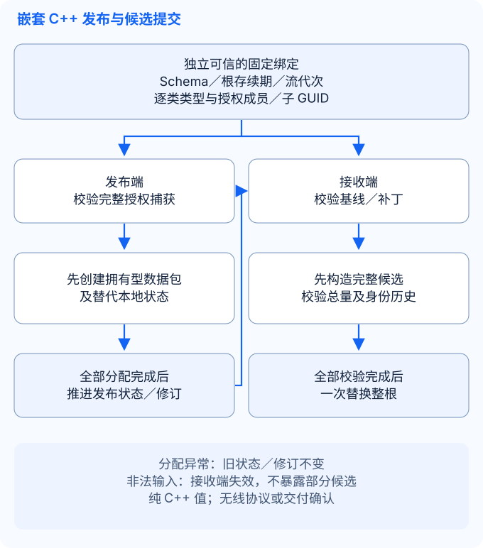

# Kernel 插件

Kernel 管理实体、结构、静态配置和地图实例。`kernel_module` 创建／查找／销毁实体，`entity` 访问其字段、表格与容器。

## 模块与数据模型

| 对象 / 模块 | 用途 | 主要接口 |
| --- | --- | --- |
| `class_meta_module` | 加载实体与配置的结构定义，管理类事件回调 | `find_meta()`、`find_static_meta()`、`add_class_call_back()` |
| `config_module` | 按配置 ID 查找已加载的静态数据 | `find_static_entity()` |
| `map_module` | 创建地图和实例，维护实例内实体列表 | `create_map()`、`create_map_instance()`、`get_inst_entity_list()` |
| `kernel_module` | 管理实体及其事件，转换实体数据 | `create_entity()`、`get_entity()`、`destroy_entity()`、`entity_to_db_data()` |
| `entity` | 运行时数据：字段、表格、容器和空间位置 | `get_int32()`、`set_int32()`、`find_table()`、`find_container()` |
| `static_entity` | 从资源文件加载的配置记录 | `get_config_id()`、`get_int32()`、`get_string()` |

结构定义字段名、类型、索引与属性；静态配置按配置 ID 提供值；运行时实体另有 ID 和可修改数据。

### 必需提供方

`config_module` 声明 `class_meta_module` 为必需提供方。`kernel_module` 声明
`class_meta_module`、`config_module` 和 Utility 的 `guid_module` 为必需提供方。
manager 在任何模块启动钩子执行前校验这些提供方，并在每个启动阶段按提供方先于消费方的顺序调用。
停止接入采用相反顺序；实体销毁与 DSO 拆卸仍采用既有顺序。
使用官方 Kernel 插件时应同时注册 Utility。`config_module_impl` 与 `kernel_module_impl`
改用带提供方参数的 `module_base` 特化；直接引用旧基类类型的代码须更新，使用这些保留实现类型的消费方须重新构建。

Map 与 Kernel 在运行时也互相依赖：Kernel 通过 Map 创建和移除实体、查找接收者；
Map 通过 Kernel 查找实体、释放实例。两者在 `init()` 中保存对方的指针，不调用对方。
当前单一生命周期依赖图未声明这两个方向的边，因为同时声明会形成启动环。
这些指针是必需依赖，不能视为可选项：两个模块都必须注册，且实体相关 API 应在启动完成后调用。
当前依赖图不校验两者是否同时存在，也不约束两者之间的停止接入顺序。
完整声明需要另行确定「必需模块存在」与「阶段调用顺序」的语义边界，或先解除运行时依赖环。

### 资源加载

没有选择 JSON 结构时，元数据模块在 `init()` 中加载 `resource/meta/config_class.config` 和 `resource/meta/entity_class.config`。这两个文件引用具体的结构文件；配置结构还可指定数据资源文件。`config_module` 在 `post_init()` 中按元数据加载静态记录。

XML 加载在正常返回／C++ 异常展开时释放临时 ID 节点，Debug 断言／进程退出不保证展开。后续行被拒绝不回滚已有记录；正常 `shut()` 释放 manager，共享记录存活至最后一个所有者释放。安装后启动失败仍按现有策略退出进程。

业务代码应在框架完成相应初始化后查询配置。创建运行时实体前，需要存在对应类结构、地图和地图实例。类事件回调应在目标实体创建前注册。模块接入方式见[创建模块](../guides/modules_CN.md)。

## JSON 实体定义与业务配置

存在 `resource/meta/entity_schema.json` 时，元数据 `init()` 校验完整版本文档并持有静态行快照，配置 `post_init()` 消费同一快照；阶段间换文件不混用结构／数据。非法 JSON 带源路径／JSON Pointer 使启动失败，不回退 XML；文件缺失时保留 XML 路径与读取器。

文件定义类、标量字段、表、容器和配置预设。索引显式指定且保持稳定，不由数组顺序决定，也不依赖生成头文件中的 `meta_name_index`。继承字段须由编写或导出步骤展平。以下示例将应用字段放在旧 BaseEntity 索引 `1..4` 之后：

```json
{
  "format": "ark.entity-schema",
  "version": 1,
  "classes": [
    {
      "name": "GuestPlayer",
      "description": "Guest attributes",
      "fields": [
        {"name": "id", "index": 99, "type": "uint32"},
        {"name": "name", "index": 100, "type": "string", "mask": ["sync_view", "sync_self"]},
        {"name": "x", "index": 101, "type": "double"},
        {"name": "y", "index": 102, "type": "double"},
        {"name": "move_seq", "index": 103, "type": "uint32"},
        {"name": "hp", "index": 104, "type": "uint32", "mask": ["save", "real_time"]},
        {"name": "mp", "index": 105, "type": "uint32"},
        {"name": "hp_max", "index": 106, "type": "uint32"},
        {"name": "mp_max", "index": 107, "type": "uint32"},
        {"name": "action_seq", "index": 108, "type": "uint32"}
      ],
      "tables": [{"name": "inventory", "index": 200, "class": "Item", "mask": ["save"]}],
      "containers": [{"name": "bag", "index": 201, "class": "Item", "mask": ["save"]}]
    },
    {
      "name": "Item",
      "fields": [{"name": "count", "index": 1, "type": "uint32"}],
      "tables": [],
      "containers": []
    }
  ],
  "configs": [{"class": "GuestPlayer", "rows": [
    {"id": 1, "name": "Guest", "x": 80.0, "y": 100.0, "move_seq": 0,
     "hp": 100, "mp": 100, "hp_max": 100, "mp_max": 100, "action_seq": 0}
  ]}]
}
```

类必须包含 `name`、`fields`、`tables` 和 `containers`，数组允许为空。标量字段必须包含 `name`、`index` 和 `type`；表或容器必须包含 `name`、`index` 和引用的 `class`。类、字段、表和容器可带 `description` 字符串，导出时保留，运行时不参与业务逻辑。可选 `mask` 默认是空数组。按位顺序支持 `sync_view`、`sync_self`、`real_time`、`save`、`sync_team`、`sync_guild`、`sync_map` 和 `log`。

| 标量类型 | JSON 值与校验 |
| --- | --- |
| `bool` | JSON 布尔值 |
| `int32`、`uint32`、`int64`、`uint64` | 位于对应有符号或无符号范围内的 JSON 整数，不从字符串或浮点数强制转换 |
| `float`、`double` | 位于对应范围内的有限 JSON 数值；`float` 按原生精度规范化 |
| `string` | 不含 NUL 字节的 UTF-8 JSON 字符串 |
| `guid` | 规范的有符号 64 位十进制字符串；运行时还检查当前配置的 GUID 位宽 |

版本 1 拒绝只有枚举声明、尚未实现的字段类型，包括 `vector3d`、`wstring`、`array`、指针和 userdata。表的列结构引用只含标量字段的类；容器引用已声明的类，并沿用既有实体所有权和显式销毁 API。公共容器销毁回调会注册到每个类的每个容器，包含 `Player` 之外的类；这不增加任意实体图的自动级联销毁保证。

类名以及类内成员名称、索引必须唯一，成员索引范围为 `1..4294967295`。未知键、重复 JSON 对象键、重复 mask、非法引用、类型错误和越界数值均导致校验失败。配置类复用对应类的标量结构，并须声明 `uint32` 类型的 `id`。每行必须提供全部标量字段；ID 为正数，并在所有配置类之间全局唯一。版本 1 不提供隐式字段 `default` 属性，也不提供表或容器的嵌套行默认值。

使用预设 `1` 创建实体后，通过普通类型字段和表列 API 操作：

```cpp
const auto player = kernel.create_entity(ark::null_guid, map_id, 0, "GuestPlayer", 1, args);
if (player)
{
    const auto hp = player->get_u_int32("hp");
    player->set_u_int32("hp", hp > 0 ? hp - 1 : 0);
    if (auto* inventory = player->find_table("inventory"))
    {
        if (auto* row = inventory->add_row(0))
        {
            row->set_u_int32("count", 3);
        }
    }
}
```

结构或惰性零值、所选静态预设以及逐字段参数的优先级沿用下文约定。预设类名须与实体类名一致。预设值复制到独立节点，参数仅覆盖明确提供的字段，包含显式零值。不使用预设时，读取字段前仍须遵循既有惰性节点初始化规则。索引 `99` 的 `id` 属于配置数据，与运行时实体 GUID、构造参数 `config_id` 分开。

离线工具和 Kernel 共用 `<ark/kernel/entity_json.hpp>` 及编译目标 `ark::kernel_json`。公开的普通 C++ 模型包括 `document`、`class_definition`、`field`、`relation`、`config_definition` 和有类型的标量 `value`；`parse()`、`load()`、`validate()`、`serialize()` 复用同一校验器。头文件不暴露 nlohmann 类型，目标不依赖 Net、Boost 或 Protobuf。已安装的消费者可单独请求 `kernel_json` 组件。编写和导出流程见[配置工具](../guides/tools_CN.md)。

**构建与 ABI 变更：**Kernel 应用构建现在需要 `nlohmann_json`，`application` vcpkg 特性已包含该依赖。`class_meta` 新增普通 C++ 配置快照，改变了类布局。Kernel 和 C++ 消费者须一起重新构建。继续使用原有 XML 资源不要求立即转换格式。

`check-entity-json` 检查有类型模型、数值范围、重复键精确位置、mask、引用和确定性导出。`check-kernel-initialization` 覆盖 XML／JSON 加载、预设与参数优先级、字段独立性、表列、容器所有权、启动快照一致性和所选 JSON 失败。`check-kernel-plugin` 分别在 XML、JSON 子进程中加载真实 Kernel／Utility 动态库。这些检查只证明覆盖的原生行为，不代表任意热加载或生产部署验收。

## 创建和查找实体

以下函数用于已加载 Kernel 插件的进程。`map_id` 由应用分配；`create_map()` 会创建编号为 `0` 的默认实例。示例使用已有的 `Player` 结构，不加载配置记录，也不写入业务字段。

```cpp
#include <memory>

#include "ark/kernel/data_list_impl.hpp"
#include "ark/kernel/kernel_module.hpp"
#include "ark/kernel/map_module.hpp"
#include "ark/meta_define.hpp"
#include "ark/plugin_manager.hpp"

std::shared_ptr<ark::entity> create_player(ark::plugin_manager& manager, int map_id) {
    auto* kernel = manager.find_module<ark::kernel_module>();
    auto* maps = manager.find_module<ark::map_module>();
    if (kernel == nullptr || maps == nullptr)
    {
        return nullptr;
    }

    if (!maps->exist_map(map_id) && !maps->create_map(map_id))
    {
        return nullptr;
    }

    ark::data_list_impl args;
    return kernel->create_entity(ark::null_guid, map_id, 0, ark::entity_meta_player::self_name(), 0, args);
}
```

`create_entity()` 返回 `nullptr` 表示创建失败，例如类结构、地图或实例不存在，实体 ID 重复，或参数数量不符合要求。传入 `null_guid` 时由 Guid 模块生成 ID；初始化参数按「值、字段索引」成对排列；本例传入空参数列表。已有实体可用 `get_entity(id)` 查询，用 `exist(id)` 检查，用 `destroy_entity(id)` 请求销毁。

持有 `shared_ptr<entity>` 不等于实体仍在 Kernel 中注册。销毁后不要继续将外部保存的指针当作有效业务实体；需要时按 ID 重新查询。

## 配置默认值与初始化参数

`config_id > 0` 时，配置记录必须存在且与实体类匹配。配置为未指定的字段提供默认值，合法的 `args` 覆盖同一字段；显式传入 `0` 或空字符串也会覆盖配置值。同一字段在合法参数中重复出现时，最后一个值生效。实体数据独立于配置记录，修改实体不会修改原配置。

节点复制或插入抛出异常时，会释放尚未发布的节点并向调用方传播异常。深复制的数据仍独立，重复索引保留原值。

参数按 `(value, uint32_t field_index)` 成对排列：先加入值，再用 `add_u_int()` 加入字段索引。索引必须来自已加载的实体结构，值类型必须与字段类型完全一致；不要依赖隐式转换。

DataList 对无法表示的追加长度抛出 `std::length_error`，分配失败时抛出 `std::bad_alloc`。单项追加或字符串扩容失败保留已有值和项数，但内部容量可能已经增长。

DataList 深拷贝和分词构造在分配失败时释放部分存储，源值保持不变；自赋值保留列表内容。其他赋值在分配失败时仍可能改变目标值。

下面使用声明为 int32 的 `Player.level` 和 string 的 `Player.name`，显式将等级设为 `0`、名称设为空字符串，其余字段保留配置默认值。调用前，目标地图、实例和对应的 Player 配置记录必须存在。

```cpp
#include <memory>

#include "ark/kernel/data_list_impl.hpp"
#include "ark/kernel/kernel_module.hpp"
#include "ark/meta_define.hpp"

std::shared_ptr<ark::entity> create_configured_player(
    ark::kernel_module& kernel, int map_id, int instance_id, ark::id_type config_id) {
    ark::data_list_impl args;
    args.add_int(0);
    args.add_u_int(ark::entity_meta_player::level_index());
    args.add_string("");
    args.add_u_int(ark::entity_meta_player::name_index());

    return kernel.create_entity(
        ark::null_guid, map_id, instance_id, ark::entity_meta_player::self_name(), config_id, args);
}
```

配置默认值与参数值在第一个类事件 `entity_evt_pre_load_data` 前就已就绪。`create_container_entity()` 没有 `args` 参数，按配置初始化；`create_entity(protobuf_data)` 从保存的数据恢复，不自动合并配置默认值。

## 访问字段、表格和配置

字段读写属于 `entity`，可以使用字段名称或元数据索引。类型应与结构定义一致；不要用数值返回值判断实体或字段是否存在。

`set_u_int64()` 的名称和索引重载均接受已声明的 `uint64` 字段，保留到 `UINT64_MAX` 的完整范围。值变化时，字段回调接收无符号的旧值和新值；设置相同值返回 `false`，不触发该回调。

GUID 字段回调保留 `dt_guid` 标签。默认 GUID64 构建使用 `data::get_int64()` 读取其原生有符号值，`ARK_USE_GUID_32` 构建使用 `data::get_int()`。`data_impl::from_guid()` 显式构造带标签的值；复制、赋值、节点转换和相等比较均保留 GUID 类型。普通数字构造函数继续要求匹配的数字类型。

`data_impl`/`data_base` 的字符串或用户数据分配返回空指针时，抛出 `std::bad_alloc`。赋值或设置失败保留目标原值，复制保留源值。设置操作支持引用自身有效存储的输入。

`data_impl`/`data_base` 的堆存储大小须能用 32 位长度表示，包含字符串末尾零字符或用户数据长度头。超出范围时，在调用存储分配器前抛出 `std::length_error`，原值保持不变。

```cpp
#include <cstdint>
#include <string>

#include "ark/kernel/kernel_module.hpp"

bool set_int32_field(ark::kernel_module& kernel, const ark::guid_t& id, const std::string& field, std::int32_t value) {
    auto object = kernel.get_entity(id);
    if (object == nullptr || object->get_node_type(field) != ark::data_type::dt_int32)
    {
        return false;
    }

    return object->set_int32(field, value);
}
```

| 数据类型 | 访问方式 |
| --- | --- |
| 单值字段 | `entity::get_bool()`、`get_int32()`、`get_int64()`、`get_string()`、`get_guid()` 等；写入使用对应的 `set_*()` |
| 表格 | `entity::find_table()` 返回 `table*`；使用 `find_row()` / `add_row()` 获取 `row*`，再按列名称或索引读写 |
| 容器 | `entity::find_container()` 获取容器；`kernel_module::create_container_entity()` 创建容器内实体 |
| 静态配置 | `config_module::find_static_entity(config_id)` 返回 `shared_ptr<static_entity>`；检查空值后按已知字段类型读取 |

`table*` 和 `row*` 是借用指针，不独立拥有实体数据。表格删除行、清空表格或销毁所属实体后，不要继续使用相关指针。

禁用断言时，行分配失败返回 `nullptr`，保留现有行及下一个自动索引，不触发 `table_add`。内存恢复后可以重试；Debug 构建保留添加失败时的既有断言。插入 map 时若抛出异常，会在向上传播前回收尚未发布的行；既有行仍由表格持有。

容器槽位交换在移除 map 记录前保留子 Entity 句柄。移至空槽和交换占用槽保留选定的子 Entity 及既有回调顺序；跨容器交换通过既有移除／放入回调更新各子 Entity 的父关系。`remove()` 解除子关系，`destroy()` 走 Kernel 销毁回调。这些操作不提供跨容器回滚，也不支持在回调中任意修改相关结构。

### 自定义标量的所有权

创建自定义标量时，值构造或插入抛出异常会释放尚未发布的值，向调用方传播异常，不新增名称记录。插入成功的值仍由实体持有。

### 自定义无符号值

`entity::add_custom_u_int32(name, value)` 创建按名称访问的运行时 `uint32_t` 值，与元数据字段分开。创建后，`set_custom_u_int32(name, value)` 可在 `0` 到 `UINT32_MAX` 的完整范围内更新值，使用 `get_custom_u_int32(name)` 读取。名称不存在或对应其他标量类型时，设置操作在 Debug 和 Release 构建中均返回 `false`，不会创建数据、转换类型或修改已有值。使用 `find_custom_data()` 检查是否存在；已存储的零是有效值。

`check-kernel-initialization` 通过公开的 `entity` 接口验证这些操作，并检查其他自定义标量。启用应用、Kernel、Utility 和示例后，`check-typed-examples` 还会在真实 Kernel、EntityOperations 动态库创建的实体上验证无符号值更新。

## 注册事件

可以按类注册创建 / 销毁事件、字段变化、表格变化和容器操作，也可以为单个实体注册业务事件。公共类事件通过 `add_common_class_event()` 注册。

```cpp
#include <string>

#include "ark/kernel/kernel_module.hpp"

class entity_observer
{
public:
    bool attach(ark::kernel_module& kernel, const std::string& class_name) {
        return kernel.add_class_call_back(class_name, this, &entity_observer::on_class_event);
    }

private:
    int on_class_event(
        const ark::guid_t& id, const std::string& class_name, ark::entity_event event, const ark::data_list& args) {
        if (event == ark::entity_event::entity_evt_data_finished)
        {
            // Handle the entity after its creation stages complete.
        }
        return 0;
    }
};
```

注册保存了对象指针；`entity_observer` 必须在回调可能执行期间一直有效。不要使用创建后立即离开作用域的局部对象注册成员回调。当前接口未提供对应的公开注销方法。

普通 `create_entity()` 的类事件按以下顺序同步分发：

| 阶段 | `entity_event` |
| --- | --- |
| 加载前 | `entity_evt_pre_load_data` |
| 加载 | `entity_evt_load_data` |
| 应用数据前 | `entity_evt_pre_effect_data` |
| 应用数据 | `entity_evt_effect_data` |
| 应用数据后 | `entity_evt_post_effect_data` |
| 数据阶段完成 | `entity_evt_data_finished` |

`entity_evt_all_finished` 由应用按需显式触发，不是上述创建函数自动发送的阶段。正常实体销毁时先分发 `entity_evt_pre_destroy`，再分发 `entity_evt_destroy`。

字段和表格回调分别使用 `add_node_call_back()`、`add_table_call_back()`；参数包含实体 ID、变化位置以及旧值 / 新值。`do_event(id, event_id, args)` 用于分发单实体业务事件。回调参数和优先级以公开头文件签名为准。

### 延迟同步批次

带有 `sync_view` 或 `sync_self`、且没有 `real_time` 的变更收集到 `kernel_module::update()` 时处理。仅包含容器变更的批次与标量、表格和混合批次使用相同的 `protobuf_delay_entity` 序列化与掩码回调分发路径；只有标量、表格和容器条目都为空时才跳过。容器载荷按现有发送状态保留完整实体数据或实体引用、空槽标记和销毁标记。

每次 `class_call_back_manager::on_delay_sync()` 在调用回调前分离当前收集集合。回调期间收集的新条目保留到下一次刷新，不会被刷新末尾的清空操作丢弃。递归刷新返回 `false`，不消耗待刷新变更。回调抛出异常时，异常继续向外传播，刷新防护复位，新收集的条目仍保持待刷新状态；分离出的批次不会自动重放。

`kernel_module_impl::update()` 保留原有行为：忽略收集器的布尔返回值，在没有异常向外传播时返回 `true`。因此，嵌套调用 Kernel 更新不会向应用报告递归刷新被拒绝。

此边界固定批次条目，不提供某一时刻的值快照。延迟标量和表格条目仍借用 `node*` 指针，序列化读取当时的值。如果前一个掩码回调修改了已在分离批次中的标量，后一个掩码仍可能在同次刷新中读到新值；新收集的条目也会保留到下一次刷新。在所有相关待刷新批次和当前批次处理完之前，必须保持引用的节点及其所属实体／行存活，不要在交付回调中销毁或替换它们。收集器仍按单线程使用，不提供所有权、重试、回滚或交付确认。

`check-kernel-initialization` 从真实容器操作经过延迟收集、Kernel 更新、序列化和既有交付回调验证此路径，并保留空批次、标量、表格和混合对照。仅用于测试的回调观察器不提供网络交付。现有 `send_to_self()` 仍是占位实现；这些检查不证明客户端复制协议、确认机制或 AOI 行为。

### 拥有型标量快照

`<ark/kernel/entity_snapshot.hpp>` 在 `ark::entity_sync` 中定义不依赖 Entity 的值类型：`guid_value`、`scalar_value`、`scalar_snapshot` 和 `snapshot_limits`。此值类型头不包含 Entity 或 Protobuf。GUID 使用独立的 variant 分支，保留当前配置的 `guid_t` 宽度。快照独立拥有实体 ID、类名和按字段索引存储的值，支持 `bool`、有符号／无符号 32 位和 64 位整数、`float`、`double`、字节字符串及 GUID。源实体修改或销毁后，快照及其副本仍然有效。

**虚函数表 ABI 不兼容变更：** `kernel_module` 新增虚方法 `capture_scalar_snapshot()`。加载前必须一起重新构建所有插件和宿主／消费者，不能混用旧插件二进制与新接口。外部源码子类可以保留默认实现（抛出 `std::logic_error`），也可以覆写该方法。框架的 `kernel_module_impl` 提供捕获实现。此变更不新增模块、自由函数导出或生命周期阶段。

```cpp
#include <array>
#include <ark/kernel/kernel_module.hpp>

const std::array<std::uint32_t, 2> authorized_fields{100, 104};
ark::kernel_module* kernel = manager.find_module<ark::kernel_module>();
auto snapshot = kernel->capture_scalar_snapshot(*entity, authorized_fields);
```

调用者必须先授权，再显式选择每个字段。空集合只捕获 ID 和类名，不包含字段，也不表示全部字段。捕获只读取选定索引的定义和节点；调用者选中没有同步掩码的字段时，也会捕获该字段。已声明但尚未物化的字段产出类型正确的零值或空值，不创建节点。未知、零值或重复索引、不支持的类型（包括宽字符串、表格、容器和指针）、选定的非有限浮点值，以及自定义 `entity` 实现均抛出 `std::invalid_argument`。目前仅支持框架的 `entity_impl`。

`snapshot_limits` 默认值为 `max_fields = 1024`、`max_string_bytes = 1024 * 1024`。字节限制累计类名和选定字符串字段的字节数，包括内嵌 NUL；即使没有选择字段，也计算类名。这些限制约束结构和文本大小，不是精确堆内存或编码消息大小上限。捕获在复制字符串前检查字段选择、类型、有限值及累计字节数。超限抛出 `std::length_error`，内存分配异常正常向外传播。失败不返回部分快照，也不修改源实体。

捕获期间必须在源实体所属线程上保持定义和节点稳定；此 API 不同步并发修改。它不改变延迟同步回调，不执行字段授权，不定义线协议，也不提供传输或交付保证。公开聚合值类型还可由调用者直接构造；捕获时的校验不代表任意手工构造的快照已经合法。通过插件管理器返回的既有 `kernel_module` 指针调用捕获方法。独立 `check-kernel-plugin` 宿主仅链接公开接口，调用真实加载的 Kernel DSO，并检查正常实体销毁及插件停止后独立拥有的值仍有效；这不证明任意热更新安全，也不允许卸载后继续持有 Entity。

### 拥有型嵌套快照

`<ark/kernel/entity_nested_snapshot.hpp>` 提供纯值的表格／行／容器树快照。在所有者线程调用 `kernel_module::capture_nested_snapshot()`，保持源稳定，并显式传入已授权的 `nested_projection`。投影绑定非零根 GUID、应用 `schema_id`、类名、标量索引、表格列选择及逐个允许的子 GUID。未选择成员／子 Entity 时拒绝访问，空选择不代表全部字段。表格选择覆盖全部行；子投影单独授权自身字段和后代，容器访问权本身不选择子 Entity。捕获校验实际 Schema 的局部索引／类型，不校验会话凭证或应用 Schema ID 的含义。

```cpp
ark::entity_sync::nested_projection projection{
    "inventory/v1", player->get_id(),
    {"GuestPlayer", {100, 104}, {{200, {1}}},
        {{201, {{item->get_id(), {"Item", {1}, {}, {}}}}}}}};
auto snapshot = kernel->capture_nested_snapshot(*player, projection);
```

快照独立拥有全部选定标量值、行键／存续期标记和子 GUID／实例标记／槽位关系。已声明但未实例化的表格／容器捕获为空；惰性标量／列保持类型正确的零值，不创建节点。表格使用引用行类的索引。子类绑定即使在子 Entity 缺席时也会校验；字段／类型在授权子 Entity 存在时校验。选定的重复 GUID／引用、环、零槽位、过期父关系、不支持的值及非有限选定浮点值均被拒绝。不捕获自定义字段或任意 Entity 实现。

| 上限 | 默认值／范围 |
| --- | --- |
| `max_depth` | 8；根深度为零，限制投影输入与捕获树 |
| `max_entities` | 1024；分别限制投影节点、捕获 Entity 数和累计检查的容器记录数，后者包括已选择且允许列表非空的容器中的隐藏记录 |
| `max_rows` | 65536；所有捕获表格的总行数 |
| `max_fields` | 65536；标量值加选定表格／容器成员，分别对投影输入和捕获状态累计限制 |
| `max_string_bytes` | 1 MiB；Schema ID、类名和选定字节串，包括内嵌 NUL；分别校验投影输入和捕获状态 |

非法绑定／选择／值抛出 `std::invalid_argument`；超限抛出 `std::length_error`；分配异常向上传播。捕获失败不返回部分快照，也不改变源。这些结构／文本上限不代表编码大小或精确堆内存。源修改／销毁及 Kernel 正常停止后，结果仍可使用；结果不包含借用指针或由插件持有的多态句柄。

行存续期标记在成功插入 map 后、添加回调前提交。分配／插入失败不消耗行标记；添加回调抛异常时，已发布的行／标记仍存在。删除／清空回调先于擦除，因此不修改行的回调抛异常时保留原行。本变更不新增回调中修改表格结构的重入支持。成功删除再新增即使行号和值相同，也获得新标记；清空不重置计数器。行计数器属于一张表的存续期，耗尽抛出 `std::overflow_error`，不回绕。

Entity 实例标记在一个已加载的 `entity_impl` 实现副本内单调分配，可以区分复用 GUID 的新 Entity；不保证多个实现副本间的进程全局唯一性，也不跨重启或 DSO 重载保持身份。跨越这些边界须建立新复制流。构造失败可能消耗 Entity 标记，但不会允许复用或回绕；计数耗尽以 `std::overflow_error` 拒绝创建。

**ABI 不兼容变更：** 新 Kernel 虚方法及 Entity／row／table 实现布局变化要求同时重建全部插件、宿主和消费者，不能将旧二进制与新头文件混用。源代码子类可保留默认方法，该方法抛出 `std::logic_error`。独立的 `check-kernel-plugin` 宿主通过真实已加载虚方法捕获，并在子 Entity 销毁、表格清空和正常停止后读取保留值。

捕获提供[嵌套发布端／接收端](#嵌套基线与增量)使用的拥有型源值。现有标量 API 和房间 v1 消息保持不变，不提供嵌套发送队列或编解码。应用负责绑定授权，并在流内保留固定投影。[复制设计](../project/entity-replication-design_CN.md)记录已选定的一致性／恢复边界。

## 地图与数据转换

地图按 `map_id` 区分，每张地图可以创建多个实例。`create_map_instance()` 成功时返回实例 ID，失败返回 `-1`。`switch_map()` 将已有实体移到目标实例；目标地图和实例必须事先存在。

地图模块提供实体列表与在线数量查询。它不提供完整的可见范围管理（AOI）；九宫格、空间索引和业务广播范围需要由应用实现。`get_max_online_count()` 当前是固定返回值，不应作为部署容量上限或容量测试结论。

`entity_to_db_data()` 将实体转换为 `ark::protobuf::protobuf_db_entity`，对应的 `create_entity(protobuf_data)` 重载用于恢复。`entity_node_to_protobuf_data()` 和 `entity_table_to_protobuf_data()` 可按数据掩码转换部分字段。转换不等于写入数据库；持久化、版本兼容和恢复后的业务校验由应用负责。

## API 来源

- [Kernel 接口](https://github.com/OpenArkStudio/ark/blob/main/src/plugins/kernel/kernel_module.hpp)
- [Entity 接口](https://github.com/OpenArkStudio/ark/blob/main/src/plugins/kernel/entity.hpp)
- [元数据接口](https://github.com/OpenArkStudio/ark/blob/main/src/plugins/kernel/class_meta_module.hpp)
- [配置接口](https://github.com/OpenArkStudio/ark/blob/main/src/plugins/kernel/config_module.hpp)
- [地图接口](https://github.com/OpenArkStudio/ark/blob/main/src/plugins/kernel/map_module.hpp)
- [数据定义与生成](../guides/data-structures_CN.md)

## Kernel 源码共置

Kernel 的公开头与 cpp 共同位于 `src/plugins/kernel/`。
`ark::kernel` 的显式映射保留全部 `<ark/kernel/...>` 包含路径，
包括 `data_impl.hpp`、`data_list_impl.hpp` 和 `kernel_plugin.hpp`，运行时插件关闭时同样可用。
业务代码仍可使用原有值类型和模板定义。四个模块实现现在继承
`module_base<原接口>`，`kernel_plugin` 继承 `plugin_base<kernel_plugin>`。
核心源码头位于 `src/core/`。

独立工程 `tests/consumer/kernel` 仅链接 `ark::kernel`，开启 Protobuf 时逐个编译
全部公开头，并运行值类型和模板消费检查。`container_meta.hpp` 保留原有的
`ark/define.hpp`、`ark/enum.hpp` 前置包含要求，消费者显式提供这两个头。`ARK_BUILD_PROTO=OFF` 时检查其余头；
`kernel_module.hpp`、`kernel_module_impl.hpp`、`map_module_impl.hpp`
仍要求 Protobuf。数据与节点、初始化与配置、应用回归分别使用 `check-core`、
`check-kernel-initialization`、`check-typed-examples`。
`check-kernel-initialization` 要求 `ARK_BUILD_PROTO=ON`；`check-typed-examples`
还要求开启应用、配置、示例构建及 Kernel/Utility 运行时目标。

```sh
cmake -S tests/consumer/kernel -B kernel-headers-build -G Ninja \
  -DCMAKE_TOOLCHAIN_FILE="$VCPKG_ROOT/scripts/buildsystems/vcpkg.cmake" \
  -DVCPKG_MANIFEST_FEATURES=application -DASIO_STANDALONE=OFF
cmake --build kernel-headers-build --target check-kernel-headers --parallel 2
```

## Kernel 类型化构造

**ABI／布局不兼容变更：** `class_meta_module_impl`、`config_module_impl`、`kernel_module_impl`、`map_module_impl` 现在继承 `module_base<原接口>`，`kernel_plugin` 继承 `plugin_base<kernel_plugin>`。原有公开类型、构造函数、方法和 38 个头路径继续保留。Kernel 与消费者必须一起重建；旧实现类／插件二进制不兼容变更后的类布局。此变更不引入跨编译器的插件 ABI。

插件使用私有拥有型工厂与显式 `DllEntryPlugin`／`DllExitPlugin`。`kernel_factory.hpp` 仅保留在插件源码目录，不映射、不安装。工厂返回类型保留原接口 RTTI 注册键：

| 注册接口 | 保留的实现类型 | update 注册 |
| --- | --- | --- |
| `class_meta_module` | `class_meta_module_impl` | `module_update::disabled`，继承默认 update |
| `config_module` | `config_module_impl` | `module_update::disabled`，继承默认 update |
| `kernel_module` | `kernel_module_impl` | `module_update::enabled`，保留原有覆写 |
| `map_module` | `map_module_impl` | `module_update::disabled`，继承默认 update |

安装按表格顺序执行，卸载按相反顺序执行。所有注册仍在生命周期初始化前完成，初始化阶段的容器遍历不保证依赖顺序。类型化创建保留实体默认值、加载阶段和 Protobuf 消息语义；JSON 资源见上文。

开启 Protobuf 且存在 Kernel／Utility 运行时 target 时，`check-kernel-plugin` 成为 `check-core` 的依赖。独立 runner 仅链接公开 `ark::kernel`，加载两个真实 DSO，检查四个接口注册键与管理器归属、元数据／静态记录加载、地图／实体注册、公开生命周期回调、管理器更新、正常插件退出和重复 stop。不在卸载后检查注册表，也不证明任意热更新安全。公开头消费者还检查类型基类及原有 update 覆写；现有初始化和实体默认值回归继续保留。

**无符号 64 位 getter 迁移：**`static_entity::get_u_int64()` 及 `static_entity_impl` 的两个覆写现在返回 `uint64_t`，保留到 `UINT64_MAX` 的完整范围。将自定义覆写和误用 `int64_t` 的接收变量改为无符号类型，并一起重新构建 Kernel 与 C++ 消费者。有符号字段继续使用 `get_int64()`。

## 标量基线与增量

`<ark/kernel/entity_stream.hpp>` 基于拥有型快照提供 C++ 状态闭环。`scalar_publisher` 在应用显式刷新时比较完整的所选状态，只返回变化字段；`scalar_replica` 安装基线、检查流代次与修订号连续性，再原子应用增量。接收状态与增量的共享句柄指向不可变的拥有型值，后续更新或生产者销毁不会使已保存的句柄失效。

```cpp
#include <array>
#include "ark/kernel/entity_stream.hpp"

// kernel 和 player 属于当前模块线程。
const std::array visible{104U, 105U}; // GuestPlayer 的 HP、MP
using namespace ark::entity_sync;
auto state = kernel->capture_scalar_snapshot(*player, visible);
scalar_publisher sender({"guest-player/v1", 1, 1, state});
scalar_replica receiver("guest-player/v1", state.entity_id, state.class_name);
receiver.apply(sender.baseline());

player->set_u_int32(104, 90);
player->set_u_int32(104, 80);
// 业务修改后统一刷新，本次 HP 只输出最终值 80。
if (auto delta = sender.update(kernel->capture_scalar_snapshot(*player, visible)))
{
    receiver.apply(*delta);
}
```

示例在同一进程中传递 C++ 值。网络编码、连接基线与 Godot 接入见[访客房间 Protobuf 适配层](../../examples/guest_room/protocol_CN.md)。表、容器和业务事件不属于这条标量路径；现有借用指针的延迟同步路径继续独立存在。

| 条件 | 行为 |
| --- | --- |
| 状态未变 | 不产生增量，也不增加修订号 |
| 一次捕获前多次写入 | 比较捕获时的最终值 |
| 同一流代次中的重复帧 | 忽略，不使当前状态回退 |
| 缺口、绑定／Schema／类型不匹配、非法或超限帧 | 拒绝并使接收状态失效，不暴露部分更新 |
| 在同一接收对象上恢复 | 使用更大流代次的基线，完整替换所选状态 |
| 字段选择或类型变化 | 建立新的发布对象／流代次和基线 |
| 移除实体 | 按顺序应用删除标记；旧重复帧不能使实体复活 |
| 修订号耗尽 | 发布端抛出 `std::overflow_error`，不推进状态 |

流代次区分重建的状态流，修订号标识流内的状态版本。共享句柄不提供动态库卸载保障；卸载插件代码前应排空并释放由该插件创建的句柄。

应用提供 `schema_id`、绑定的实体 ID／类名及已授权的字段集合。匹配标识不等于校验完整 Schema 定义，也不进行会话认证。新连接可以创建新的接收对象；已有接收对象在失效或移除后保留流代次，旧基线不能将其重置。发布端的输入／限额错误抛出标准异常；接收端对非法值返回 `scalar_apply_result::rejected`。分配异常向外传播，已提交状态保持不变。

`snapshot_limits` 同样约束重建后的完整状态，不能只检查增量大小。Schema 标识使用同一字节限额单独检查。限额针对字段数与文本字节数，不代表编码长度或精确进程内存。本层不提供待发队列、确认、重放历史或传输；后续适配层需约束编码负载和待发任务，在入队失败时关闭／重置流，并先确认活动会话绑定与授权。字符串为 C++ 字节串，线协议编解码器须执行自己的文本校验。不能将这些结构体的内存或 variant 序号直接作为二进制协议。

每个发布／接收对象由一个所有者线程使用；跨线程传递返回的拥有型值／不可变句柄，不传递发布对象、接收对象或 Entity。调用者需限制保留历史句柄的数量。本组件没有吞吐量或带宽测试结论。

`check-entity-stream` 提供永久状态机回归，关闭 Protobuf 后也能运行。`check-kernel-initialization` 另从真实 Entity 验证捕获、基线、合并后的 HP／MP 变更、接收状态、源销毁、删除与新基线。这些检查覆盖原生 C++ 状态闭环；`check-guest-room` 与配套 Godot 客户端测试分别覆盖传输与表现边界。

`check-entity-stream` 包含 `check-scalar-stream-allocation`，逐个注入发布端构造、基线复制、更新和接收端提交中的分配失败。用例覆盖长二进制字符串、保留值、修订不变和一次成功重试，无需数据库或传输。

## 嵌套基线与增量

`<ark/kernel/nested_stream.hpp>` 为[拥有型嵌套捕获](#拥有型嵌套快照)增加纯 C++
发布端／差异器／接收端，不增加 Kernel 虚方法，也不改变现有标量流。
在接收首个基线前，独立提供固定的 `nested_stream_binding`：应用 Schema ID、非零根
GUID／实例标记及流代次，并用 `nested_entity_layout` 指定逐类字段类型、表格行类／列类型，
以及每个授权子 GUID 的布局。空表也必须有可信列类型。同一类／索引的成员种类、类型或引用类
相互矛盾时拒绝绑定。数据包不能定义或扩大自身权限。

`nested_scalar_type` 包括布尔、32／64 位有符号和无符号整数、有限的 32／64 位浮点数、
字节串及 GUID。完整快照须恰好包含选定标量／表格／容器成员；选定容器可以为空。
子槽位须为正数，整根内 GUID 唯一，每个子 Entity 按其所在位置的允许布局校验。
应用负责认证接收者并选择捕获投影；这些检查不认证会话，也不会把任意 Schema ID 变成 Schema 定义。

```cpp
#include <ark/kernel/nested_stream.hpp>
using namespace ark::entity_sync;

// authorized_binding 来自可信应用 Schema／会话策略及已知根存续期，不能从远端基线推断。
// 在所属线程捕获。
nested_publisher sender(authorized_binding,
    {authorized_binding.generation, 1, captured_state});
nested_replica receiver(authorized_binding);
receiver.apply(*sender.baseline());
if (auto delta = sender.update(next_authorized_capture))
{
    receiver.apply(*delta);
}
```



业务修改结束后，在显式刷新点调用一次 `update()`。它比较完整授权状态、合并重复写入，
返回不可变的 `shared_ptr<const nested_delta>`。投影不变时返回空句柄且不推进修订，
包括被该接收者捕获投影隐藏的修改。`baseline()` 返回当前完整不可变基线，供后加入者安装。
返回句柄可无异常移动；数据包、替代状态及身份历史分配全部完成后，发布端才提交。
后续操作及源／发布端销毁不影响已保留值。

| 操作／条件 | 契约 |
| --- | --- |
| 同一存续期内的标量／列变化 | 稀疏、带类型的字段补丁 |
| 行新增／删除／同号复用 | 完整新增／核对存续期的移除／以更新实例标记完整替换 |
| 清空后再新增 | 已退役行标记不得重现，即使值相同 |
| 槽位移动／交换、解除关系、子销毁或替换 | 完整替换该容器的最终授权成员；子身份不变时递归生成补丁 |
| 接收端提交 | 检查消息／补丁上限，重建并验证完整候选及身份历史，再一次替换整根 |
| 重复 | 结构合法且不高于当前修订的增量，以及旧基线被忽略；同修订基线须等于当前有效状态。不保留包重放／历史 |
| 缺口、错误绑定／类型、非法或超限输入 | 返回 `rejected`，使接收端失效并隐藏状态；不暴露部分候选 |
| 根移除 | 有序删除标记移除整根；后续重复消息不能复活它 |
| 恢复／权限变化 | 新建独立绑定的发布端／接收端／流；现有嵌套接收端不接受重置基线或流代次变化 |
| 修订耗尽 | 抛出 `std::overflow_error`，发布端状态不变；计数不回绕 |

首个基线先按可信绑定校验，再安装。接收端失效后不可恢复。此前返回的不可变状态句柄仍可读，
但拒绝输入或根删除后，`state()` 返回空。已删除根的接收端仍可处理重复；失效接收端拒绝全部输入。
发布端的输入／上限错误抛异常。接收端分配失败向上传播，原安装／有效状态及修订保持不变，
调用方可重试同一操作；非法输入拒绝是另一个终态结果。这是本地状态重试，不是传输重发策略。
发布端分配失败同样保留状态／修订／源，不会先提交修订再因返回值复制抛异常。

`nested_stream_limits` 使用 `nested_snapshot_limits` 限制完整绑定及重建快照。
补丁另行限制，默认最多 65536 个操作、65536 个标量值和 1 MiB 的 Schema／类名／字节串。
操作数包括访问的 Entity 增量／替代 Entity、表格／容器／行记录；值数包括选定标量／列值。
这些工作量上限包括替代子树。`max_lifetime_entries` 默认为 132096，累计记录过的 Entity、
表格及最近可见行身份。行消失后，表格仍保留单调实例标记水位；已解除关系的授权 Entity
仍保留最新已知实例标记，阻止旧存续期重现。新的 Entity 实例标记会退役旧表格历史。

上限分别约束完整状态、补丁及保留历史，不代表编码大小或精确堆用量。准备阶段可能同时持有
旧已提交状态、候选、数据包和历史副本；应用须计入组合峰值，并限制自行保留的句柄／队列。
每个发布端／接收端只在一个所属线程使用。卸载代码前须释放插件创建的共享句柄；句柄不证明任意 DSO 卸载安全。

该头文件不依赖 Protobuf 或传输。不提供嵌套编解码、发送队列、ACK／重放日志、原地重置、
动态权限变更或跨根提交，不改变房间 v1。返回发布不代表交付；适配器须单独绑定会话、
限制编码后／待发工作，并在接收或发送失败时关闭受影响流。
`check-entity-stream` 覆盖类型绑定、递归补丁、行／Entity 复用、重复、缺口、原子失效及上限。
其依赖 `check-nested-stream-allocation` 对路径中的每个分配点注入失败。
`check-kernel-initialization` 另用真实 JSON 支持的 Kernel 捕获，检查两个固定投影、行复用／清空、
子移动／销毁，以及世界销毁后保留的拥有型值。这些属于本地 C++ 正确性检查，须与托管和客户端／网络验收区分。
